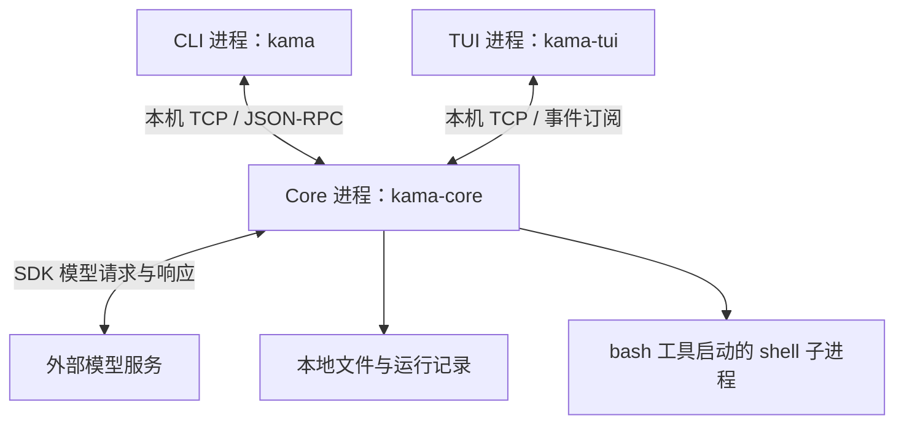
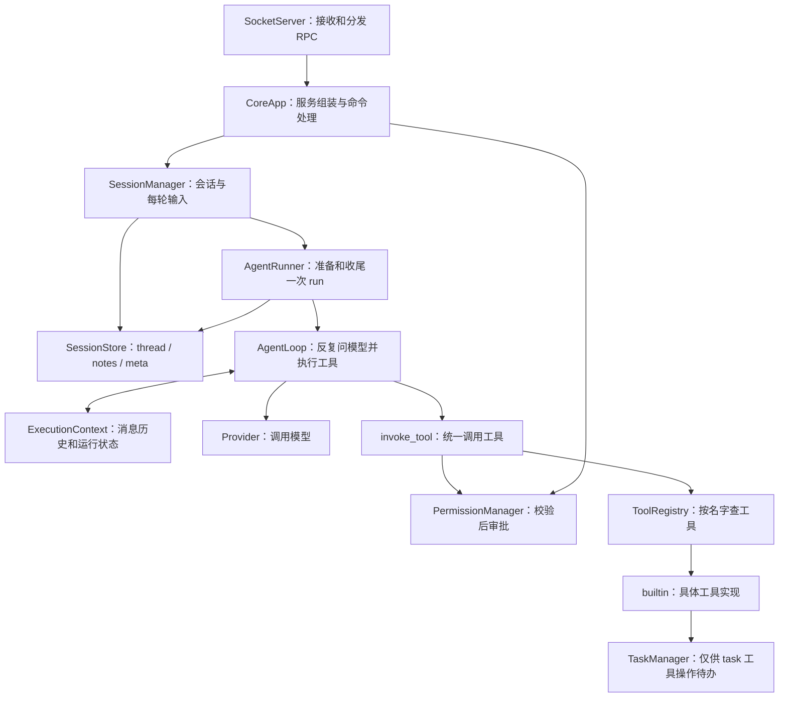
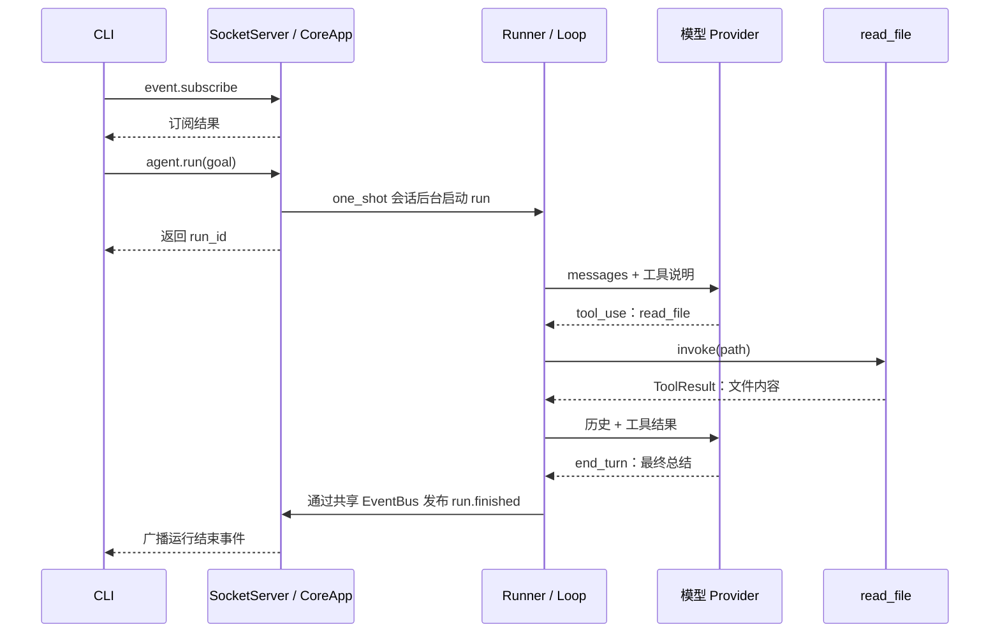
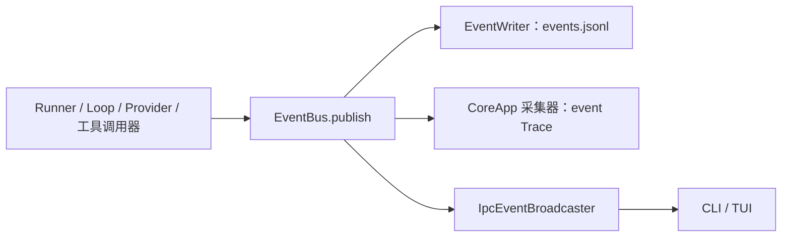

# KamaClaude 项目架构地图（S5）

> 对照当前 `study/s5` 源码整理，更新日期：2026-10-23。包含本学习分支的 Windows 兼容修复与 Trace 异常诊断；不把后续阶段规划当作已实现功能。
>
> 本文先建立全局关系，再提供逐文件索引。具体语法和逐步实现请配合 [S5 学习指南](STUDY_GUIDE_S5.md) 阅读。

## 目录

- [1. 先区分四种视角](#1-先区分四种视角)
- [2. 进程与系统架构](#2-进程与系统架构)
- [3. Core 内部职责](#3-core-内部职责)
- [4. 一次请求的完整旅程](#4-一次请求的完整旅程)
- [5. 事件与 Trace](#5-事件与-trace)
- [6. 状态与文件保存在哪里](#6-状态与文件保存在哪里)
- [7. 源文件逐个索引](#7-源文件逐个索引)
- [8. 当前实现的边界](#8-当前实现的边界)
- [9. 推荐学习路线](#9-推荐学习路线)

## 1. 先区分四种视角

理解架构时，先确定自己正在回答哪一种问题，不必把所有概念塞进同一张图。

| 视角 | 回答的问题 | 本项目的例子 |
| --- | --- | --- |
| 目录和模块 | 代码放在哪里，谁负责什么？ | `cli`、`core`、`tui`，以及 Core 中的工具、模型、传输模块 |
| 进程 | 哪些程序独立运行？ | CLI 进程、Core 进程、可选的 TUI 进程 |
| 异步执行 | 一个进程内有哪些工作可以交替推进？ | 网络接收、一次 run、Trace 队列消费 |
| Trace 分类 | 从哪个位置观察交互？ | `ipc`、`event`、`llm` |

`ipc/event/llm` 是 Trace 的分类，不是三个独立服务，也不是请求必须依次经过的三层。源码中也没有要求三个目录与它们一一对应。

### 三个容易混淆的任务

| 名称 | 实际含义 | 谁创建或更新 |
| --- | --- | --- |
| 一次 run | 用户提交一个 goal 后的一次 Agent 执行，有 `run_id` | CoreApp 创建，Runner 组织，Loop 推进 |
| `asyncio.Task` | Python 事件循环调度的协程执行对象 | `asyncio.create_task(...)` 创建；用于执行 run、接收消息、消费 Trace 等 |
| `core.task.model.Task` | 一个待办条目的数据：标题、状态、依赖等 | TaskManager 创建、读取和更新，写进 `.tasks/task_N.json` |

一次 run 可以包含很多待办条目，也可以一个都没有。读取文件并不会自动创建待办。待办变成 `pending` 也不会自动启动一个 Python 异步任务。

## 2. 进程与系统架构



这里的双向连线表示可以双向通信，并不意味着每种消息都有一次对应回复。事件推送就是 Core 主动向订阅者发送消息。

### 三个程序入口

安装后命令与 Python 函数的对应关系由 [pyproject.toml](../pyproject.toml) 的 `[project.scripts]` 定义。

| 命令 | 入口 | 当前职责 |
| --- | --- | --- |
| `uv run kama` | `cli.main:main` | 解析子命令；提交目标、探测连接、管理 Core 或查看 Trace |
| `uv run kama-core` | `core.app:run` | 启动 Core 及其事件循环，持续接收请求 |
| `uv run kama-tui` | `tui.__main__:main` | 启动 Textual 界面，订阅并展示事件 |

CLI 不在自己的进程中执行 AgentLoop。`kama run` 需要已有的 Core 服务。TUI 在 S5 有多行输入与权限审批控件，创建 chat session 并提交消息；CLI 另有 kama chat。

并非所有 CLI 命令都连接 Core：`kama trace` 直接读日志文件，`--version` 直接读版本号；`core start` 则会启动另一个进程。

### 进程内的异步关系

Core 中通常有一个由 `asyncio.run` 驱动的事件循环，它调度连接处理、run 协程以及 Trace 消费协程。`await` 让当前协程等待，为其他工作提供执行机会；它不等于创建线程。

`create_task(runner.run(...))` 让一次 run 在后台推进，所以 Core 可以先返回 `run_id`。普通 `await invoke_tool(...)` 则等待工具结束；当前一轮中的多个工具调用按顺序执行。

文件读写等同步操作即使出现在 `async def` 里，仍然同步执行，不会自动移到后台线程。

## 3. Core 内部职责



图中的箭头表示主要使用关系，不是 Python 的完整 import 图。Runner 实际负责构造 Context、Provider、注册表和 TaskManager，再把依赖交给 Loop。

| 核心对象 | 记住一句话 | 不负责什么 |
| --- | --- | --- |
| CoreApp | 管理整个服务，并把网络请求接到业务入口 | 不直接编写每轮模型处理逻辑 |
| AgentRunner | 给一次 run 准备对象、目录、事件记录，并收尾 | 不自行实现模型 SDK |
| AgentLoop | 循环调用模型，遇到工具请求就执行，再把结果送回模型 | 不负责 TCP 连接管理 |
| ExecutionContext | 保存当前 run 的 goal、messages、step、status、result 等 | 不负责持久化待办条目 |
| LLMProvider | 约定统一的模型调用接口 | 接口声明本身不发网络请求 |
| ToolRegistry | 保存工具名到工具对象的映射，并提供工具说明 | 注册工具不会执行工具 |
| EventBus | 把事件交给订阅回调 | 不跨进程通信，也不是后台队列 |
| TraceWriter | 接收记录并通过队列写入统一 Trace 文件 | 不执行 Agent 业务 |

特别注意：`core/bus` 是消息的数据定义；`core/events/bus.py` 才是 EventBus 的执行实现。目录名相近，职责不同。

## 4. 一次请求的完整旅程

以下以“先读取 README，再总结”为例。假设模型确实选择调用 `read_file`，且所有调用成功。



这是主要先后关系的简图：run 的执行和网络处理可以交替推进，`run_id` 的 RPC 响应与最早一批事件没有严格的全局到达顺序。模型流式输出的事件推送在图中省略。

1. `cli/main.py` 解析 `--goal`，调用 `cli/commands/run.py`。
2. CLI 创建 SocketClient，启动接收循环，先订阅事件，再发 `agent.run`。
3. SocketServer 解析 NDJSON 行、校验 JSON-RPC 外壳，按 method 找 CoreApp 的 handler。
4. CoreApp 创建 one_shot 会话，分配 `run_id`，后台执行 SessionManager.send_message，返回 ID。
5. Manager 先写用户消息；Runner 读取会话历史/笔记，创建运行目录、Context、EventWriter、Provider 和九个工具。
6. Loop 把 `context.messages` 和工具 schema 发给 Provider。启用 Trace 时，外面还有 TracingProvider 包装。
7. 模型返回 `tool_use`，Loop 保存 assistant 消息，再调用 `invoke_tool`。
8. `invoke_tool` 查表、校验参数、审批、有限重试、控制超时、发布工具事件，调用具体工具的 `invoke`。
9. 工具返回 ToolResult。Context 把结果关联到对应 `tool_use_id`，追加为后续模型可读的消息。
10. 下一轮模型看到文件内容后给出总结；`end_turn` 时 Loop 标记成功，Runner 发布结束事件并关闭事件文件。
11. CLI 收到 `run.finished` 后退出；Runner 保存新增模型消息，Manager 自动关闭 one_shot。chat 则进入 waiting_for_input。

### 三类消息不要混在一起

| 数据 | 谁消费 | 例子 |
| --- | --- | --- |
| RPC 命令及响应 | 客户端与 Core 的传输代码 | `agent.run`、返回 `run_id` |
| 模型消息及工具块 | Provider、模型、Loop | user / assistant / tool_use / tool_result |
| 业务事件 | EventBus 订阅者、CLI/TUI | `run.started`、`llm.token`、`tool.call_finished` |

RPC 提交成功只说明请求被接受，不等于 Agent 已经成功完成。最终状态由运行结束事件体现。

## 5. 事件与 Trace

### 一条事件怎样到达界面



EventBus 保存回调列表，`publish` 按注册顺序逐个 `await handler(event)`。图中的分支表示多个接收者，不表示并行执行；一个慢回调会拖慢发布过程。

广播器负责把内部事件包装为网络消息。客户端 SocketClient 再区分“RPC 响应”和“事件推送”：响应按请求 ID 唤醒等待的 Future，事件则交给注册的回调。

### Trace 的三个观察位置

| layer | 方向 | 采集点 | 能回答的问题 |
| --- | --- | --- | --- |
| `ipc` | CLIENT→CORE、CORE→CLIENT | SocketServer、IpcEventBroadcaster | 收到了什么命令，提交了什么响应或推送？ |
| `event` | CORE | CoreApp 的总线订阅回调 | Core 内部发生了哪些业务事件？ |
| `llm` | CORE→LLM、LLM→CORE | TracingProvider | 给模型传了什么，它返回了什么，耗时多少？ |

内部发布 `tool.call_finished` 是 event 记录；把这个事件推送给 TUI 又是 ipc 记录。重复的是业务事实，不同的是观察位置。

模型 Trace 记录项目 Provider 接口层的输入输出，不是完整 HTTP 抓包。当前学习分支增加了 `api_error`：记录异常类型、可用的 HTTP 状态码和耗时，再重新抛出异常；不保存异常正文。

`TraceWriter.emit` 只是入队；后台 `_drain` 取出记录、写文件、调用 `task_done`。关闭时 `queue.join()` 等未完成计数归零，再取消消费者。它不证明每次写入成功，更不保证磁盘物理落盘。

另一个同名词是 `StreamWriter.drain()`：它负责网络发送的流量控制，不等于客户端已经收到或处理消息。响应 Trace 位于 drain 之后，也只能说明发送端截至采集点没有报告发送异常。

## 6. 状态与文件保存在哪里

### 对象的生命周期

| 范围 | 对象 | 含义 |
| --- | --- | --- |
| 整个 daemon | CoreApp、EventBus、广播器、TraceWriter、SessionManager | 多次 run 共用 |
| 每个 session | Session、asyncio.Lock、thread/notes 文件 | 串起多次 run；Manager 在内存保存索引 |
| 每次 run | Runner、ExecutionContext、工具注册表、TaskManager、EventWriter | 管理这一次执行及其记录 |
| 每条连接 | StreamReader/StreamWriter、订阅关联信息 | 管理与一个客户端的通信 |
| 每次模型调用 | LlmResponse、工具调用块、用量数据 | Loop 接收后更新上下文 |

### 磁盘记录

| 文件或目录 | 谁写 | 内容与用途 |
| --- | --- | --- |
| `~/.kama/sessions/<sid>/runs/<run_id>/events.jsonl` | EventWriter | 业务事件流；Core 可读取它向界面回放 |
| `~/.kama/sessions/<sid>/runs/<run_id>/.tasks/task_N.json` | TaskManager | 待办当前状态，包含依赖；不是工具调用日志 |
| `~/.kama/sessions/<sid>/meta.json` | SessionManager 经 Store | 会话状态、模式、标题和 run_ids |
| `~/.kama/sessions/<sid>/thread.jsonl` | Manager/Runner 经 Store | 用户、模型和工具结果消息 |
| `~/.kama/sessions/<sid>/notes.md` | note_save 经 Store | 主动笔记，无自动摘要或检索 |
| `~/.kama/traces/daemon.jsonl` | TraceWriter | 多次运行的 ipc/event/llm 时间线；默认路径可配置 |
| `~/.kama/logs/core.log` | logging 配置的文件处理器 | 服务启动、连接等普通运行日志；默认路径可配置 |

`~` 是用户目录。无会话的直接 Runner 调用仍可使用相对 `runs/`，daemon 的 S5 路径则位于会话目录。`runs` 和工具的相对文件路径以 **Core 进程的工作目录** 为基准，不以源码所在目录、也不自动以每次 CLI 的目录为基准。学习时从项目根目录启动 Core，有助于避免读错文件。

Runner 初始化 TaskManager 时会创建 `.tasks` 目录；只有调用 `task_create` 才会出现待办文件。TaskManager 将某待办标记 completed 时会清除其他条目对它的依赖，但不会自动开始执行后续条目。

Context 每轮从 thread 预填完整历史，结束追加新增消息；notes 下一轮注入 system。事件回放仍只是显示事件；Core 重启不恢复 Manager 的会话索引。

## 7. 源文件逐个索引

以下覆盖当前 `src/` 中全部 **69 个 Python 文件及 1 个 `py.typed` 标记文件**。每一行都可以点击进入源码。包初始化文件单独说明，避免误以为导入一个包就会启动服务。

### 7.1 包入口与 CLI

| 源文件 | 实现功能 |
| --- | --- |
| [__init__.py](../src/kama_claude/__init__.py) | 定义包版本 `__version__`，供 CLI 和 Core 使用。 |
| [py.typed](../src/kama_claude/py.typed) | PEP 561 类型标记，告诉类型检查器这个安装包提供类型信息；不是执行脚本。 |
| [cli/__init__.py](../src/kama_claude/cli/__init__.py) | CLI 包标记，没有命令执行逻辑。 |
| [cli/__main__.py](../src/kama_claude/cli/__main__.py) | 支持 `python -m kama_claude.cli`，调用 `main()`。 |
| [cli/main.py](../src/kama_claude/cli/main.py) | 用 argparse 定义参数，读取配置，将子命令分派给各个 cmd 函数。 |
| [cli/commands/__init__.py](../src/kama_claude/cli/commands/__init__.py) | 命令实现子包标记。 |
| [cli/commands/version.py](../src/kama_claude/cli/commands/version.py) | `cmd_version` 输出包版本。 |
| [cli/commands/ping.py](../src/kama_claude/cli/commands/ping.py) | `cmd_ping/_ping` 直接建立连接，发送 core.ping、读取响应并关闭；没有复用完整的 SocketClient 事件循环。 |
| [cli/commands/core.py](../src/kama_claude/cli/commands/core.py) | 实现 start/status/stop；启动后台 Core、保存 PID、检测连接和进程、停止进程；包含 Windows PID 探测和隐藏控制台适配。 |
| [cli/commands/run.py](../src/kama_claude/cli/commands/run.py) | `_run_async` 订阅后提交目标并等待结束；`StdoutPrinter` 将事件转为终端文字；不在本进程执行模型或工具。 |
| [cli/commands/trace.py](../src/kama_claude/cli/commands/trace.py) | 本地读取统一 Trace，按 run/layer/direction 过滤，支持摘要、raw 和 follow；兼容逐行混合的 UTF-8 与旧 GBK/GB18030 编码。 |

### 7.2 Core 组装与执行

| 源文件 | 实现功能 |
| --- | --- |
| [core/__init__.py](../src/kama_claude/core/__init__.py) | Core 子包标记，不会因导入而启动服务。 |
| [core/__main__.py](../src/kama_claude/core/__main__.py) | 支持 `python -m kama_claude.core`，调用 app.run。 |
| [core/app.py](../src/kama_claude/core/app.py) | `CoreApp` 组装共享服务，注册八个 RPC，启动 run，订阅/回放事件，采集 event Trace；退出时取消活动 run、关闭服务与 Trace。同步 run 函数启动事件循环。 |
| [core/config.py](../src/kama_claude/core/config.py) | 定义配置 dataclass；`get_config` 合并默认值、TOML、dotenv/环境变量并校验配置。已有环境变量优先于 .env。不同进程分别加载配置。 |
| [core/logging_setup.py](../src/kama_claude/core/logging_setup.py) | 设置 Python logging 的级别、终端/文件处理器及格式，支持配置的结构化输出；与业务 EventBus 是不同机制。 |
| [core/runs.py](../src/kama_claude/core/runs.py) | 规定 runs 路径、events 文件路径，生成 UTC 时间加随机后缀的 run_id，并提供建目录辅助函数。 |
| [core/runner.py](../src/kama_claude/core/runner.py) | `AgentRunner` 准备一次运行的 Context、Provider、八个基础工具及会话专属 note_save、TaskManager；管理 EventWriter 生命周期和起止事件；`run_and_capture` 返回 RunOutcome。 |
| [core/loop.py](../src/kama_claude/core/loop.py) | `AgentLoop.run` 推进模型轮次、保存响应、顺序执行工具、追加工具结果，按 end_turn/步数上限/模型异常更新状态。 |
| [core/context.py](../src/kama_claude/core/context.py) | `ExecutionContext` 保存运行状态和消息历史；提供添加 assistant/tool result、查询完成状态和标记成功/失败的方法。 |

### 7.3 协议数据定义

| 源文件 | 实现功能 |
| --- | --- |
| [core/bus/__init__.py](../src/kama_claude/core/bus/__init__.py) | 集中导出部分协议模型、事件模型和错误码；不是消息分发器。 |
| [core/bus/commands.py](../src/kama_claude/core/bus/commands.py) | 定义 core.ping、agent.run、event.subscribe 、四个 session 命令和 permission.respond的参数/结果模型及 Command 联合类型；模型定义不会自动注册 handler。 |
| [core/bus/envelope.py](../src/kama_claude/core/bus/envelope.py) | 定义 JSON-RPC 请求、成功/错误响应、事件推送外壳，以及 HandlerError、错误码、make_error。 |
| [core/bus/events.py](../src/kama_claude/core/bus/events.py) | 定义 session、run、step、tool、llm、core、log 等事件的数据字段及 Event 联合类型；有数据类型不等于所有路径都会发布它。 |

### 7.4 网络传输

| 源文件 | 实现功能 |
| --- | --- |
| [core/transport/__init__.py](../src/kama_claude/core/transport/__init__.py) | 传输子包标记。 |
| [core/transport/socket_server.py](../src/kama_claude/core/transport/socket_server.py) | `SocketServer` 监听 TCP、逐行解析请求并分派 handler，编码响应、处理协议错误、管理断连及 IPC Trace；ContextVar 帮 handler 取得当前连接。 |
| [core/transport/socket_client.py](../src/kama_claude/core/transport/socket_client.py) | `SocketClient` 管理连接、递增请求 ID 与等待响应的 Future；接收循环将 RPC 响应和事件推送分别分派；错误响应转为 IpcError。虽然位于 core 目录，也供 CLI/TUI 导入。 |
| [core/transport/ipc_broadcaster.py](../src/kama_claude/core/transport/ipc_broadcaster.py) | `IpcEventBroadcaster` 保存订阅，按 topic/scope 筛选事件，发送 EventPushEnvelope 并记录 IPC push；清理断连订阅。 |

### 7.5 内部事件

| 源文件 | 实现功能 |
| --- | --- |
| [core/events/__init__.py](../src/kama_claude/core/events/__init__.py) | 导出 EventBus 和 EventWriter。 |
| [core/events/bus.py](../src/kama_claude/core/events/bus.py) | `EventBus` 保存异步回调，publish 顺序等待各回调；定义 EventHandler 类型，不含网络传输或自动并发调度。 |
| [core/events/writer.py](../src/kama_claude/core/events/writer.py) | `EventWriter` 作为总线订阅者，把事件写进 UTF-8 JSONL；通过异步上下文管理器打开和关闭文件。 |

### 7.6 模型接口

| 源文件 | 实现功能 |
| --- | --- |
| [core/llm/__init__.py](../src/kama_claude/core/llm/__init__.py) | 导出模型接口、Anthropic 实现以及响应数据类型。 |
| [core/llm/base.py](../src/kama_claude/core/llm/base.py) | 用 `Protocol` 声明 LLMProvider.chat 的参数与返回类型；函数体是接口占位，不执行模型调用。 |
| [core/llm/types.py](../src/kama_claude/core/llm/types.py) | 定义 UsageStats、ToolCallBlock 和 LlmResponse 数据类，统一 SDK 输出与 Loop 输入；这里的工具块不是 TUI 控件。 |
| [core/llm/provider.py](../src/kama_claude/core/llm/provider.py) | `AnthropicProvider` 调用异步 SDK，准备系统提示和工具定义，消费流式文本并发布模型事件，提取工具调用、结束原因和用量，返回 LlmResponse。 |

### 7.7 工具框架与九个内置工具

| 源文件 | 实现功能 |
| --- | --- |
| [core/tools/__init__.py](../src/kama_claude/core/tools/__init__.py) | 导出 BaseTool、ToolResult、ToolRegistry 和 invoke_tool。 |
| [core/tools/base.py](../src/kama_claude/core/tools/base.py) | 定义工具契约及 ToolResult，约定 params_model、名称、描述、输入 schema 与异步 invoke；不包含具体读文件等业务。 |
| [core/tools/registry.py](../src/kama_claude/core/tools/registry.py) | `ToolRegistry` 注册/查找工具，并把各工具的说明组装成发给模型的 schema 列表。 |
| [core/tools/invocation.py](../src/kama_claude/core/tools/invocation.py) | `invoke_tool` 统一处理查找、Pydantic 参数校验、权限审批、超时、失败分类、有限退避及工具事件；实际执行交给 tool.invoke。 |
| [core/tools/builtin/__init__.py](../src/kama_claude/core/tools/builtin/__init__.py) | 导出九个工具类；真正实例化和注册发生在 Runner._build_registry。 |
| [core/tools/builtin/read_file.py](../src/kama_claude/core/tools/builtin/read_file.py) | `ReadFileTool` 检查路径、读取文件，按上限截取返回内容，用 UTF-8 解码；不自动创建待办。 |
| [core/tools/builtin/write_file.py](../src/kama_claude/core/tools/builtin/write_file.py) | `WriteFileTool` 检查路径和内容大小，创建父目录，以 UTF-8 覆盖写入文本。 |
| [core/tools/builtin/list_dir.py](../src/kama_claude/core/tools/builtin/list_dir.py) | `ListDirTool` 遍历目录并返回树形文字，限制深度及条目数。 |
| [core/tools/builtin/bash.py](../src/kama_claude/core/tools/builtin/bash.py) | `BashTool` 通过 asyncio 的 shell 子进程接口执行命令，合并输出、限制超时与输出长度；Windows 下名字叫 bash 不代表实际使用 Git Bash。 |
| [core/tools/builtin/task_create.py](../src/kama_claude/core/tools/builtin/task_create.py) | `TaskCreateTool` 定义创建待办的模型工具接口，转交 TaskManager.create，将条目转为 JSON 文本结果。 |
| [core/tools/builtin/task_update.py](../src/kama_claude/core/tools/builtin/task_update.py) | `TaskUpdateTool` 转交 TaskManager.update，更新状态及增删依赖，返回条目结果。 |
| [core/tools/builtin/task_get.py](../src/kama_claude/core/tools/builtin/task_get.py) | `TaskGetTool` 按 task_id 读取一个条目，返回 JSON 文本。 |
| [core/tools/builtin/task_list.py](../src/kama_claude/core/tools/builtin/task_list.py) | `TaskListTool` 通过 TaskManager.format_list 返回待办列表的文本概览。 |

### 7.8 待办数据与持久化

| 源文件 | 实现功能 |
| --- | --- |
| [core/task/__init__.py](../src/kama_claude/core/task/__init__.py) | 导出 Task、TaskStatus 和 TaskManager。 |
| [core/task/model.py](../src/kama_claude/core/task/model.py) | 定义待办数据类与 pending/in_progress/completed 状态类型，以及字典转换；本身不执行任务。 |
| [core/task/manager.py](../src/kama_claude/core/task/manager.py) | `TaskManager` 管理 task_N.json 的编号、UTF-8 读写、创建/查询/更新/列表；完成条目时清除其他条目对它的依赖；不是调度器。 |

### 7.9 统一 Trace

| 源文件 | 实现功能 |
| --- | --- |
| [core/trace/__init__.py](../src/kama_claude/core/trace/__init__.py) | 导出 TraceRecord、TraceWriter 和 TracingProvider。 |
| [core/trace/record.py](../src/kama_claude/core/trace/record.py) | 用 Pydantic 定义 ts、direction、layer、kind、run_id、step、client_id、data 等字段；kind 包括 api_error。 |
| [core/trace/writer.py](../src/kama_claude/core/trace/writer.py) | `TraceWriter` 使用 asyncio.Queue 收集记录，由单个消费协程追加 UTF-8 JSONL；stop 等待队列计数归零再取消消费者。 |
| [core/trace/provider.py](../src/kama_claude/core/trace/provider.py) | `TracingProvider` 包装 LLMProvider，记录请求、正常响应、耗时和安全异常摘要；按 include_payload 决定模型记录是否包含正文。 |

### 7.10 TUI 界面

| 源文件 | 实现功能 |
| --- | --- |
| [tui/__init__.py](../src/kama_claude/tui/__init__.py) | TUI 子包标记。 |
| [tui/__main__.py](../src/kama_claude/tui/__main__.py) | 解析 --replay，加载连接配置和 UTF-8 滚动文件日志后启动 KamaTuiApp；也是 kama-tui 命令入口。 |
| [tui/app.py](../src/kama_claude/tui/app.py) | Textual 的 KamaTuiApp 管理连接、订阅、重连和事件展示；LLMStreamBlock 拼接流式文本，ToolCallBlock 展示可折叠的参数/结果；ChatTextArea 提交多行输入并管理 busy 状态；PermissionSelect 提供键盘审批，发送 worker 保障消息泵响应；尚无待办看板。 |

### 7.11 从 S4 延续的会话文件与协作关系

| 源文件 | 实现功能与协作 |
| --- | --- |
| [cli/commands/chat.py](../src/kama_claude/cli/commands/chat.py) | CLI 多轮入口，线程池等待 input；SocketClient 订阅与提交，ChatPrinter 展示事件。 |
| [core/session/__init__.py](../src/kama_claude/core/session/__init__.py) | 导出 Session、Manager、Store 和类型；不自动创建会话。 |
| [core/session/model.py](../src/kama_claude/core/session/model.py) | 元数据 dataclass 与字典转换；Manager 更新，Store 保存。 |
| [core/session/manager.py](../src/kama_claude/core/session/manager.py) | 内存会话索引、每会话锁、用户消息持久化与 Runner 工厂；发布会话事件。 |
| [core/session/store.py](../src/kama_claude/core/session/store.py) | UTF-8 meta/thread/notes 读写；剥离模型消息元数据并裁剪孤立工具尾部。 |
| [core/tools/builtin/note_save.py](../src/kama_claude/core/tools/builtin/note_save.py) | Runner 绑定会话和 run；模型调用后通过 Store 追加笔记，下一轮注入 system。 |

### 7.12 S5 权限与错误分类

| 源文件 | 实现功能与协作 |
| --- | --- |
| [core/permissions/__init__.py](../src/kama_claude/core/permissions/__init__.py) | 导出 Manager、规则、存储和预留异常接口。 |
| [core/permissions/policy.py](../src/kama_claude/core/permissions/policy.py) | Decision/ToolPolicy、默认规则、shell 启发式与四层静态评估；供 Manager 复用。 |
| [core/permissions/manager.py](../src/kama_claude/core/permissions/manager.py) | 六层判断、审批 Future 索引、respond、超时/取消收尾、session/global always 缓存。Core 共享到每个 Runner。 |
| [core/permissions/storage.py](../src/kama_claude/core/permissions/storage.py) | UTF-8 加载/覆盖 policy.toml；Manager 启动加载，always 时保存。 |
| [core/permissions/errors.py](../src/kama_claude/core/permissions/errors.py) | PermissionDeniedError 仅定义/导出；主线用 ToolResult 返回拒绝。 |
| [core/tools/errors.py](../src/kama_claude/core/tools/errors.py) | RateLimitedError 供具体工具抛出，invocation 分类并重试。 |

## 8. 当前实现的边界

这些边界有助于正确理解架构，不能根据目录或类名推断出更强的能力。

- 当前注册八个 RPC：`core.ping`、`agent.run`、`event.subscribe` 、`session.create/send_message/get_history/close` 和 `permission.respond`；`task_create` 是模型工具，不是 `task.create` RPC。
- 工具由模型选择调用。提到文件名不会让程序自动读文件；模型可以直接返回文字。
- 待办支持状态和依赖记录，但没有自动调度、依赖环检测或严格的依赖执行门禁。
- Core 可以同时接收多个 run，但隔离仍不完整：EventWriter 订阅共享总线时没有按 run_id 过滤，CLI 的全局事件回调也没有按自己的 run_id 过滤；TUI 流文本没有完整的多 run 隔离。学习和验证时先顺序运行。
- EventBus 顺序执行回调，缺少自动异常隔离与退订接口。不要把它想成独立消息队列服务。
- Trace 消费者写入失败后没有自动恢复；若留下未完成记录，关闭时 join 可能一直等待。模型异常记录也不能追溯补回旧版本未保存的信息。
- Trace follow 不处理文件轮转；事件回放到实时订阅的切换也没有保证无缝、去重的游标机制。
- 当前工具的路径检查不是完整的文件系统沙箱；bash 和 write_file 默认交互审批，always 按工具名跨会话生效。
- Windows `core stop` 使用的终止方式可能直接结束进程，不能假设一定走完协程清理。学习关闭流程可从前台 Core 的 Ctrl+C 路径观察。

- Core 重启不自动恢复旧会话索引；TUI 重连会创建新 session。完整历史读回不等于自动压缩或语义检索。
- session.send_message 仍等本轮结束，但每请求独立 Task，同连接可同时处理 permission.respond；close 遇忙会报错，不是取消 RPC。

## 9. 推荐学习路线

### 第一遍只看五个文件

先读 [session/manager.py](../src/kama_claude/core/session/manager.py) 与 [session/store.py](../src/kama_claude/core/session/store.py)，再按 [cli/commands/run.py](../src/kama_claude/cli/commands/run.py) → [core/app.py](../src/kama_claude/core/app.py) → [core/runner.py](../src/kama_claude/core/runner.py) → [core/loop.py](../src/kama_claude/core/loop.py) → [core/context.py](../src/kama_claude/core/context.py) 阅读。

每个文件只回答三个问题：谁调用我？我保存什么状态？我把工作交给谁？第一次不要停在每个类型标注和库函数上。

### 第二遍沿一条读文件路径走到底

从 Loop 的 invoke_tool 调用走到 [invocation.py](../src/kama_claude/core/tools/invocation.py)、[registry.py](../src/kama_claude/core/tools/registry.py)、[read_file.py](../src/kama_claude/core/tools/builtin/read_file.py)，再回到 Context 的 add_tool_result。

在纸上写出四个值的变化：`tool_name`、`params`、`ToolResult.content`、`tool_use_id`。分清“给模型看的工具 schema”和“本地执行的 Python 方法”。

### 第三遍沿事件返回路径读

选择一个 `tool.call_finished` 事件，沿 EventBus → IpcEventBroadcaster → SocketClient → StdoutPrinter 或 TUI 控件追踪。再看 EventWriter 与 Trace 采集器如何订阅同一个事件。

最后再深入 SocketServer 的协议错误处理、Trace 队列关闭、Windows 信号回退。这些细节很重要，但提前逐行研究容易打断对主流程的理解。

### 优先做无需模型的实验

从仓库根目录使用 PowerShell：

```powershell
# 检查参数与入口，不调用模型
uv run kama --help
uv run kama trace --help

# 使用假模型或本地对象的测试，不需要真实模型凭据
uv run pytest tests/unit/test_tracing_provider.py -q
uv run pytest tests/unit/test_task_manager.py -q
uv run pytest tests/integration/test_s3_task_graph.py -q
```

最后一个集成测试使用离线模型场景或离线 daemon，能观察真实 Loop/工具/文件行为。真实模型测试是另一份 `test_run_e2e.py`，不要把它与离线验证混用。

需要观察服务通信时，先在一个终端运行 `uv run kama-core`，再在另一个终端运行 `uv run kama ping` 或 `uv run kama-tui`；这些操作本身不需要调用模型。已经有 Core 监听时，不要重复启动。

### 建议保留一张个人对照表

每读完一个模块，只补充一行“输入 → 核心对象 → 输出 → 下一站”。例如：

| 输入 | 核心对象 | 输出 | 下一站 |
| --- | --- | --- | --- |
| goal | CoreApp | run_id 和后台执行任务 | Runner |
| Context、工具 schema | AgentLoop / Provider | LlmResponse | Loop 判断结束或调用工具 |
| 工具名、参数 | invoke_tool | ToolResult | Context 消息历史 |
| 业务事件 | EventBus | 依次调用订阅者 | 文件、Trace、广播器 |

建议把提问分成两步：先问“这段代码位于哪条调用链、为什么存在”，再问“这一行语法是什么意思”。这样学到的语法会挂在已有架构上，而不是成为零散知识。

### 自测

1. `agent.run` 已经返回，为什么 CLI 还不退出？
2. 为什么读取文件成功后 `.tasks` 可以仍然为空？
3. `bus/events.py` 与 `events/bus.py` 分别定义数据还是执行分发？
4. 为什么同一个工具完成事实可能同时出现 event 和 ipc Trace？
5. `queue.join()`、`StreamWriter.drain()` 分别等待什么？能否证明客户端处理完成？
6. Trace 的 Provider 包装器和 AnthropicProvider 谁真正调用 SDK？

答案线索：运行完成依靠事件通知；待办需要显式创建；前者是模型定义、后者是分发器；内部发布和网络发送是两个动作；前者等未完成计数、后者做写流量控制，均不证明客户端处理完成；真正调用 SDK 的是 AnthropicProvider。

继续深入时可查阅 [S1 指南](STUDY_GUIDE_S1.md)、[S2 指南](STUDY_GUIDE_S2.md)、[S3 指南](STUDY_GUIDE_S3.md) 和 [协议定义](../WIRE_PROTOCOL.md)。本文作为入口地图，阶段指南作为详细讲义。


## 10. S5 深入入口

当前阶段完整讲义见 [STUDY_GUIDE_S5](STUDY_GUIDE_S5.md)，分支与执行差异、真实验证结果见 [S5_VALIDATION](S5_VALIDATION.md)。S4 新增文件仍在上方索引中，但已按当前实现更新说明；旧阶段指南保留原内容。

权限检查入口是 Loop → invoke_tool → PermissionManager，只有通过审批才进入 tool.invoke；直接调用 Python 工具可以跳过。当前没有按操作类别统一防绕过规则、全局唯一 tool_use_id 保证或多用户审批鉴权。CLI chat 的长 RPC 等待仍限制键盘审批；实际交互闭环以 TUI 为主。协议失败字段为 error_class，ToolResult 仍为 error_type。
