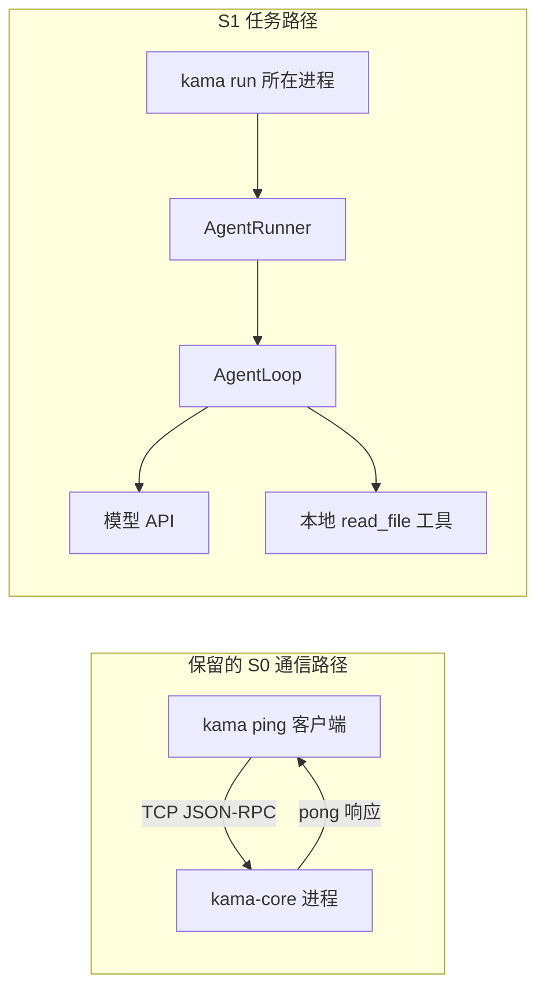
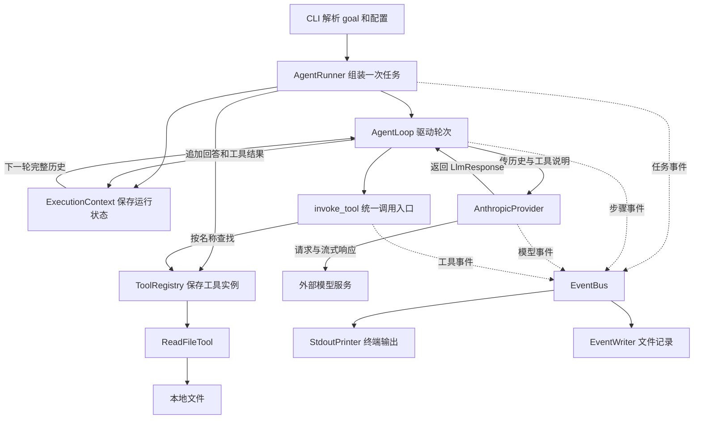
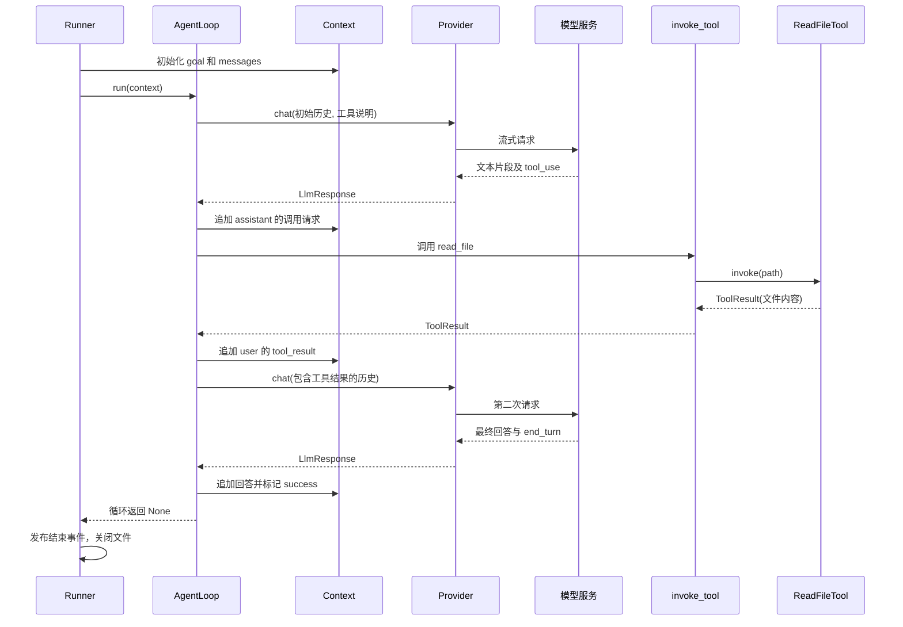
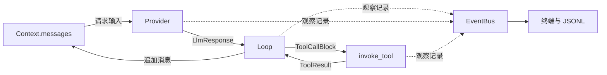
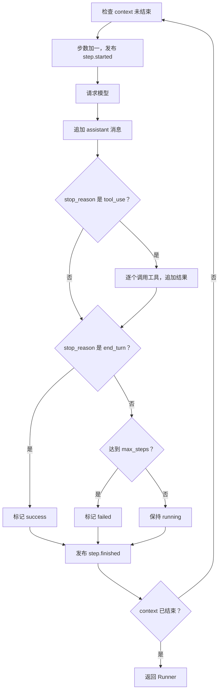
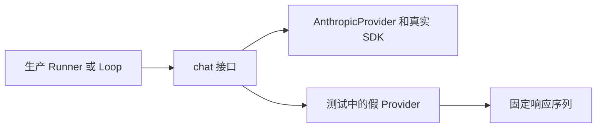

# study/s1 学习讲义：从整体架构到一次工具调用

> 适合已经掌握 Python 基本语法、列表和字典，但第一次阅读异步 Agent 项目的读者。
> 本文对应当前 `study/s1`：远程 `stage/s1` 的业务代码，加上教学注释与 Windows 兼容修复。
> 下文的消息、文件内容和事件顺序示例用于解释代码，不是真实模型运行结果。

## 目录与使用方法

| 章节 | 回答的问题 | 第一遍是否必读 |
|---|---|---|
| [1. 这个阶段做什么](#1-先明确这个阶段究竟做什么) | S1 相比 S0 多了什么？ | 是 |
| [2. 整体架构](#2-整体架构先认清对象的分工) | 哪些对象一起完成任务？ | 是 |
| [3. 跟踪一次任务](#3-跟踪一次任务读取文件中的数字) | 从命令到最终回答发生了什么？ | 是 |
| [4. 数据如何变化](#4-理解数据最值得花时间的一节) | 模型怎样得到工具结果？ | 是 |
| [5. 逐模块阅读](#5-逐模块阅读带着问题看源码) | 代码各段负责什么？ | 分次阅读 |
| [6. 异步与 Python 语法](#6-用项目代码理解-python-与异步) | 遇到陌生语法怎么拆解？ | 按需查阅 |
| [7. 事件与日志](#7-事件终端输出与文件记录) | 如何知道任务进行到哪一步？ | 第二遍 |
| [8. 终止与异常](#8-结束失败和取消沿着异常边界看) | 什么时候结束？失败如何处理？ | 第二遍 |
| [9. 配置与 Windows 修复](#9-配置与-windows开始运行前看这一节) | 配置怎么生效，修复了什么？ | 运行前 |
| [10. 测试与调试练习](#10-用测试学习先不调用真实模型) | 不调用真实 API 怎样学？ | 是 |
| [11. 分轮阅读与自测](#11-分三轮阅读不要一次看完所有文件) | 怎样判断自己真正理解了？ | 每轮结束 |

第一遍只建立执行主线，不需要记住所有类型名。第二遍把本文放在一侧，按链接打开源码，跟着一次任务逐步阅读。第三遍再看错误路径和测试替身。

图使用 Mermaid 代码块；支持 Mermaid 的 Markdown 预览器会显示为图形。若当前预览器只显示文本，可以直接看图下解释和表格，不影响理解。这里没有性能测量数据，因此使用结构图、流程图和状态表，不绘制没有依据的性能曲线。

## 1. 先明确：这个阶段究竟做什么

S1 实现了一个最小的 Agent 执行流程：接收一个目标，把目标交给模型；模型可以请求读取文件；程序执行读取并把结果交回模型；模型继续回答，直到结束或达到轮数上限。

它比“调用一次模型接口”多出的关键能力是：**程序能够执行模型提出的工具请求，再携带工具结果继续请求模型。**

| 能力 | S0 | 当前 S1 |
|---|---|---|
| CLI 与 daemon 的 TCP ping | 已有 | 保留 |
| `kama run --goal ...` | 没有 | 新增，在 CLI 进程内运行 |
| 多轮模型与工具交互 | 没有 | AgentLoop 驱动 |
| 本地工具 | 没有 | Runner 注册 `read_file` |
| 流式模型文本 | 没有 | AnthropicProvider 发布文本片段事件 |
| 每次任务的事件文件 | 没有 | `runs/<run_id>/events.jsonl` |
| 会话恢复、长期记忆、权限审批 | 没有 | 当前 S1 尚未实现 |
| TUI 交互界面 | 占位 | 仍是占位 |

### 1.1 两条入口不要混在一起



**运行 S1 的 `kama run` 不需要先启动 `kama-core`。** `core` 目录里的 Python 类可以被 CLI 直接导入使用；目录名叫 core，并不代表这些类一定在 daemon 进程内执行。当前 daemon 的 `CoreApp` 仍只注册 `core.ping`。

## 2. 整体架构：先认清对象的分工

### 2.1 一张图看清协作关系



实线表示调用、返回或数据使用关系；虚线表示发布观察事件。EventBus 不负责执行工具，也不负责把工具结果交给模型。模型能看到工具结果，是因为 Loop 更新了 Context 中的消息历史。

### 2.2 每个模块只记一句话

| 对象 | 职责 | 主要输入 | 输出或状态变化 |
|---|---|---|---|
| `cmd_run` | 连接同步 CLI 和异步任务 | goal、config | 启动 Runner、处理 Ctrl+C |
| `AgentRunner` | 组装一次任务并收尾 | 配置、可选模型替身、回调 | 创建目录、上下文、事件流 |
| `AgentLoop` | 决定何时请求模型、执行工具、结束 | provider、registry、bus、context | 修改 context |
| `ExecutionContext` | 保存本次任务的可变状态 | 目标、上限、消息 | 历史、步数、状态和原因 |
| `AnthropicProvider` | 把项目接口转换成 SDK 请求 | messages、工具 schema | `LlmResponse` 与模型事件 |
| `ToolRegistry` | 保存并查找工具 | 工具实例或工具名 | 实例、工具 schema 列表 |
| `invoke_tool` | 统一执行与错误包装 | `ToolCallBlock` | `ToolResult` 与工具事件 |
| `ReadFileTool` | 读取本地文件内容 | path | 文本或文件异常 |
| `EventBus` | 按顺序通知订阅者 | 事件对象 | 调用各异步回调 |
| `EventWriter` | 追加事件记录 | 事件对象 | JSONL 文件 |

**Runner 是组装者，Loop 是执行者，Context 是状态容器。** 遇到这三个名字时先用这三个角色判断代码位置，不急于钻入方法细节。

### 2.3 目录地图

```text
src/kama_claude/
├─ cli/
│  ├─ main.py                 解析命令，分发 ping 或 run
│  └─ commands/run.py         cmd_run 和 StdoutPrinter
└─ core/
   ├─ app.py                  daemon 生命周期，保留 S0 ping
   ├─ config.py               配置加载
   ├─ runner.py               组装一次 Agent 任务
   ├─ loop.py                 模型—工具执行循环
   ├─ context.py              本次任务的状态与消息历史
   ├─ runs.py                 任务 ID 与目录辅助函数
   ├─ bus/events.py           事件数据模型：描述消息形状
   ├─ events/bus.py           事件分发：实际调用订阅者
   ├─ events/writer.py        事件落盘
   ├─ llm/base.py             模型接口 Protocol
   ├─ llm/types.py            内部响应类型
   ├─ llm/provider.py         Anthropic SDK 适配
   └─ tools/
      ├─ base.py              工具抽象类与返回类型
      ├─ registry.py          工具注册表
      ├─ invocation.py        校验、超时与执行事件
      └─ builtin/read_file.py 文件读取实现
```

容易混淆的两个路径：`core/bus/events.py` 定义“事件有哪些字段”；`core/events/bus.py` 实现“把事件交给谁”。一个偏数据模型，一个偏运行行为。

## 3. 跟踪一次任务：读取文件中的数字

假设当前目录有 `sample.txt`，内容为 `The magic number is 7391.`，目标是“读取 sample.txt 并告诉我数字”。下面假设模型第一轮请求读取、第二轮回答。这是教学场景，不保证真实模型始终采取相同轮数或措辞。

### 3.1 从终端走进 Python

入口配置在 [pyproject.toml](../pyproject.toml) 的 `[project.scripts]`：`kama` 对应 CLI 的 `main` 函数。

```text
终端：kama run --goal "读取 sample.txt 并告诉我数字"
  → cli.main.main()
  → argparse 得到 args.command == "run" 和 args.goal
  → get_config()、setup_logging(config)
  → cmd_run(args.goal, config)
  → 创建 StdoutPrinter 和 AgentRunner
  → asyncio.run(runner.run(goal))
```

`runner.run(goal)` 先创建协程对象，外层 `asyncio.run(...)` 才启动事件循环并驱动它。普通构造函数 `AgentRunner(...)` 此前只保存配置和依赖，还没有执行模型请求。

### 3.2 Runner 先准备环境

阅读 [runner.py](../src/kama_claude/core/runner.py) 时，把 `run` 分成四段：

| 段落 | 做什么 | 为什么在这里做 |
|---|---|---|
| 创建 run_id、run_path | 为本次任务创建独立目录 | 不同任务的事件文件分开 |
| 创建总线、模型、工具和 Loop | 把依赖交给执行循环 | Loop 不需要自己决定如何构造 SDK 或文件路径 |
| 创建 Context、打开 EventWriter | 初始化历史并连接文件订阅者 | 在开始事件之前准备好记录渠道 |
| 发布开始事件、执行 Loop、发布结束事件 | 管理任务生命周期 | 业务循环与任务收尾分离 |

Runner 中的 `loop = AgentLoop(...)` 是业务对象，不是 asyncio 的事件循环。两个“loop”名字相似，负责的层次不同。

### 3.3 两轮交互的顺序图



模型只产生“我要调用哪个工具、参数是什么”的结构化请求。读取磁盘的动作由你电脑上的 Python 工具完成。Provider 也不执行工具，它只负责请求和解析模型响应。

### 3.4 一步到底指什么

在这个例子中，总共是 **1 次 run、2 个 step、1 次工具调用**。

| 时刻 | `step` | 消息条数 | `status` |
|---|---:|---:|---|
| Context 初始化 | 0 | 1 | running |
| 第一轮模型返回后 | 1 | 2 | running |
| 工具结果追加后 | 1 | 3 | running |
| 第二轮回答追加并判断结束后 | 2 | 4 | success |

Loop 每次进入 `while`，先执行 `context.step += 1`。一轮模型响应即使请求三个工具，也仍然算一个 step；本实现会依次执行这三个工具。

## 4. 理解数据：最值得花时间的一节

### 4.1 四种对象不要混为一谈

| 数据 | Python 形状 | 谁创建 | 谁消费 |
|---|---|---|---|
| 对话历史 | `list[dict[...]]` | Context 与 Loop | Provider，随后发给模型 |
| 模型响应 | `LlmResponse` dataclass | Provider | Loop |
| 工具结果 | `ToolResult` dataclass | 工具或 invoke_tool | Loop、Context |
| 事件 | Pydantic `BaseModel` 子类 | Runner、Loop、Provider、invoke_tool | 打印器和文件写入器 |

`response.text` 是对象属性；`message["content"]` 是字典取值。先认出变量属于哪个类型，点号和方括号就不会显得混乱。

### 4.2 Context 从一条消息开始

初始化后的教学示例：

```python
messages = [
    {"role": "user", "content": "读取 sample.txt 并告诉我数字"}
]
```

`ExecutionContext` 是 dataclass。构造完成后，`__post_init__` 检查历史是否为空；为空才自动插入 goal。`default_factory=list` 保证每次构造使用新的列表，不会共享其他任务的历史。

### 4.3 模型请求工具后，历史增加第二条

Provider 将 SDK 的工具块转为内部对象，形状如下：

```python
ToolCallBlock(
    id="toolu_demo_1",
    name="read_file",
    input={"path": "sample.txt"},
)
```

Loop 再把它装进模型对话格式：

```python
{
    "role": "assistant",
    "content": [
        {
            "type": "tool_use",
            "id": "toolu_demo_1",
            "name": "read_file",
            "input": {"path": "sample.txt"},
        }
    ],
}
```

如果这一轮同时返回文字，Loop 会先加入 `{"type": "text", "text": ...}`，再加入工具块。`content` 因而是一个块列表，不总是普通字符串。

### 4.4 工具结果增加第三条

```python
{
    "role": "user",
    "content": [
        {
            "type": "tool_result",
            "tool_use_id": "toolu_demo_1",
            "content": "The magic number is 7391.",
        }
    ],
}
```

这里的 `user` 是供应商消息格式的角色，不表示人又输入了一条消息。`tool_use_id` 与之前的 `id` 对应，才能知道这个结果属于哪次调用。同一个工具可以多次调用，仅凭名称不够。

如果同一轮有多个工具结果，`add_tool_result` 会在最后一条消息确实是非空、全由 tool_result 组成的 user 消息时继续追加块。它不是看到 user 角色就无条件合并。

### 4.5 第二轮请求携带前三条，最终回答成为第四条

```python
{
    "role": "assistant",
    "content": [{"type": "text", "text": "文件中的数字是 7391。"}],
}
```

第二次调用 Provider 时，传入的是前三条完整历史。文件内容并不是通过 EventBus 传给模型的。回答返回后，Loop 才把第四条加入本地历史，并根据 `end_turn` 标记成功。

### 4.6 三条数据路径



- **决策路径**：历史 → 模型 → 返回文本或调用请求。
- **执行路径**：调用请求 → 本地工具 → 工具结果 → 历史。
- **观察路径**：各模块发布事件 → 终端与文件。

这三条路径理解清楚后，大部分模块就能找到位置。

## 5. 逐模块阅读：带着问题看源码

### 5.1 AgentRunner：为什么不把所有代码写进 Loop

源码：[runner.py](../src/kama_claude/core/runner.py)。

Runner 接受可选的 `provider`、`extra_handlers` 和 `runs_dir`。生产运行不传 provider 时，它创建 `AnthropicProvider`；测试传入假 provider，就能执行同一段 Runner 逻辑而不请求真实 API。这就是本项目中“依赖注入”的具体意思：**所依赖的对象可以由调用者提供。**

`extra_handlers=[printer.handle]` 传的是方法对象，不是方法返回值。Runner 把它订阅到本任务总线。文件写入器随后也订阅到同一总线。

Runner 的 `run` 返回 `None`，不是最终回答字符串。最终回答在 Provider 收到文本片段时经事件打印；任务结果主要通过 Context 和结束事件体现。

阅读检查：你能在这个文件中指出“创建实例”“注册回调”“实际 await 执行”的区别吗？

### 5.2 AgentLoop：最重要的业务流程

源码：[loop.py](../src/kama_claude/core/loop.py)。



这张图展示正常控制路径，异常路径见第 8 节。需要注意：

1. 先记录模型的调用请求，再执行工具并记录结果。
2. 只有 `stop_reason == "tool_use"` 才进入工具执行分支。
3. `end_turn` 的判断在步数上限之前；恰好最后一轮完成仍算成功。
4. `context.is_done()` 只读 status；上限判断在 Loop 中，而不是 Context 内。

### 5.3 Provider：把外部 SDK 隔离在一个地方

源码：[接口](../src/kama_claude/core/llm/base.py)、[类型](../src/kama_claude/core/llm/types.py)、[实现](../src/kama_claude/core/llm/provider.py)。

| 顺序 | Provider 的工作 | 阅读时关注 |
|---|---|---|
| 1 | 发布模型选择事件 | 当前 strategy 固定为 static |
| 2 | 准备 system、messages、tools | 工具描述是数据，不是可执行函数 |
| 3 | 用 SDK 打开响应流 | `async with` 管理流生命周期 |
| 4 | 逐段读取文字并发布事件 | `async for` 等待下一片段 |
| 5 | 获取完整消息 | 从中提取工具调用、停止原因和用量 |
| 6 | 返回内部 LlmResponse | Loop 无需直接处理 SDK 对象 |

`kwargs` 是普通字典名称。`stream(**kwargs)` 中的 `**` 将键值展开为关键字参数。例如 `{"model": "x"}` 展开后相当于 `model="x"`。

`list(tool_schemas)` 只复制外层列表。随后 `dict(tools[-1])` 再复制最后一个字典，才向它添加缓存字段；目的在于不修改注册表提供的那份顶层字典。这个过程不是深拷贝。

`llm.token` 里的 token 实际是文本片段，可能包含多个词；它的事件条数不等于用量中的 token 数。`"".join(text_parts)` 将所有片段按顺序拼成完整文本。

### 5.4 工具层：描述、查找、执行各自分开

源码：[base.py](../src/kama_claude/core/tools/base.py)、[registry.py](../src/kama_claude/core/tools/registry.py)、[invocation.py](../src/kama_claude/core/tools/invocation.py)、[read_file.py](../src/kama_claude/core/tools/builtin/read_file.py)。

| 层次 | 作用 | 类比到普通 Python |
|---|---|---|
| BaseTool | 约定子类必须提供 invoke | 有待实现方法的基类 |
| ToolRegistry | 保存 name → 工具实例 | 一个字典 |
| input_schema | 告诉模型参数结构 | 一份描述性字典 |
| invoke_tool | 处理通用检查、超时和事件 | 包在具体函数外的统一调用步骤 |
| ReadFileTool.invoke | 具体读取文件 | `Path.read_bytes()` 与解码 |

`ToolRegistry.tool_schemas()` 返回名称、描述、参数 schema；模型看不到 Python 方法本身。模型返回 name 后，程序才用 `registry.get(name)` 找回实例。

`invoke_tool` 当前只检查 required 中的键是否存在，不是完整 JSON Schema 校验。`cast(list[str], ...)` 只是向类型检查器说明预期类型，不会把错误数据转换成正确列表。

读文件工具先取 bytes，再截断到 512 × 1024 字节并用 UTF-8 解码。因此限制的是**返回内容**，它仍然先把整个文件读进内存。`errors="replace"` 让无法解码的字节使用替代字符。

路径检查拒绝组成部分中的 `..`，但未限制绝对路径或符号链接目标。不要把工具描述中的“相对路径”误认为代码已实现完整目录隔离。

## 6. 用项目代码理解 Python 与异步

### 6.1 先分清名字从哪里来

| 名字 | 类别 | 在 S1 中的意思 |
|---|---|---|
| `len`、`isinstance`、`getattr` | Python 内置函数 | 长度、类型判断、按名称取属性 |
| `asyncio.run`、`Path`、`dataclass` | 标准库接口 | 事件循环入口、路径、数据类 |
| `BaseModel`、`Discriminator` | Pydantic 第三方库 | 模型校验与联合类型判别 |
| `AsyncAnthropic` | Anthropic 第三方 SDK | 外部模型客户端 |
| `mark_failed`、`publish` | 本项目方法 | 更新任务状态、分发事件 |

读到陌生调用先看 import，再跳转定义。无需为了读一行代码先掌握整个库。

### 6.2 await 没有自动创建新线程

```python
response = await provider.chat(...)
```

可以拆成：调用异步函数得到可等待对象；等待它完成；将结果赋给 response。等待网络数据期间，事件循环可以处理其他就绪任务，但当前 Loop 要等 chat 完成才执行下一行。

```python
for tc in response.tool_calls:
    result = await invoke_tool(...)
```

这段逐个执行工具。代码里没有 `create_task` 或 `gather`，不能因为存在 async 就理解为多个工具同时执行。

`async def` 里面仍然可能调用同步文件 I/O。ReadFileTool 的 `read_bytes()` 会阻塞当前线程，EventWriter 的 write/flush 也没有自动变成后台异步写入。

### 6.3 async with 和 async for 各负责什么

| 语法 | 在项目中的例子 | 执行含义 |
|---|---|---|
| `async with` | EventWriter、SDK stream | 等待进入方法，执行块，退出时等待清理方法 |
| `async for` | `stream.text_stream` | 等待下一段数据，直到异步迭代结束 |
| `await` | `bus.publish(event)` | 当前调用等待发布完成 |

EventWriter 的 `__aenter__` 打开文件并返回 self，所以 `as writer` 得到当前写入器。`__aexit__` 关闭文件，即使代码块因异常离开也会进入退出流程。

FakeStream 测试中的 `yield` 每次产生一个文本片段。它配合 `async def` 构成异步生成器，用来模拟 SDK 的异步文本流。

### 6.4 类型提示与运行时校验不是一回事

| 机制 | 当前用途 | 会自动校验输入吗 |
|---|---|---|
| `dict[str, object]` 等标注 | 说明参数形状 | 普通函数调用不会 |
| dataclass | 保存 Context、LlmResponse、ToolResult | 不按类型标注自动校验 |
| Protocol | 描述 provider 应提供的接口 | 本项目用作静态类型契约 |
| ABC + abstractmethod | 约束工具子类实现 invoke | 未实现抽象方法的类不能实例化 |
| Pydantic BaseModel | 事件与协议模型 | 构造或显式校验时处理数据 |

Protocol 不要求 AnthropicProvider 写出 `class AnthropicProvider(LLMProvider)`。它关注方法结构是否兼容。假 provider 因而也能被传入 Loop，只要提供合适的 chat 方法。

### 6.5 源码中的短表达式

| 表达式 | 逐步理解 |
|---|---|
| `provider or AnthropicProvider(...)` | 前者是真值就使用它，否则才求值后者 |
| `self.messages[-1]` | 取最后一项；列表为空时会失败，所以源码先判断 |
| `all(b.get("type") == "tool_result" for b in blocks)` | 逐块检查，全部满足才为 True；空集合也为 True |
| `getattr(usage, "cache_read_input_tokens", 0) or 0` | 属性缺失取 0；属性存在但为 None 等假值时也取 0 |
| `next((e for e in events if ...), None)` | 取第一个匹配事件，找不到则返回 None |
| `dict(existing)` | 复制字典外层，内部嵌套对象仍可能共享 |
| `printer.handle` | 绑定当前 printer 的方法对象，尚未调用 |
| `printer.handle(event)` | 调用异步方法，得到协程，仍需 await 驱动 |

## 7. 事件、终端输出与文件记录

### 7.1 订阅不等于执行

```python
bus.subscribe(printer.handle)
await bus.publish(event)
```

第一行把方法存进列表；第二行才按列表顺序逐一 `await handler(event)`。总线直接传递事件对象，没有先转 JSON，也没有自动创建线程或后台队列。

默认 CLI 路径先订阅打印器，再订阅文件写入器。因此同一事件先经过打印器，再经过写入器。打印器只处理它认识的事件类型；忽略某类事件不代表文件也不记录它。

### 7.2 谁发布什么

| 发布位置 | 事件类型 | 用途 |
|---|---|---|
| Runner | run.started、run.finished | 任务边界、目标与结果 |
| Loop | step.started、step.finished | 轮次进展 |
| Provider | llm.model_selected | 本次模型与策略 |
| Provider | llm.token | 文本片段输出 |
| Provider | llm.usage | 请求用量 |
| invoke_tool | tool.call_started | 调用名称、ID 与参数 |
| invoke_tool | tool.call_finished、tool.call_failed | 耗时及失败信息 |

CoreStartedEvent 与 LogLineEvent 在模型文件中有定义，不代表 S1 已经在对应运行位置自动发布它们。

### 7.3 教学例子的正常事件序列

```text
run.started
  step.started (1)
    llm.model_selected
    llm.token × 若干（也可能没有文字片段）
    llm.usage
    tool.call_started
    tool.call_finished
  step.finished (1)
  step.started (2)
    llm.model_selected
    llm.token × 若干
    llm.usage
  step.finished (2)
run.finished (success, steps=2)
```

真实事件字段中，步骤事件有 step，模型和工具事件主要通过 run_id 关联任务；不要假设所有事件都带 step 字段。

### 7.4 JSONL 是什么，能否恢复任务

JSONL 每行是一个独立 JSON 对象；整个文件不是用 `[]` 包裹的 JSON 数组。教学示例：

```json
{"type":"run.started","run_id":"demo","goal":"读取文件","ts":"2026-10-12T00:00:00+00:00"}
{"type":"run.finished","run_id":"demo","status":"success","reason":null,"steps":2,"ts":"2026-10-12T00:00:01+00:00"}
```

实际运行通常还会包含中间事件。EventWriter 使用追加模式、UTF-8 和每次写后的 flush；flush 不是保证物理磁盘持久化的 fsync。

S1 的事件文件用于观察过程，**不是完整的可恢复会话存档**。当前没有从事件文件重建 Context 并恢复任务的流程，工具完成事件也没有包含完整工具返回内容。

## 8. 结束、失败和取消：沿着异常边界看

| 情况 | 处理位置 | 结果 |
|---|---|---|
| stop_reason 为 end_turn | Loop | success，即使恰好达到步数上限 |
| 未结束且达到 max_steps | Loop | failed，reason 为 exceeded_max_steps |
| provider.chat 范围内发生普通异常 | Loop | failed，reason 为 llm_error |
| 工具不存在、缺参或执行异常 | invoke_tool | 错误 ToolResult 追加到历史，循环可继续 |
| 异步工具超时 | invoke_tool 的 wait_for | 通常转换为 timeout 工具结果 |
| 执行中的取消传播到 Runner 的等待范围 | Runner | 标记取消、尝试发布结束事件，关闭文件后重新抛取消 |
| CLI 收到 KeyboardInterrupt | cmd_run | 以 130 退出 |

工具失败和任务失败不是同一个概念。文件不存在可以成为一条 `is_error=True` 的工具反馈；下一轮模型仍可能解释问题或调整调用。

当前状态中的 success 表示模型返回了 `end_turn`，程序没有额外判断“用户目标是否真的完成”。业务上是否答对，需要进一步检验答案或测试断言。

另外，错误分类和捕获范围有关：Provider 发布事件时，如果订阅者抛异常，它也可能从 `provider.chat` 传播出去，被 Loop 归为 llm_error。因此看到这个 reason 不能断言一定是网络或模型服务故障。

EventBus 没有通用异常隔离，Runner 也不是任何异常路径都保证发布 run.finished。先记住正常路径，再通过具体 try/except 的范围判断特殊路径；不要把事件开始与结束理解为绝对成对。

`asyncio.wait_for` 的超时依赖事件循环得到运行机会和协程配合取消；它无法让当前同步阻塞的 read_bytes 立即中断。

## 9. 配置与 Windows：开始运行前看这一节

### 9.1 配置读取顺序与覆盖优先级

源码：[config.py](../src/kama_claude/core/config.py)。覆盖优先级从低到高为：

```text
内置默认值 < TOML 配置 < .env 中的配置 < 进程原有环境变量
```

实际执行先用 `load_dotenv(..., override=False)` 将 `.env` 补入进程环境，再决定 TOML 路径，最后应用环境值。这解释了为什么 `.env` 虽先读取，仍能覆盖 TOML 的业务字段。

| 设置 | 当前默认或用途 | 对应位置 |
|---|---|---|
| KAMA_CONFIG | 默认 ~/.kama/config.toml | 选择 TOML 路径 |
| KAMA_MAX_STEPS | 默认 20 | config.agent.max_steps |
| KAMA_LLM_DEFAULT_MODEL | 源码默认 claude-sonnet-4-6 | 原样传入 Anthropic SDK |
| ANTHROPIC_API_KEY | 无默认凭据 | Provider 创建客户端时读取 |
| KAMA_HOST、KAMA_PORT | 127.0.0.1、7437 | S0 ping/daemon 通信 |
| KAMA_LOG_LEVEL、KAMA_LOG_FILE、KAMA_LOG_FORMAT | 日志级别、文件、格式 | 普通应用日志 |

模型默认值是本分支代码中的值，不代表你的服务账户一定可用。S1 只实现 Anthropic SDK 适配，不会看到 `openai/...` 前缀就自动改用其他供应商。

已有较新阶段的全局 TOML 如果包含 S1 不认识的小节，可能被配置加载器拒绝。学习时可用 KAMA_CONFIG 指向单独的 S1 配置；无需覆盖其他阶段的配置。也要留意原目录保留的 `.env`，因为切换 Git 分支不会自动替换未跟踪的本地环境文件。

### 9.2 当前分支保留的兼容修复

| 修复 | 原问题 | 当前实现 |
|---|---|---|
| daemon 信号注册 | Windows 不支持 loop.add_signal_handler | 回退 signal.signal，将通知交回事件循环 |
| daemon 退出清理 | 等待取消或异常时需关闭服务 | finally 中调用 server.stop |
| 测试临时目录 | 系统 pytest 临时目录可能拒绝访问 | 默认使用项目 .pytest_cache/tmp，保留显式覆盖 |
| 协议文档编码 | Windows 默认 GBK 读取 UTF-8 失败 | 文档生成器明确用 UTF-8 读写 |

退出帮助函数保存旧信号处理器，离开时通过 ExitStack 恢复；ExitStack 的回调按后注册先执行。此修复属于 daemon 生命周期，不需要用它解释 S1 的 AgentLoop。

## 10. 用测试学习：先不调用真实模型

### 10.1 推荐的第一条命令

在仓库根目录运行：

```powershell
uv sync
uv run pytest tests/unit/test_loop.py::test_tool_use_then_end_turn_marks_success -v
```

这个测试用 `_MockProvider` 依次返回两份预置响应：第一次工具调用，第二次 end_turn。工具是测试里的 EchoTool，不是真实模型生成的调用，也不会访问外部 API。

先看 [test_loop.py](../tests/unit/test_loop.py) 这个测试函数，再按调用跳到 Loop，比从整个项目第一行开始阅读更容易建立执行顺序。

### 10.2 建议断点和观察变量

| 断点位置 | 观察变量 | 这个测试中应看到 |
|---|---|---|
| Loop 内 step 增加后 | context.step、status | 第一轮为 1、running |
| provider.chat 返回后 | response.stop_reason、tool_calls | 第一轮 tool_use，第二轮 end_turn |
| 追加 assistant 消息后 | context.messages | 已包含 tool_use 块 |
| invoke_tool 返回后 | result.content、is_error | 回显文本、False |
| add_tool_result 之后 | messages 最后一项 | user 角色的 tool_result |
| 成功判断后 | step、status | 2、success |

在 VS Code 的 Python 测试调试功能中运行该用例，可以观察同一轮中的变量。关注值的变化即可，不必一开始就单步进入 SDK 或 Python 标准库内部。

### 10.3 测试为什么可以没有模型密钥



测试中替换的是外部依赖，Loop 本身仍是真实业务实现。这样可以固定“第一轮调用工具、第二轮结束”，反复验证历史变化和终止条件。

| 测试替身 | 用在哪里 | 理解重点 |
|---|---|---|
| `_MockProvider` | Loop 测试 | iter/next 按顺序提供响应 |
| `_EndTurnProvider` | Runner 测试 | 立即结束，以便检查组装与落盘 |
| `_LoopingProvider` | Runner 测试 | 持续请求工具，以便触发上限 |
| `FakeStream` | Provider 测试 | 模拟 async with 和 async for |
| `MagicMock` | Provider 测试 | 提供 SDK 对象的属性和返回值 |
| `_SlowTool`、`_BrokenTool` | 工具调用测试 | 稳定制造超时或异常 |

`iter(responses)` 得到保存位置的迭代器；每次 `next` 取下一项。响应耗尽会导致异常，测试必须准备足够的响应，不能认为它会自动重复最后一项。

### 10.4 从成功路径扩展到失败路径

```powershell
# 工具失败后模型仍能结束任务
uv run pytest tests/unit/test_loop.py::test_tool_failure_loop_continues_to_success -v

# 超过步数上限
uv run pytest tests/unit/test_loop.py::test_max_steps_marks_failed -v

# 真实业务组装与临时文件写入，使用假模型
uv run pytest tests/unit/test_runner.py -v

# 全部单元测试，不请求真实模型
uv run pytest tests/unit -v

# 本地 TCP ping 集成测试，夹具会启动测试 daemon
uv run pytest tests/integration/test_ping_roundtrip.py -v
```

前四类帮助你理解 Agent，最后一类验证保留的 S0 通信路径。它们解决的问题不同，不要把 ping 成功当成模型配置正确的证明。

### 10.5 确认理解后再尝试真实运行

真实运行需要有效凭据与可用模型。以下命令使用你已有的环境配置，不会自动创建文件或配置凭据：

```powershell
uv run kama run --goal "使用 read_file 读取 README.md，并概括这个项目。"
```

如果要跑真实端到端测试：

```powershell
uv run pytest tests/integration/test_run_e2e.py -v
```

这个测试会读取项目 `.env`；缺少密钥时跳过，有密钥时会调用真实 Anthropic API。单元测试全通过只能证明被覆盖的本地逻辑成立，不等于真实服务连接、账户权限和模型配置都有效。

其他维护检查：

```powershell
uv run ruff check src tests scripts
uv run mypy src
uv run python scripts/gen_protocol_doc.py --check
```

## 11. 分三轮阅读，不要一次看完所有文件

### 第一轮：能口述一次成功任务

依次打开 [run.py](../src/kama_claude/cli/commands/run.py) → [runner.py](../src/kama_claude/core/runner.py) → [loop.py](../src/kama_claude/core/loop.py) → [context.py](../src/kama_claude/core/context.py)。

目标：能画出“目标 → 模型请求工具 → 本地执行 → 结果回到历史 → 模型回答”。暂时把 Provider.chat 当成一个输入历史、返回响应的函数。

### 第二轮：能解释数据与接口

阅读 [llm/types.py](../src/kama_claude/core/llm/types.py)、[llm/base.py](../src/kama_claude/core/llm/base.py)、[llm/provider.py](../src/kama_claude/core/llm/provider.py)，然后看 [tools/invocation.py](../src/kama_claude/core/tools/invocation.py)。

目标：分清字典、dataclass、Pydantic 模型；说清工具 schema、工具请求和工具结果的区别。运行一个 Loop 测试并观察 messages。

### 第三轮：能定位失败和观察记录

阅读 [events/bus.py](../src/kama_claude/core/events/bus.py)、[events/writer.py](../src/kama_claude/core/events/writer.py)、[bus/events.py](../src/kama_claude/core/bus/events.py) 及相关测试。

目标：看到一条失败记录时，能判断应从模型适配器、工具调用器、配置加载还是文件写入处开始排查。

### 自测与参考答案

| 问题 | 参考答案 |
|---|---|
| 为什么不用先启动 core 就能运行 S1 Agent？ | cmd_run 直接在 CLI 进程创建并执行 Runner。 |
| 谁真正读取磁盘？ | ReadFileTool，模型只返回请求。 |
| 模型如何知道文件内容？ | 工具结果被写进 Context.messages，随下一次 chat 发送。 |
| 一轮有三个工具调用算几步？ | 一步，对应一次模型请求。 |
| EventBus 是否向模型发送工具结果？ | 不负责；它调用终端和文件等订阅者。 |
| 工具返回错误是否必然导致任务失败？ | 不必然；错误会进入历史，模型可以继续。 |
| success 是否证明答案正确？ | 不是；当前代码按 end_turn 标记成功。 |
| 为什么假模型不用继承 AnthropicProvider？ | Loop 依赖 chat 接口，不依赖具体 SDK 实现。 |
| 为什么 async 文件工具也可能阻塞？ | 内部 read_bytes 是同步 I/O。 |
| 能否用事件文件直接恢复对话？ | 当前 S1 没有这条恢复流程。 |

## 附：与 S0 的衔接

[S0 学习导航](STUDY_GUIDE_S0.md)继续用于学习 CLI、TCP、JSON-RPC、配置与 daemon 生命周期。它对“仅有一个事件类型、没有 Agent 执行”的描述属于 S0 历史阶段，不能直接套到 S1。

当前阅读顺序应以本讲义为主。遇到函数名暂时看不懂，先判断它属于哪一层，再看输入、返回值和调用者；只有阻碍你理解当前执行链时，才进一步追入实现。
