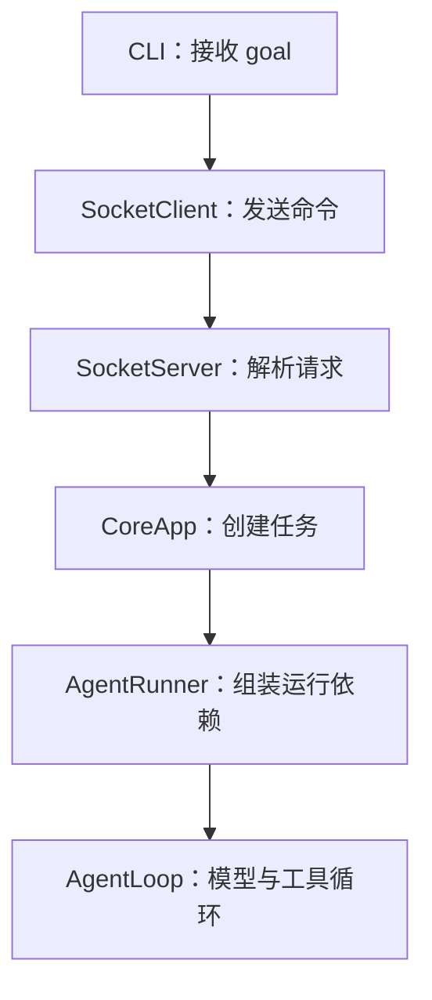
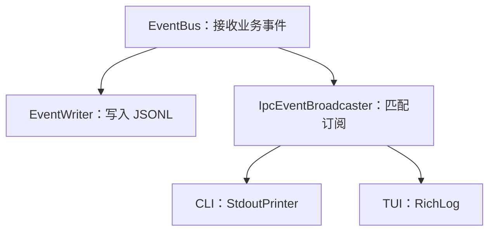
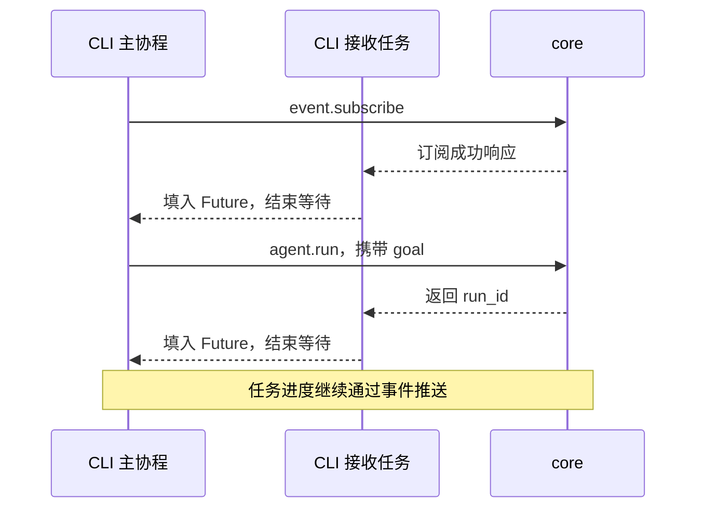
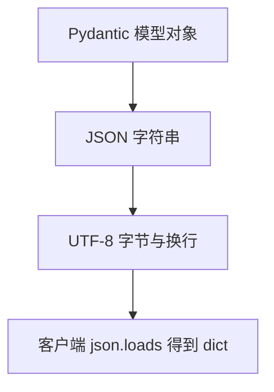
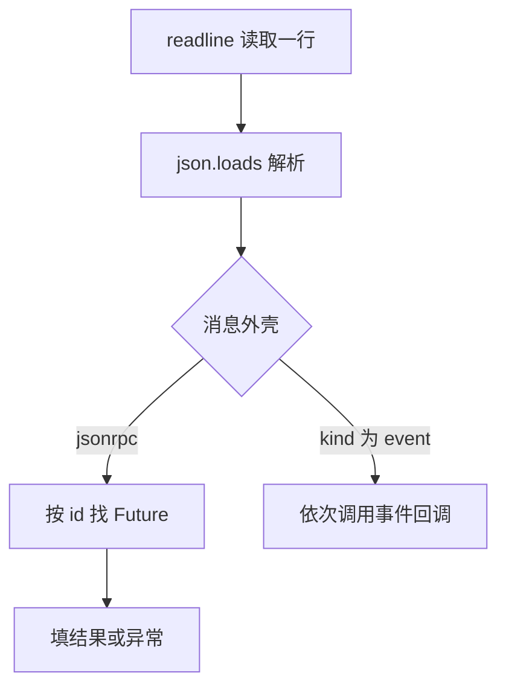
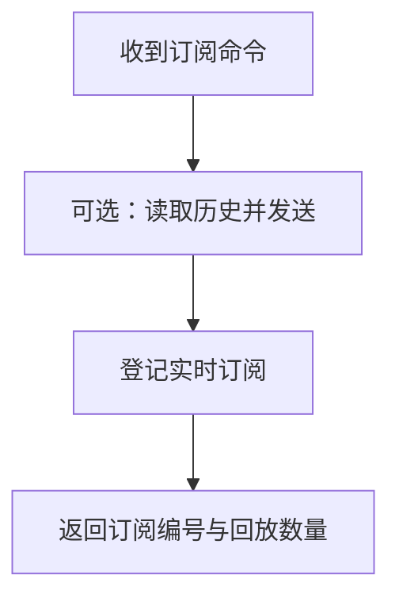

# study/s2 学习讲义：从进程架构到一次完整的事件通信

> 适合掌握 Python 基本语法、列表和字典，正在学习异步项目的读者。
> 本文对应 `study/s2`：`origin/stage/s2` 的功能，加上详细中文注释与 Windows 兼容修复。
> 示例中的 ID、消息、文件内容和输出用于解释代码，不是真实模型运行记录。

## 目录与使用方法

| 章节 | 回答的问题 | 建议阅读时机 |
|---|---|---|
| [1. 阶段目标](#1-阶段目标从单进程执行到核心与客户端分离) | S2 到底改变了什么？ | 第一遍 |
| [2. 架构与对象](#2-整体架构先区分进程再认识对象) | 哪个对象在哪个进程，负责什么？ | 第一遍 |
| [3. 完整任务](#3-跟踪一次任务从提交目标到收到完成事件) | 一次 run 怎样穿过所有模块？ | 第一遍 |
| [4. 协议与数据](#4-通信数据命令响应和事件分别长什么样) | JSON、dict、模型对象如何转换？ | 第一遍 |
| [5. 客户端](#5-客户端拆解一个连接如何同时收响应和事件) | Future 如何让请求等到自己的响应？ | 第二遍 |
| [6. 服务端](#6-服务端拆解从网络请求到后台任务) | ContextVar、命令分发和后台 Task 怎样配合？ | 第二遍 |
| [7. 广播与回放](#7-事件广播与回放实时流和历史文件如何衔接) | 谁能收到事件，回放会不会重新运行任务？ | 第二遍 |
| [8. CLI 与 TUI](#8-显示层同一事件怎样出现在-cli-和-tui) | 文本输出、界面、重连如何工作？ | 第二遍 |
| [9. Python 知识](#9-python-与异步语法对照代码逐项理解) | 陌生语法、内置函数和库调用怎么区分？ | 随时查阅 |
| [10. 生命周期与异常](#10-生命周期与异常沿着等待和清理的位置阅读) | 何时结束、取消、断线，资源谁清理？ | 第三遍 |
| [11. 配置与 Windows](#11-配置运行方法与-windows-修复) | 怎样运行，为什么有兼容代码？ | 运行前 |
| [12. 测试与调试](#12-通过测试学习先观察确定的输入输出) | 不用真实模型如何验证理解？ | 每轮阅读后 |
| [13. 阅读路线与自测](#13-分轮阅读与自测建立自己的源码地图) | 怎样避免读乱，怎样判断读懂？ | 每轮结束 |

**第一遍只读第 1～4 节，再做第 12 节中的客户端测试。** 先记住目标怎样提交、事件怎样回来，不必一次理解所有错误分支。第二遍打开源码对照阅读；第三遍再追取消和断线。

本文将架构拆成多张小图，每张只回答一个问题。图使用 Mermaid；如果预览器不能渲染，图下的文字和表格也能独立说明流程。目录使用 Markdown 标题链接，没有额外 HTML 锚点。

## 1. 阶段目标：从单进程执行到核心与客户端分离

### 1.1 S2 新增的核心能力

S1 已经能让模型提出工具请求，执行本地工具，再把工具结果交回模型。S2 的重点是把这个执行过程放进长期运行的 core，让客户端通过网络提交目标、订阅进度。

可以先记住这句话：**core 执行任务，CLI 提交目标并显示过程，TUI 订阅并展示过程。**

| 能力 | S1 | S2 |
|---|---|---|
| `kama run` 执行 Agent 的位置 | CLI 进程内 | 独立 core 进程内 |
| 运行任务前是否启动 core | 不需要 | 需要 |
| 模型和工具循环 | AgentLoop | 沿用 AgentLoop |
| 客户端收到的数据 | 进程内事件模型 | TCP JSON 解码后的 dict |
| 任务进度观察 | 当前 CLI | 多个已订阅的客户端 |
| TUI | 占位入口 | 状态栏、日志面板、重连与回放 |
| 事件文件 | EventWriter 写 JSONL | 仍由 EventWriter 写，现在位于 core 进程 |
| 后台 core 管理 | 无对应子命令 | `core start/stop/status` |
| 同时执行多个 Agent 任务 | 没有 daemon 调度 | core 仍限制一次一个运行中的任务 |

多个客户端可以同时连接，**不等于多个 Agent 任务可以同时运行**。这两个数量由不同机制决定。

### 1.2 先分清三个容易混淆的概念

| 概念 | 本项目的例子 | 关键区别 |
|---|---|---|
| 进程 | core、CLI、TUI | 操作系统运行的独立程序，有各自的内存和 PID |
| 异步 Task | core 中的 `runner.run(...)` 任务 | 在该进程的事件循环中调度，不会创建新进程 |
| 业务 run | 一次“读取文件并回答”的任务 | 用 `run_id` 标识，包含多轮模型调用和工具执行 |

“创建 Task”与“启动 core 进程”发生在不同代码处：前者使用 `asyncio.create_task()`，后者使用 `subprocess.Popen()`。不要看到“后台”两个字就把它们当成同一件事。

### 1.3 双进程架构为何可能出现三个进程

只打开 core 和一个 CLI 时有两个进程；再打开 TUI 就有三个。所谓双进程架构强调核心与客户端分离，并不是规定操作系统里恰好只能出现两个进程。

每个客户端分别有自己的 TCP 连接。TUI 不从 CLI 读取输出，而是直接从 core 接收事件，所以 CLI 的 `print()` 不负责更新 TUI。

## 2. 整体架构：先区分进程，再认识对象

### 2.1 图 A：目标提交与执行



前两个节点在 CLI 进程，后四个在 core 进程。跨进程的边界是 SocketClient 与 SocketServer 之间的 TCP 连接。图只画调用方向，响应沿同一连接返回。

### 2.2 图 B：过程怎样被记录和显示



事件由 Runner、Loop、Provider、工具调用层发布。EventBus 依次等待订阅者，广播器再依次向匹配连接发送。图中的分支表示接收关系，不表示这些操作自动并行。

### 2.3 图外的辅助对象

| 对象 | 存在哪里 | 保存什么 | 谁使用它 |
|---|---|---|---|
| ExecutionContext | core，每次 run 新建 | goal、消息历史、步数、状态 | AgentLoop |
| ToolRegistry | core，每次 run 新建 | 工具名称与实例 | Loop 与 invoke_tool |
| `_pending` | 每个 SocketClient 实例 | 请求 ID 与 Future 的对应关系 | 发命令与读消息的协程 |
| `_subscriptions` | core 的广播器 | writer、topic、scope | 事件广播 |
| `_current_run_task` | CoreApp | 最近创建的运行 Task | 限制同时只运行一个任务 |
| `_token_buf` | TUI 实例 | 尚未写入日志的模型文本 | TUI 格式化逻辑 |

core 的 EventBus 跨 run 共用，Context 则每次新建。**共享事件总线不会自动共享对话历史。**

### 2.4 文件地图：遇到问题应该打开哪里

| 入口或问题 | 文件 | 先找的函数或类 |
|---|---|---|
| 命令行参数 | [cli/main.py](../src/kama_claude/cli/main.py) | `main` |
| 提交任务并等待完成 | [cli/commands/run.py](../src/kama_claude/cli/commands/run.py) | `_run_async` |
| 后台进程管理 | [cli/commands/core.py](../src/kama_claude/cli/commands/core.py) | `cmd_core_start` |
| 客户端通信 | [socket_client.py](../src/kama_claude/core/transport/socket_client.py) | `send_command`、`_dispatch` |
| 请求解析与响应 | [socket_server.py](../src/kama_claude/core/transport/socket_server.py) | `_handle_line` |
| daemon 业务入口 | [core/app.py](../src/kama_claude/core/app.py) | `_agent_run_handler` |
| 运行依赖组装 | [core/runner.py](../src/kama_claude/core/runner.py) | `AgentRunner.run` |
| 模型与工具交互 | [core/loop.py](../src/kama_claude/core/loop.py) | `AgentLoop.run` |
| 订阅过滤与广播 | [ipc_broadcaster.py](../src/kama_claude/core/transport/ipc_broadcaster.py) | `handle` |
| 界面与重连 | [tui/app.py](../src/kama_claude/tui/app.py) | `_socket_loop` |
| 业务参数和网络外壳 | [commands.py](../src/kama_claude/core/bus/commands.py)、[envelope.py](../src/kama_claude/core/bus/envelope.py) | Pydantic 模型 |

不要按目录顺序逐个打开所有文件。先沿表中的一条问题路线，确认它的输入、输出和调用者，再换到下一条路线。

## 3. 跟踪一次任务：从提交目标到收到完成事件

假设 core 已启动，目标是“读取 number.txt，告诉我里面的数字”，文件内容是 `The magic number is 7391.`。以下假设模型第一轮请求 read_file，第二轮给出答案；真实模型不保证采用同样步骤。

### 3.1 第一步：CLI 准备连接

`main()` 解析 `--goal`，加载本进程配置，调用 `cmd_run()`。后者用 `asyncio.run(_run_async(...))` 启动客户端的事件循环。

`_run_async()` 依次创建 SocketClient、连接 core、创建 StdoutPrinter 和一个 `asyncio.Event`。这个 Event 用来表示“已经收到任务完成事件”，不是消息内容本身。

随后注册 `on_event` 回调，并用 `create_task(client.run_event_loop())` 启动接收任务。此时客户端有两条协作路线：主协程提交命令，接收任务持续读取响应和事件。

### 3.2 第二步：先订阅，再提交目标



这张图只描述提交阶段，省略了业务事件与响应可能交错到达的细节。必须先订阅，是因为任务可能很快发布 run.started，甚至很快完成；事后才订阅可能错过这些通知。

### 3.3 第三步：core 接受任务，但没有等待任务结束

SocketServer 根据请求的 `method` 找到 `_agent_run_handler`。处理器先用 AgentRunCommand 校验参数，再检查已有 Task 是否仍在运行。

如果可以开始，它生成 run_id，创建使用公共 EventBus 的 AgentRunner，然后：

```python
self._current_run_task = asyncio.create_task(
    runner.run(cmd.goal, run_id=run_id)
)
return AgentRunResult(run_id=run_id)
```

第一行提交后台协程；返回值告诉客户端这个任务的编号。它没有等模型回答，也没有把最终答案放入 RPC 响应。

### 3.4 第四步：Runner 和 Loop 沿用已有执行能力

Runner 创建任务目录、ExecutionContext、EventWriter，发布 run.started，然后建立 Provider、工具注册表和 AgentLoop。

| 时刻 | core 内部做什么 | Context.messages 的变化 |
|---|---|---|
| 初始化 | 把 goal 放入上下文 | 一条 user 消息 |
| 第一轮模型返回 | 记录读取文件的 tool_use | 追加 assistant 消息 |
| 工具执行完成 | 把文件文本交回上下文 | 追加含 tool_result 的 user 消息 |
| 第二轮模型返回 | 记录“数字是 7391” | 追加 assistant 消息 |
| `end_turn` | 标记 success | 不因结束状态额外追加消息 |

这里的 tool_use_id 用来对应工具请求和工具结果；它与 RPC 请求 ID 是两套不同的关联机制。

### 3.5 第五步：同一过程产生事件流

下面按层次列出典型事件，不把 Provider 内部所有流式片段展开：

| 层次 | 典型事件 | 显示或记录的内容 |
|---|---|---|
| Runner | `run.started` | run_id 和目标 |
| Loop | `step.started` | 当前模型调用轮次 |
| Provider | `llm.model_selected`、`llm.token`、`llm.usage` | 模型、文本片段和用量 |
| invoke_tool | `tool.call_started`、`tool.call_finished` | 工具参数和耗时 |
| Loop | `step.finished` | 本轮结束 |
| Runner | `run.finished` | 状态、原因和总步数 |

第二轮会再次产生步骤和模型事件。CLI 的订阅没有包含所有事件类型，例如默认不订阅 llm.model_selected；文件与屏幕显示不必逐行一致。

### 3.6 第六步：客户端结束等待

接收任务把 run.finished 交给 `on_event`。回调先打印，再根据状态更新 `exit_code`，最后调用 `finished.set()`。

主协程在 `await finished.wait()` 处恢复，取消并等待接收 Task，关闭 TCP，返回退出码。业务失败返回 1，成功返回 0，`cmd_run` 捕获 KeyboardInterrupt 时退出码为 130。

**区分这三个信号：连接成功表示能通信，agent.run 响应表示任务已提交，run.finished 才表示业务循环已结束。**

## 4. 通信数据：命令、响应和事件分别长什么样

### 4.1 四种数据形态



进程之间传的是字节。服务端的 Python 对象没有被直接搬到客户端；客户端重新解析数据，因此用 `event.get("type")` 分支，而不再用服务端事件类的 `isinstance` 判断。

| 调用 | 输入 | 输出 |
|---|---|---|
| `model_validate(params)` | Python 数据，通常为 dict | 校验后的模型实例 |
| `model_dump()` | 模型实例 | Python dict |
| `model_dump_json()` | 模型实例 | JSON str |
| `.encode()` | str | UTF-8 bytes |
| `json.loads(line)` | JSON 文本或字节 | Python 数据，本协议预期 dict |

`json.loads` 本身并不保证返回字典，也不校验业务字段；合法 JSON 还可以是列表、数字或 null。类型注解不会替代这一步运行时校验。

### 4.2 命令请求：外壳负责路由，params 保存业务参数

```json
{
  "jsonrpc": "2.0",
  "id": "request-1",
  "method": "agent.run",
  "params": {"goal": "读取 number.txt 并告诉我数字"}
}
```

SocketServer 用 `method` 查找处理器。业务命令模型还有 `type` 字段，但带默认值，因此示例 params 可以不写 type；当前路由实际不依靠 params.type。

| 字段 | 意义 | 在哪里使用 |
|---|---|---|
| `jsonrpc` | 协议版本标签 | JsonRpcRequest 校验 |
| `id` | 一次请求的关联编号 | 客户端 `_pending` |
| `method` | 要调用的命令 | 服务端处理器字典 |
| `params` | 命令的参数 | 业务处理器 |

### 4.3 成功响应和错误响应

成功响应沿用请求 ID：

```json
{"jsonrpc":"2.0","id":"request-1","result":{"run_id":"run-1"}}
```

错误响应也通过 ID 对应请求：

```json
{"jsonrpc":"2.0","id":"request-1","error":{"code":-32603,"message":"Internal error"}}
```

SocketClient 将错误转换成 IpcError，通过 Future 传回 `send_command` 的等待者。这与业务任务执行后的 `status="failed"` 不同：前者是命令响应失败，后者是已经启动的任务失败。

### 4.4 事件推送有自己的外壳

```json
{
  "kind": "event",
  "event": {
    "type": "run.started",
    "run_id": "run-1",
    "goal": "读取 number.txt 并告诉我数字",
    "ts": "2026-10-12T00:00:00Z"
  }
}
```

外层 kind 让接收循环判断这是推送；内层 type 让显示层判断是哪一种业务事件。事件不要求之前存在一个对应的 RPC 请求，因此没有复用请求 ID。

### 4.5 四种 ID 对照

| ID | 标识对象 | 生命周期示例 |
|---|---|---|
| 请求 `id` | 一次 JSON-RPC 交互 | 发命令到收响应 |
| `run_id` | 一次业务任务 | 多轮模型调用及其历史文件 |
| `subscription_id` | 一次客户端订阅 | 注册到连接断开或内部移除 |
| `tool_use_id` | 一次模型提出的工具调用 | tool_use 与 tool_result 对应 |

同一个 run 可以产生很多事件、很多工具调用；客户端也可能为同一个连接发送很多命令。不要用其中一个 ID 代替另一个。

### 4.6 NDJSON 为什么要加换行

TCP 不保留应用层“消息”的边界。两次 write 的内容可能一起到达，一次 write 的内容也可能分批到达。

本项目在每个 JSON 后加 `b"\n"`，接收端用 readline 组织完整行。JSON 字符串内部的换行会被序列化为转义字符，不会直接变成另一条协议消息。

`writer.write()` 把字节交给缓冲区；`await writer.drain()` 在需要时等待写缓冲压力缓解。它不表示客户端已经打印完，也不表示事件文件已经持久化到物理磁盘。

### 4.7 三个命令的输入输出速查

| method | 主要 params | 成功 result |
|---|---|---|
| core.ping | client | server_version、uptime_ms、received_at |
| agent.run | goal | run_id |
| event.subscribe | topics；可选 scope、replay_from_run | subscription_id、replayed_count |

scope 默认 global，replay_from_run 默认 None。replayed_count 为零可能是未请求回放、文件不存在或没有匹配事件，不能只凭这个数字判断“任务从未执行”。

完整字段和 Schema 见 [WIRE_PROTOCOL.md](../WIRE_PROTOCOL.md)。它由 [gen_protocol_doc.py](../scripts/gen_protocol_doc.py) 根据模型生成；阅读模型能理解字段约束，阅读 SocketServer 和处理器才能理解实际路由、错误码与执行顺序。

## 5. 客户端拆解：一个连接如何同时收响应和事件

### 5.1 先认识 SocketClient 的状态

| 属性 | 初始状态 | 用途 |
|---|---|---|
| `_reader` | None | 从 TCP 连接读取字节 |
| `_writer` | None | 向同一连接写入字节 |
| `_pending` | 空 dict | 保存还没有收到响应的请求 |
| `_event_handlers` | 空 list | 保存收到推送后要调用的异步函数 |

`connect()` 才创建网络连接，构造实例本身不会联网。`on_event(handler)` 只登记函数，也不会立即执行它。

### 5.2 send_command 的六个动作

打开 [SocketClient.send_command](../src/kama_claude/core/transport/socket_client.py)，按以下顺序读：

1. 检查 writer，确认调用过 connect。
2. 使用 UUID 生成请求 ID。
3. 将 method、params 和 ID 装进 JsonRpcRequest。
4. 创建 Future，并放进 `_pending`。
5. 序列化并发送一行 JSON，等待 drain。
6. `await fut`，等接收任务填入结果。

必须先登记 Future 再发送，否则响应可能先到，而接收任务还不知道谁在等待。

### 5.3 Future 到底保存了什么

Future 是一个可以被等待的对象。这里创建它时还没有结果；接收任务解析响应后，再调用 set_result 或 set_exception。

| 时刻 | `_pending` | Future 的状态 | 发命令的协程 |
|---|---|---|---|
| 尚未发命令 | `{}` | 尚未创建 | 正在执行 |
| 登记请求 | `{"request-1": fut}` | pending | 准备发送 |
| `await fut` | 同上 | pending | 暂停等待 |
| 收到成功响应 | pop 后为空 | finished，保存 result | 恢复执行并返回 result |
| 收到错误响应 | pop 后为空 | finished，保存异常 | 恢复时抛出 IpcError |
| 接收循环退出 | finally 清空 | 未完成项被取消 | 等待者收到取消异常 |

这里的 Future 不负责发送请求，也不会自己读 socket。**填入结果的代码在 `_dispatch()`，等待结果的代码在 `send_command()`。**

### 5.4 接收任务怎样分流



`run_event_loop` 反复执行读取和分发；图省略了坏 JSON、未知消息和 EOF 的分支。坏 JSON 被忽略；EOF 让读取循环结束；响应 ID 不在 pending 中时不会唤醒任何请求。

服务端可能先发送回放事件，再返回订阅成功响应。客户端依靠字段分流，因此不要求“发送一条命令后，下一行一定是它的响应”。

### 5.5 回调为什么需要简短

`_dispatch` 使用 `await handler(event_data)`，逐个等待回调。回调耗时就会延迟下一条网络消息的处理。

尤其不要在这个回调里直接等待同一个客户端的新命令：回调等待新响应，而读取循环又在等待回调结束，就形成相互等待。当前 CLI 回调只是打印、更新退出码、设置 Event，TUI 回调只是处理展示。

### 5.6 close 与取消不是一个动作

`close()` 关闭 writer 并等待底层关闭，但它没有主动取消外部创建的接收 Task。调用方同时持有 client 与 loop_task，所以需要分别处理 Task 退出和连接关闭。

S2 的 `send_command()` 没有请求超时参数。测试中用 `asyncio.wait_for` 限制等待时间，这是测试施加的限制，不能理解为产品代码已经具有相同超时能力。

## 6. 服务端拆解：从网络请求到后台任务

### 6.1 CoreApp 启动时完成哪些接线

阅读 `CoreApp.__init__` 和 `run`：

| 时机 | 动作 | 目的 |
|---|---|---|
| 构造 CoreApp | 创建 EventBus 与广播器 | 准备进程内事件路径 |
| 构造 CoreApp | 订阅广播器 handle | 让业务事件可以发往客户端 |
| run 开始 | 加载配置并初始化 logging | 决定地址、模型、日志等 |
| run 中 | 创建 SocketServer，传入广播器 | 连接断开时能清理订阅 |
| run 中 | 注册三个命令处理器 | 支持 ping、run、subscribe |
| run 中 | 启动监听并等待退出信号 | 维持 daemon 生命周期 |

`register("agent.run", self._agent_run_handler)` 保存的是绑定方法对象，没有括号。收到请求时才调用这个方法，而不是注册时就运行。

### 6.2 SocketServer 怎样逐层解析

```text
_handle_connection
    └─ _read_loop
          └─ _handle_line
                ├─ json.loads：解析 JSON
                ├─ JsonRpcRequest.model_validate：校验请求外壳
                ├─ 按 method 找 handler
                ├─ await handler(params)：执行业务处理
                └─ _send：写回成功或错误响应
```

第一层保证 JSON 能解析，第二层检查请求外壳，业务处理器再检查自己的参数。把这些层次分开读，比把整段 try/except 当成一个大块更容易理解。

当前参数错误实际返回 `INVALID_REQUEST`（-32600）；普通业务异常返回 `INTERNAL_ERROR`（-32603）。不要仅根据协议文档列出的错误码推断每条分支已经使用了对应代码。

### 6.3 ContextVar 解决什么问题

事件订阅处理器需要拿到当前连接的 writer，但统一处理器接口只传入 params。SocketServer 在调用 handler 前执行：

```python
_writer_var.set(writer)
result = await handler(req.params)
```

订阅处理器内部再调用 `get_connection_writer()`，后者读取 `_writer_var.get()`。

如果简单用一个全局 writer，连接 A 处理到一半让出执行权，连接 B 就可能把它覆盖。ContextVar 将值放在当前异步上下文中，不同连接 Task 有各自的值。

| 场景 | 普通模块变量 | ContextVar |
|---|---|---|
| A 设置 writer A，B 设置 writer B | 模块里只剩最近一次赋值 | A、B 上下文分别保留自己的值 |
| handler 内部读取 | 可能读到别的连接 | 读取当前上下文的 writer |
| 新建子 Task | 仍访问同一个模块变量 | 继承创建时的上下文 |

它不是网络连接池，也不是线程锁，只负责让当前调用链取得正确的上下文值。

### 6.4 同时只接受一个 run 的判断

```python
if self._current_run_task is not None and not self._current_run_task.done():
    raise RuntimeError("a run is already in progress")
```

`and` 短路求值：前面不是 None 才调用 done。done 为 True 表示 Task 已结束，包括正常完成、异常结束和取消，并不只表示业务成功。

若已有任务未结束，SocketServer 捕获这个 RuntimeError 后返回通用内部错误。S2 没有为它单独构造“忙碌”业务响应。

### 6.5 Runner 的 S2 改动为何很小

最核心的接口变化是可以注入公共 `bus`，以及可以由 core 预先指定 `run_id`。模型、工具注册和 Context 的工作方式基本沿用 S1。

Runner 先发布 run.started，再创建 Provider。因此观察到 started 只证明运行开始，不证明 API 凭据有效或 Provider 已初始化成功。

读取 [Runner](../src/kama_claude/core/runner.py) 时注意 try 的范围：捕获取消的 try 包围 `loop.run(context)`，没有包围前面的所有初始化步骤。解释错误路径时必须按实际缩进判断。

## 7. 事件广播与回放：实时流和历史文件如何衔接

### 7.1 两种“订阅”发生在不同层

| 订阅 | 保存内容 | 谁调用它 |
|---|---|---|
| EventBus.subscribe | Python 异步函数 | CoreApp、EventWriter |
| IpcEventBroadcaster.subscribe | writer、topics、scope | event.subscribe 命令处理器 |

前者是同一进程内的函数列表，后者是要发送网络数据的客户端列表。客户端不能直接订阅 core 内存中的 Python 函数，而是通过命令让广播器记录它的连接。

### 7.2 topic 和 scope 如何一起过滤

假设订阅参数是：

```json
{"topics":["run.*","tool.*"],"scope":"run:run-A"}
```

| 到来的事件 | topic 匹配 | scope 匹配 | 是否发送 |
|---|---|---|---|
| run-A 的 run.started | 是 | 是 | 是 |
| run-A 的 tool.call_finished | 是 | 是 | 是 |
| run-A 的 llm.token | 否 | 是 | 否 |
| run-B 的 run.started | 是 | 否 | 否 |

`global` 允许任意任务；`run:<id>` 精确比较事件 run_id；其他 scope 字符串不匹配。Pydantic 这里声明 scope 为 str，因此不能把它当作已经严格校验的枚举。

`topics=[]` 时 any 的结果为 False，实时过滤不会发送事件。重复注册重叠订阅时，同一个 writer 可能收到重复消息；S2 没有合并订阅。

### 7.3 广播器的处理顺序

`handle` 先把模型转换为字典，提取 type 和 run_id，再遍历订阅快照。匹配的订阅收到 EventPushEnvelope；遇到连接写入错误，把 writer 放进 dead 列表，遍历后统一清理。

`list(self._subscriptions)` 创建浅拷贝列表，订阅对象本身没有被复制。`unsubscribe` 使用 `is not writer` 比较对象身份，并移除这个连接上的全部订阅。

### 7.4 文件里保存的是事件本体

[EventWriter](../src/kama_claude/core/events/writer.py) 每行写入一个业务事件模型的 JSON，而不是网络推送外壳：

```json
{"type":"run.started","run_id":"run-A","goal":"读取文件","ts":"2026-10-12T00:00:00Z"}
```

| 位置 | 最外层字段示例 | 为什么不同 |
|---|---|---|
| events.jsonl | type、run_id、ts | 保存业务事件本身 |
| TCP 推送 | kind、event | 需要与命令响应区分 |
| CLI 回调参数 | type、run_id、ts | SocketClient 已取出内层 event |

文件默认位于 **core 当前工作目录** 下的 `runs/<run_id>/events.jsonl`，不是用户主目录，也不是固定相对于源码文件。core 从哪里启动，会影响相对路径的解析。

### 7.5 回放的具体步骤

`_subscribe_handler` 有 replay_from_run 时先调用 `_replay_events`：

1. 根据 run_id 找到 events.jsonl；不存在则返回 0。
2. 以 UTF-8 读取文本，按行拆分。
3. 跳过空行和 JSON 语法错误行。
4. 按 topic 过滤事件。
5. 重新包上 EventPushEnvelope，发给当前 writer。
6. 返回发送计数，再注册实时订阅，最后返回订阅响应。

历史回放按 topic 过滤，没有额外按 scope 过滤。它也不会自动重建完整模型上下文或再次执行 read_file。

### 7.6 回放和实时流的边界



这个顺序解释了为什么订阅响应前可能已经收到历史事件，也解释了 S2 尚未保证无缝衔接：历史读取和实时登记之间没有事件序号或统一游标。

TUI 重连后继续使用原 replay_run_id，会再次请求同一段历史；它没有去重。回放帮助查看发生过什么，不等于“从断点恢复 Agent”。

### 7.7 顺序分发会影响什么

core 首先订阅广播器，Runner 后续订阅文件 writer。因此一次 publish 通常先等待广播器，再轮到文件写入。客户端观察到 started，不是文件已经 flush 完成的严格证明。

文件 writer 使用同步 write/flush；广播器等待每个匹配连接的 drain。这些都处在业务事件发布的调用链上。S2 没有独立消息队列把观察者处理与业务执行完全隔开。

### 7.8 程序日志、事件文件与屏幕输出

| 内容 | 主要来源 | 用途 |
|---|---|---|
| core.log / logging 输出 | logger.info、logger.exception 等 | 启动、连接和异常排查 |
| events.jsonl | EventBus → EventWriter | 每次 run 的结构化过程记录 |
| CLI / TUI | 已订阅事件的格式化显示 | 让使用者观察当前进度 |

三者不是彼此的逐行复制。CLI 订阅 llm.usage，但 StdoutPrinter 没有对应显示分支；TUI 则会显示用量。tool.call_finished 记录工具名和耗时，并不包含完整文件内容，所以 events.jsonl 不能直接当作完整模型会话备份。

CoreStartedEvent、LogLineEvent 有模型定义，也不代表标准 logging 已自动发布这些事件。当前主链路没有把所有 logger 输出接进 EventBus；TUI 支持 log.line 的展示分支，不表示运行时必然收到它。

## 8. 显示层：同一事件怎样出现在 CLI 和 TUI

### 8.1 CLI 的打印器与完成通知

StdoutPrinter 按 event.type 选择输出。llm.token 用 `end=""` 连续输出，并用 `_inline` 记住当前行尚未结束；步骤事件到来时补换行，避免状态文字挤在模型文本后面。

完成通知由 `_run_async` 中的闭包处理，不由打印器负责。把它拆开看：打印器决定“怎样显示”，闭包决定“什么时候结束命令”。

`nonlocal exit_code` 表示回调修改外层函数的变量；没有 nonlocal，赋值会产生回调自己的局部变量，外层返回值就不会按预期变化。

### 8.2 TUI 入口和布局

[tui/__main__.py](../src/kama_claude/tui/__main__.py) 解析可选 `--replay RUN_ID`，加载地址配置，创建 KamaTuiApp 并调用 app.run。

```text
┌──────────────────────────────────────────┐
│ 状态栏：连接中 / 已连接 / 准备重试          │
├──────────────────────────────────────────┤
│ 事件日志：run、step、tool、模型文本、用量   │
│                                          │
│ 可滚动查看                               │
└──────────────────────────────────────────┘
按 q 退出
```

这是布局示意，不是程序截图。`compose()` 的两个 yield 分别交付 Label 和 RichLog。CSS 中的 `#status` 和 `#log` 对应控件 ID，`1fr` 让日志区占用剩余空间。

### 8.3 Worker 与接收 Task 各负责什么

| 对象 | 谁创建 | 职责 |
|---|---|---|
| Textual 应用循环 | app.run | 处理界面事件和应用生命周期 |
| socket worker | on_mount 的 run_worker | 连接、订阅、等待断线、重试 |
| loop_task | `_socket_loop` 的 create_task | 读取当前连接的消息 |

Worker 是框架管理的工作单元；本项目又在其内部创建一个 asyncio Task 专门收消息。它们不是两个额外进程。

### 8.4 重连路线

建立连接失败时，状态栏更新为未连接，sleep 两秒后重试。连接成功则启动接收任务、注册事件回调、发送订阅，随后等待接收任务结束。

正常断线后进入 finally，尝试取消未结束的接收任务、刷新文本缓存并关闭连接，再等待两秒。这里描述的是正常重连路线；订阅未响应时断线等取消路径并不都被 IpcError 分支捕获，详见第 10 节。

### 8.5 为什么 TUI 的文本显示节奏不同

| 收到的事件 | CLI | TUI |
|---|---|---|
| token `Hello` | 立即写出 Hello | 缓存在 `_token_buf` |
| token ` world` | 继续写出 world | 缓存变成 Hello world |
| step.finished | 换行并打印步骤结束 | 先写出完整缓存，再写步骤结束 |

所以 TUI 收到了 token，并不保证每个 token 当场显示。非 token 事件或连接清理会触发缓存刷新。`llm.token` 的一个片段也不必等于模型 tokenizer 的一个 token。

RichLog 使用 markup，`[green]` 等标签用于颜色；这些方括号不是业务协议字段。当前实现也会把部分事件文本交给启用 markup 的日志控件，不能假设用户文本中的标签总会按字面显示。

## 9. Python 与异步语法：对照代码逐项理解

### 9.1 先判断“这是谁提供的”

看到不认识的调用，先查看文件顶部 import，再判断它属于哪一层，不必把所有名字都当成 Python 内置函数。

| 类别 | 本项目中的例子 | 阅读办法 |
|---|---|---|
| Python 语法 | await、yield、nonlocal、with、try | 看它改变了哪段控制流程 |
| 内置函数或类型 | any、list、isinstance、int、str | 看输入值和返回值 |
| 标准库 | asyncio、json、uuid、pathlib、contextvars | 找 import，再看当前调用参数 |
| 第三方库 | Pydantic、Textual、Anthropic SDK | 先理解项目使用的那几个接口 |
| 项目自己定义 | SocketClient、AgentRunner、get_config | 跳到定义，找调用者与返回值 |

例如 `event.get` 是 dict 的方法，`json.loads` 是标准库函数，`model_validate` 是 Pydantic 提供的方法。它们看起来都是“名字加括号”，来源和职责却不同。

### 9.2 async def、await、create_task 分别做什么

```python
coro = client.run_event_loop()
task = asyncio.create_task(coro)
result = await client.send_command("core.ping", {"client": "study"})
```

第一行调用 async 函数，得到协程对象；第二行把协程交给事件循环调度；第三行在当前协程中等待命令结果。这里只是控制流程示例，省略了连接与清理。

| 写法 | 当前协程接下来怎样执行 |
|---|---|
| `await work()` | 等 work 完成后才继续 |
| `create_task(work())` | 得到 Task，当前协程可以继续做其他事 |
| `await task` | 等之前调度的 Task 结束 |
| `task.cancel()` | 请求取消，任务稍后才有机会处理取消 |

异步主要帮助程序在等待网络时继续处理其他事情。普通同步文件读取即使写在 async 函数里，也不会自动变成后台线程操作。

### 9.3 Task、Future、Event 的区别

| 对象 | 本项目中的用途 | 谁使等待结束 |
|---|---|---|
| Task | 驱动接收循环、驱动 Runner | 协程返回、抛错或被取消 |
| Future | 保存某条 RPC 命令的结果 | `_dispatch` 填结果、异常，或清理时取消 |
| Event | 表示已经观察到 run.finished | `on_event` 调用 set |

Future 能携带 result；Event 本身只是已设置/未设置的通知。CLI 的退出码另外存在外层变量中，不是存进 Event。

### 9.4 拆开 any 与生成器表达式

广播器中的代码：

```python
any(fnmatch.fnmatch(event_type, pattern) for pattern in topics)
```

可以先理解成下面的等价逻辑：

```python
matched = False
for pattern in topics:
    if fnmatch.fnmatch(event_type, pattern):
        matched = True
        break
```

`for ... in ...` 写在括号中会逐项产生结果，any 在第一个真值时停止。topics 为空时没有任何匹配，所以结果为 False。

### 9.5 列表推导、浅拷贝与对象身份

```python
self._subscriptions = [s for s in self._subscriptions if s.writer is not writer]
```

读法是：“从原列表逐个取 s，只保留 writer 不是这个连接的项，组成新列表”。

`is` 判断是不是同一个对象，`==` 通常比较值。这里需要确认连接对象身份，所以使用 is。另一个写法 `list(self._subscriptions)` 只复制外层列表，里面仍指向同一批订阅对象。

### 9.6 闭包和 nonlocal

CLI 的 on_event 定义在 `_run_async` 内部，可以访问 printer、finished、exit_code，称为闭包。

读取外层变量通常不必声明；对 exit_code 重新赋值需要 nonlocal。调用 `finished.set()` 是修改对象状态，没有把 finished 这个名字绑定到新对象，所以这里不需要 nonlocal finished。

### 9.7 函数对象、调用结果和绑定方法

| 表达式 | 得到什么 | 常见用途 |
|---|---|---|
| `printer.handle` | 已绑定 printer 实例的方法 | 注册回调 |
| `printer.handle(event)` | 协程对象 | 准备被 await 或调度 |
| `await printer.handle(event)` | 等处理完成后的返回值 | 实际处理事件 |

`client.on_event(on_event)` 和 `bus.subscribe(writer.handle)` 都在登记函数。括号放错位置，会把“稍后调用它”变成“现在调用并传入结果”。

### 9.8 类型提示如何读

| 写法 | 含义 |
|---|---|
| `dict[str, Any]` | 键为字符串，值不限定静态类型 |
| `asyncio.Task[None]` | Task 正常结束时返回 None |
| `asyncio.Future[dict[str, Any]]` | Future 成功完成时保存一个字典 |
| `Callable[[dict[str, Any]], Awaitable[None]]` | 接收字典、返回可等待对象的函数 |
| `X` 或 None 的联合类型 | 对象尚不存在时允许为空 |
| `*, run_id=...` | 星号后的参数必须用名称传入 |

Python 3.12 的 `type EventHandler = ...` 定义类型别名。`cast` 主要帮助静态检查，不能把一个错误的运行时对象变成正确对象；`Any` 也不意味着数据已经安全校验。

### 9.9 with、async with、finally 与取消

`with` 和 `async with` 都描述资源作用域；后者允许进入和退出时执行需要 await 的方法。EventWriter 的 `async with` 负责打开、关闭文件，但文件内部 write 仍是同步调用。

finally 在正常返回和异常退出时都执行，常用于关闭连接。取消以 CancelledError 传播，它不能等同于普通 Exception；阅读代码时要看是否专门捕获和重新抛出。

`asyncio.gather(..., return_exceptions=True)` 常见于测试清理：等待多个任务结束，并把异常当作结果收集，避免某个取消让后面的清理被中断。它不会自动修复任务失败。

## 10. 生命周期与异常：沿着等待和清理的位置阅读

### 10.1 按三层判断“失败发生在哪里”

| 层次 | 例子 | 当前主要处理方式 |
|---|---|---|
| 建立连接 | core 没启动 | CLI 输出连接错误；TUI 等待后重试 |
| RPC 请求 | 未知 method、参数不合法、已有任务运行 | 服务端错误响应，客户端抛 IpcError |
| 业务执行 | 模型调用失败、达到步数上限 | Context 标记失败，正常收尾时发布 run.finished |

RPC 成功不保证业务执行成功；连接正常也不保证任务一定会产生 finished。不同 try 的作用范围决定了异常能否进入收尾路径。

### 10.2 AgentLoop 的结束条件

| 条件 | Context 结果 | 后续行为 |
|---|---|---|
| 模型返回 end_turn | success | 本轮完成后离开循环 |
| 未 end_turn 且步数达到上限 | failed / exceeded_max_steps | 离开循环 |
| Provider.chat 抛普通异常 | failed / llm_error | break，本轮不发 step.finished |
| 收到取消 | failed / cancelled | 向 Runner 传播取消 |
| 工具执行返回错误结果 | 不必立即结束 | 错误加入历史，模型可继续处理 |

同一步既返回 end_turn 又达到上限时，成功判断优先。success 只表示程序命中了结束条件，不是另有一个评审器验证目标完成质量。

### 10.3 断线后各层发生什么

| 位置 | 当前行为 | 阅读时的结论 |
|---|---|---|
| SocketClient 读取到 EOF | 离开循环，取消 pending | 等待响应的请求不会继续保持 pending |
| CLI 已进入 finished.wait | 没有同时等待断线结果 | 接收任务结束不一定唤醒这个 Event |
| TUI 正常等待接收 Task 时断线 | 清理连接后再重试 | 常规断线有重连路线 |
| TUI 正在等待订阅响应时断线 | Future 可能被取消 | CancelledError 不由 IpcError 分支处理 |
| 广播器写入失败 | 移除对应 writer 订阅 | 其他订阅可继续接收 |
| 服务端连接结束 | unsubscribe 后关闭 writer | 清理该客户端的订阅 |

不要把“有 while True”和“有重连提示”理解为所有异常都已经被覆盖。

### 10.4 客户端退出不会自动取消 core 的 run

Agent 运行 Task 保存在 CoreApp 中，不属于客户端进程。关闭 TUI 只关闭观察者；CLI Ctrl+C 也没有发送取消任务命令。S2 只注册 ping、run、subscribe，没有 agent.cancel。

因此客户端终端关闭后，core 中的任务可能继续执行。这个行为来自任务所有权的变化，是理解 S1 与 S2 差别的重要例子。

### 10.5 资源由谁持有、谁清理

| 资源 | 持有者 | 正常清理位置 |
|---|---|---|
| 监听服务器 | SocketServer | stop 关闭并等待监听结束 |
| 单个客户端写流 | 连接处理协程 | `_handle_connection` 的 finally |
| 网络订阅 | IpcEventBroadcaster | 断线处理或发送失败后的 unsubscribe |
| 客户端接收 Task | CLI/TUI 调用方 | 取消或等待接收任务结束 |
| 事件文件 | EventWriter | async with 退出 |
| Windows 查询句柄 | `_windows_pid_exists` | finally 中 CloseHandle |

SocketServer.stop 关闭监听，不是显式逐个关闭所有已有连接。CoreApp 的 finally 也没有单独 await 当前 run；外层 asyncio.run 退出时会处理剩余 Task。不要把“主协程退出”与“所有资源都已按业务设计完整收尾”画等号。

### 10.6 留给后续阶段对照的问题

以下是理解当前源码所需的边界，不是本讲义新增的功能：

- CLI 订阅 global 且没有用返回的 run_id 过滤 finished，不能把它当作严格隔离的每任务观察者。
- Provider 创建位于 Runner 捕获取消的 try 之前，初始化异常可能只有 started，没有 finished。
- 公共 EventBus 保存旧 EventWriter 的回调；文件关闭后 handle 会直接返回，但回调没有主动注销。
- 回放没有游标与去重，不能保证实时衔接无遗漏。
- 1 MiB 读取限制不等于所有超长消息异常都被妥善处理；服务端 readline 的异常分支与实际超限异常仍需区分。

第一次阅读不必立刻改这些问题。先能指出它们对应的函数、等待位置和异常分支，再对照后续阶段的演进。

## 11. 配置、运行方法与 Windows 修复

### 11.1 三个终端各做什么

在当前项目目录确认分支和依赖：

```powershell
git branch --show-current
uv sync --group dev
```

预期当前分支为 study/s2。然后按下面分工操作：

| 终端 | 命令 | 作用 |
|---|---|---|
| A | `uv run kama-core` | 前台启动 core，便于看日志 |
| B | `uv run kama ping` | 验证 JSON-RPC 通信 |
| B | `uv run kama-tui` | 之后让这个终端持续显示事件 |
| C | `uv run kama run --goal "读取 README.md 并概括用途"` | 提交真实模型任务 |

终端 C 的任务需要 core 配置可用的模型访问凭据。仅运行 ping、显示空闲 TUI 不会因此自动提交模型任务。

TUI 里按 q 退出；前台 core 用 Ctrl+C 退出。为减少相对路径困惑，学习时让各终端都位于当前项目目录。

### 11.2 文件读取相对于谁

read_file 在 core 中执行。目标里写 `README.md` 时，相对路径以 **core 的当前工作目录** 为基准，不以 CLI 的当前目录为基准。

同样，事件文件的 runs 目录也相对于 core 的工作目录。若 CLI 从另一个目录连接到已启动的 core，既不会改变 core 的工作目录，也不会让已有 core 重新加载配置。

### 11.3 配置加载顺序

[get_config](../src/kama_claude/core/config.py) 的优先级是：默认值 < TOML < .env < 进程原有环境变量。

实际执行中先用 `load_dotenv(".env", override=False)` 补充环境，再读取 KAMA_CONFIG 选择 TOML，最后把环境中的业务字段覆盖到对象上。这样 .env 可以影响配置文件路径，又不会覆盖进程原有同名环境变量。

| 配置 | 当前源码默认值 | 对应环境变量 |
|---|---|---|
| 地址 | 127.0.0.1 | KAMA_HOST |
| 端口 | 7437 | KAMA_PORT |
| 最大模型轮数 | 20 | KAMA_MAX_STEPS |
| 模型字符串 | claude-sonnet-4-6 | KAMA_LLM_DEFAULT_MODEL |
| 配置文件路径 | ~/.kama/config.toml | KAMA_CONFIG |
| 日志文件 | ~/.kama/logs/core.log | KAMA_LOG_FILE |

这里的模型名只是该阶段源码默认字符串，不是当前账号可用性的保证。S2 使用 AnthropicProvider，router 配置没有实现动态供应商切换；不能仅填写另一个供应商前缀就获得相应 Provider。

### 11.4 分支切换后为什么配置可能不兼容

Git 切换代码不会自动清除本地 .env 或用户主目录配置。S2 只接受 core、logging、agent、llm 这些 TOML 顶层小节，较新阶段的配置可能报 Unknown top-level config keys。

排查时先确认选中了哪个配置路径、是否存在同名环境变量，再决定如何调整自己的配置。不要仅凭日志里某个旧模型名就推断分支代码没有切换成功。

### 11.5 后台启动的行为

```powershell
uv run kama core start
uv run kama core status
uv run kama core stop
```

这是前台启动的另一种选择，无需两种方式同时使用。start 创建子进程、保存 PID 后就打印 started，不等待端口就绪；status 只探测 TCP 能否连接，没有发送 JSON-RPC 验证服务身份。

PID 文件位于 `~/.kama/kama-core.pid`。前台 kama-core 不会通过这个 start 函数创建 PID 文件，因此 stop 不能当作停止任意手动启动进程的通用命令。后台 stdout/stderr 被丢弃，启动失败时前台运行通常更便于定位。

### 11.6 Windows 修复逐项说明

| 位置 | 原因 | 学习分支的处理 |
|---|---|---|
| `_wait_for_shutdown` | Windows 事件循环不支持 add_signal_handler | 回退 signal.signal，把通知转交循环 |
| 协议生成脚本 | 默认文本编码可能不是 UTF-8 | 明确 UTF-8 读取与写入 |
| `_replay_events` | 中文事件由 UTF-8 写入 | 以相同编码读取 |
| `_running_pid` | Windows 的 os.kill(pid, 0) 不能当只读探测 | 使用 Windows 进程句柄查询 |
| `cmd_core_start` | 后台启动平台行为不同 | Windows 使用 CREATE_NO_WINDOW |
| pytest 默认临时目录 | 本机默认临时位置可能遇到权限问题 | 使用项目缓存，尊重显式设置 |
| daemon 测试启动等待 | S2 导入依赖增多 | 上限从 3 秒延长到 10 秒 |

信号回退中的 `call_soon_threadsafe(shutdown.set)` 是把函数交给循环稍后执行，不是在这里调用 set。ExitStack 记录清理动作，退出时恢复原信号处理器。

Windows PID 查询先 OpenProcess，随后以零等待检查进程状态，最后 CloseHandle。ctypes 的 argtypes/restype 声明 C 接口的参数与返回类型，避免 64 位句柄被当成普通 32 位整数截断；这一段可以第二遍再细读，不是理解 Agent 通信的前提。

Windows 后台 stop 仍是强制终止，不保证执行 Python finally；PID 文件也只保存编号，没有进一步验证进程身份。这些是当前进程管理方式的实际限制。

## 12. 通过测试学习：先观察确定的输入输出

### 12.1 先运行不调用真实模型的测试

```powershell
uv run pytest tests/unit tests/integration/test_ping_roundtrip.py -v
```

前一轮分支验证中，这组测试为 117 项单元测试与 3 项 ping 集成测试通过。该记录对应已有代码验证；本文的文档扩写不代表重新执行了模型任务。

`test_s2_dual_process.py` 会真正提交 agent.run。即使只断言 run.started，后台也可能继续调用 Provider；本地有真实密钥时，不能把它当作必然离线的测试。不要仅根据测试未标注真实 API 标签来判断其行为。

### 12.2 测试与学习问题对照

| 想观察的机制 | 测试文件 | 重点看什么 |
|---|---|---|
| 请求与响应关联 | [test_socket_client.py](../tests/unit/test_socket_client.py) | 假服务端回传请求 ID |
| topic 与 scope | [test_ipc_broadcaster.py](../tests/unit/test_ipc_broadcaster.py) | writer.write 是否被调用 |
| 连接关闭清理 | [test_socket_server.py](../tests/unit/test_socket_server.py) | unsubscribe 如何触发 Event |
| CLI 输出 | [test_stdout_printer.py](../tests/unit/test_stdout_printer.py) | capsys 捕获结果 |
| TUI 文本缓存 | [test_tui_app.py](../tests/unit/test_tui_app.py) | FakeLog 与缓存前后状态 |
| 公共总线注入 | [test_runner.py](../tests/unit/test_runner.py) | 不调用真实 API 的假 Provider |
| Windows 回归 | [test_s2_windows.py](../tests/unit/test_s2_windows.py) | 子进程存活、启动参数、中文回放 |
| 信号回退 | [test_app_shutdown.py](../tests/unit/test_app_shutdown.py) | 模拟不支持 add_signal_handler |

### 12.3 练习 A：跟踪一个 Future

```powershell
uv run pytest tests/unit/test_socket_client.py::test_send_command_returns_result -v
```

先读测试中的假服务端：它读取请求、取出 id、写回 `{"pong": true}`。它确实使用本机 TCP，只是不用真实 CoreApp。

建议在三个位置设断点：send_command 登记 pending 后、_dispatch 取出 Future 时、send_command 返回前。观察同一个请求 ID 怎样把这三个位置串起来。

| 观察问题 | 应能得到的结论 |
|---|---|
| 谁调用 set_result？ | 接收任务的 _dispatch |
| 暂停等待的是谁？ | 调用 send_command 的协程 |
| Future 完成后字典还有这个 ID 吗？ | pop 已移除它 |

### 12.4 练习 B：过滤事件

```powershell
uv run pytest tests/unit/test_ipc_broadcaster.py::test_scope_run_specific_filters_other_run_ids -v
```

先在纸上写出两个 run_id，预测哪一个会发给订阅者，再看 write.call_count。这里 writer 是替身：不需要启动 daemon，也不需要真实网络。

进一步阅读 topic_glob 测试，说明为什么 `step.*` 不会匹配 `run.started`。只理解名称相似不够，要对照具体模式。

### 12.5 练习 C：观察 TUI 缓冲

```powershell
uv run pytest tests/unit/test_tui_app.py::test_llm_tokens_buffered_and_flushed_together -v
```

这个测试不启动完整 TUI，而是用只实现 write 的 FakeLog 收集输出。按“第一个 token、第二个 token、非 token 事件”三步记录 `_token_buf` 和 `log.lines`，就能理解为何界面不是每收到一个片段就添加一行。

### 12.6 练习 D：确认总线是同一个对象

```powershell
uv run pytest tests/unit/test_runner.py::test_injected_bus_receives_events -v
```

注意测试传入 bus，而 Runner 使用 `self._bus if self._bus is not None else EventBus()`。如果错误地总是新建总线，外部订阅者就收不到事件。这个测试把 S2 的架构改动缩小到一个可以直接验证的事实。

### 12.7 常见测试工具怎么读

| 工具 | 用途 | 不能据此推断什么 |
|---|---|---|
| MagicMock | 记录同步方法调用和参数 | 真实网络一定正常 |
| AsyncMock | 提供可 await 的替身 | 已执行真正异步 I/O |
| monkeypatch | 临时替换属性、环境等 | 产品运行时也会自动替换 |
| tmp_path | 给测试独立目录 | 产品默认使用该目录 |
| capsys | 捕获 stdout/stderr | 已检查真实终端外观 |
| wait_for | 给等待增加超时 | 被测代码自带超时 |
| `port=0` | 请操作系统选择空闲端口 | 之后永远不会有端口竞争 |

阅读测试时按“准备输入和替身 → 执行目标动作 → 断言可观察结果 → 清理资源”四段划分，比逐行背函数名更有效。

### 12.8 遇到问题时先定位哪一层

| 现象 | 优先检查 |
|---|---|
| core not running | core 是否监听同一 host/port |
| started 后 status 暂时不可连接 | 后台 start 没有等待就绪；检查前台启动日志 |
| run 没有模型输出 | 是否收到 started；Provider 初始化与模型配置 |
| CLI 一直等待，core 已断开 | 是否停在 finished.wait，而接收 Task 已结束 |
| TUI token 暂时不出现 | 是否还停留在 token 缓存阶段 |
| 回放数量为 0 | core 工作目录、run_id、文件存在性、topic 过滤 |
| 文件找不到但 CLI 目录里有文件 | read_file 使用 core 的工作目录 |
| 参数错误码与文档枚举不同 | 查 SocketServer 实际 except 分支 |

## 13. 分轮阅读与自测：建立自己的源码地图

### 13.1 第一轮：只追一次成功任务

阅读顺序：CLI main → CLI run → CoreApp 的 run handler → AgentRunner。读完能口述“目标从哪里进入，哪个进程执行，完成事件怎样回来”即可。

暂时跳过 ctypes、日志配色、协议生成脚本和所有异常分支。这些不会改变执行主线。

### 13.2 第二轮：给数据标名字

阅读顺序：SocketClient → SocketServer → commands/envelope → 广播器 → EventWriter。

为一次请求写下四张小卡片：请求外壳、响应外壳、事件外壳、文件中的事件本体。再用不同颜色标记请求 ID、run_id、subscription_id、tool_use_id。

### 13.3 第三轮：追等待与清理

阅读顺序：TUI socket loop → 客户端 finally → 服务端断线清理 → Runner 取消 → core 信号处理。每看到一个 await，问“谁能让它结束”；每看到一个资源，问“谁拥有它，谁负责关闭”。

### 13.4 十个自测问题

| 问题 | 回答要点 |
|---|---|
| S2 的 run 为什么需要先启动 core？ | CLI 只发 RPC，Runner 在 daemon 执行 |
| 两个客户端能否同时观察？能否同时启动两个任务？ | 可以观察；当前 core 拒绝第二个仍重叠的 run |
| 为什么先订阅再运行？ | 防止错过很快发布的事件 |
| agent.run 的 result 是最终回答吗？ | 只是 run_id |
| Future 的结果由谁填写？ | 读取任务中的 _dispatch |
| 事件文件有没有 kind 外壳？ | 没有，回放发送时才包外壳 |
| ContextVar 为什么比全局 writer 合适？ | 按异步上下文区分连接 |
| q 退出 TUI 会取消模型任务吗？ | 不会，没有发送取消命令 |
| 回放能恢复模型上下文继续运行吗？ | 不能，只重发历史事件 |
| CLI 目录中的相对文件路径由谁解析？ | 实际读取发生在 core 的工作目录 |

如果这些问题能结合具体函数回答，再看后续阶段就更容易辨认哪些部分是新增能力、哪些只是把既有流程进一步完善。

### 13.5 与前两阶段的联系

[S0 讲义](STUDY_GUIDE_S0.md) 解释 CLI、配置和最初的 TCP ping；[S1 讲义](STUDY_GUIDE_S1.md) 详细解释 Context、模型消息、工具调用和 AgentLoop。S2 在这些执行能力外增加跨进程提交与观察。

旧讲义描述各自阶段：尤其 S1 的“run 不需要 core”和“TUI 尚未实现”不适用于当前 study/s2。学习时用当前讲义确定架构，再回到旧讲义复习没有改变的内部机制。
