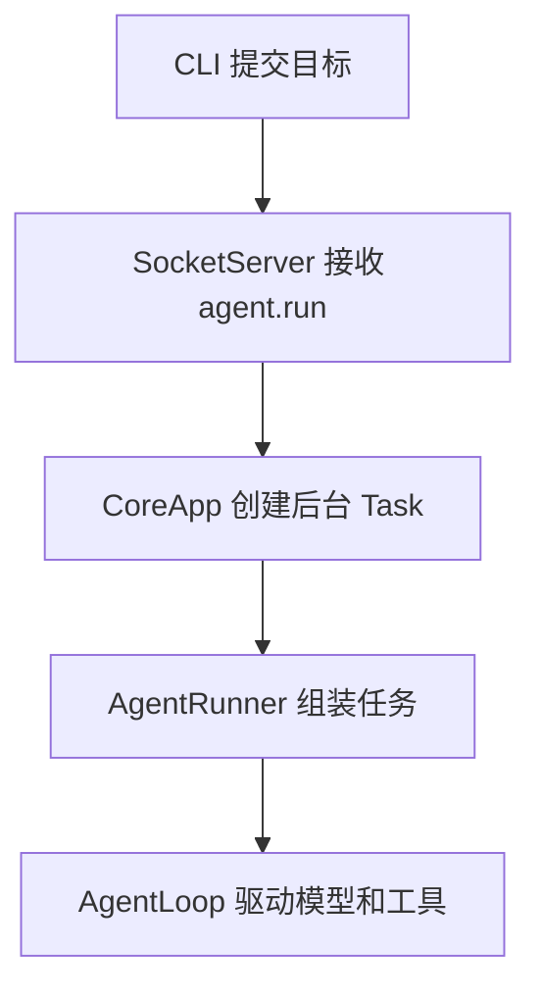
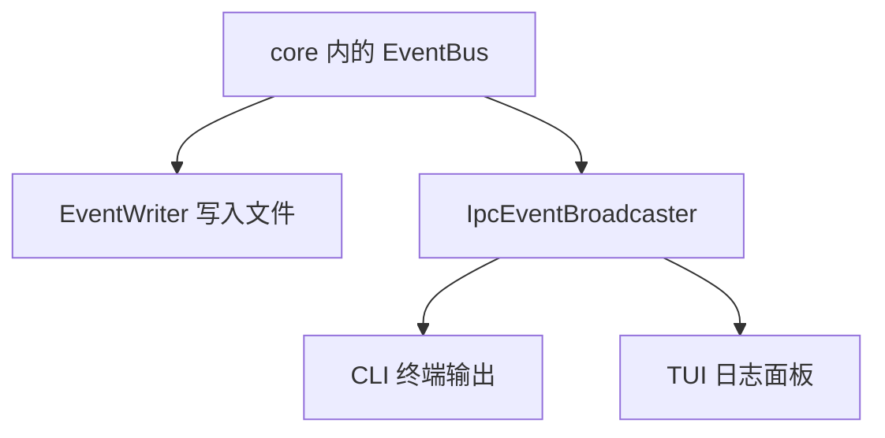

# study/s2 学习入口：守护进程、客户端与事件推送

本分支由 `study/s1` 合入 `origin/stage/s2`，保留之前的中文学习注释和 Windows 修复，并对 S2 新代码补充解释。S0、S1 讲义作为历史阶段保留；它们描述的旧架构不要直接套用到 S2。

## 1. 先理解这一阶段改变了什么

S1 在 CLI 进程中运行 AgentRunner；S2 将它移到独立的 core 守护进程中。CLI 提交目标并显示结果，TUI 观察事件。模型调用、工具执行和消息历史仍由核心进程管理。

| 问题 | S1 | S2 |
|---|---|---|
| `kama run` 在哪里执行任务？ | CLI 进程 | core 进程 |
| 是否要先启动 core？ | run 不需要，ping 需要 | run 和 TUI 都需要 |
| CLI 收到什么？ | Python 事件模型对象 | TCP 收到的 JSON 解析成 dict |
| 任务的模型与工具循环 | AgentLoop | 沿用 AgentLoop |
| 谁保存 events.jsonl？ | CLI 中的 EventWriter | core 中的 EventWriter |
| 能否有多个观察者？ | 没有远程订阅机制 | 多个客户端分别订阅同一个 core |
| TUI 的作用 | 占位入口 | 显示事件、断线重连、请求历史回放 |

“双进程”强调核心与客户端分离。实际同时打开 CLI 和 TUI 时，是一个 core 加两个客户端进程。它不表示模型请求和工具执行分别放在两个进程。

## 2. 分别看执行路线和显示路线

任务提交与执行：



事件的记录与展示：



第二张图表示接收关系，不表示并行发送。EventBus 按订阅顺序等待处理器；广播器也逐个等待连接的写缓冲。

模型看到工具结果的路线仍是：工具结果进入 Context 消息历史，然后发起下一轮模型调用。事件推送负责观察过程，不承担模型消息反馈。

## 3. 跟踪一次命令，不要把两种“完成”混淆

从 [CLI run](../src/kama_claude/cli/commands/run.py) 的 `_run_async` 开始读：

1. `connect()` 建立 TCP 连接。
2. 注册事件回调，启动独立的 `run_event_loop()` 异步任务。
3. 发送 `event.subscribe`，等待订阅确认。
4. 发送 `agent.run`，服务端返回 `run_id`。
5. 后台任务执行，事件通过同一连接持续返回。
6. 回调收到 `run.finished`，调用 `finished.set()`。
7. 主协程的 `finished.wait()` 结束，关闭接收任务和连接。

| 返回内容 | 意义 | 不代表什么 |
|---|---|---|
| 订阅响应的 `subscription_id` | 已登记事件订阅 | 已经执行任务 |
| 运行响应的 `run_id` | 已接受任务并创建后台 Task | 模型已经回答完毕 |
| `run.finished` 事件 | 业务循环结束，携带状态和步数 | 目标在语义上必然完成 |

服务器的 `create_task(runner.run(...))` 创建可被事件循环调度的任务；它没有启动新操作系统进程，也没有等待整次 run 完成。

## 4. 一个 TCP 连接如何承载两类消息

TCP 提供字节流，本项目约定每条 JSON 后加换行，称为 NDJSON。`readline()` 根据换行取出一条消息，而不是假定一次网络接收正好等于一条消息。

命令响应示意：

```json
{"jsonrpc":"2.0","id":"request-1","result":{"run_id":"run-1"}}
```

事件推送示意：

```json
{"kind":"event","event":{"type":"run.started","run_id":"run-1","goal":"读取文件","ts":"2026-10-12T00:00:00Z"}}
```

这是手写示例，完整字段见 [WIRE_PROTOCOL.md](../WIRE_PROTOCOL.md)。

[SocketClient](../src/kama_claude/core/transport/socket_client.py) 维护 `_pending` 字典，将请求 ID 对应到 Future：

| 代码动作 | 可以怎样理解 |
|---|---|
| `create_future()` | 创建一个尚未填入结果的对象 |
| `_pending[req_id] = fut` | 记住哪个请求在等待这个结果 |
| `await fut` | 当前协程暂停，其他任务继续运行 |
| `fut.set_result(result)` | 接收循环填入响应，唤醒发送命令的协程 |
| `fut.set_exception(error)` | 发送命令的协程恢复时抛出异常 |
| `fut.cancel()` | 连接退出时取消未完成的等待 |

因此必须先启动接收循环。只有 `send_command()` 而没有读取任务时，即使服务端回复了，也没有代码负责填入 Future。

回放事件可能在订阅响应之前到达。客户端依据 `jsonrpc` 或 `kind` 分流，不能简单认定“下一行就是刚才命令的响应”。事件回调也应避免在自身内部等待同一个客户端的新命令响应，否则读循环会等待回调，回调又等待读循环。

## 5. 订阅、连接上下文与回放

阅读 [CoreApp](../src/kama_claude/core/app.py)、[SocketServer](../src/kama_claude/core/transport/socket_server.py) 和 [广播器](../src/kama_claude/core/transport/ipc_broadcaster.py)。

| 名称 | 示例 | 用途 |
|---|---|---|
| `topics` | `["run.*", "llm.token"]` | 选择事件类型 |
| `scope` | `global` 或 `run:某个ID` | 选择实时事件的任务范围 |
| `replay_from_run` | 已有任务 ID | 从该任务的 events.jsonl 回放历史 |
| `writer` | StreamWriter 对象 | 向某个客户端连接写入数据 |
| `subscription_id` | `sub-...` | 标识一次订阅 |

`fnmatch` 处理通配符，`run.*` 可以匹配 `run.started` 与 `run.finished`。`any(...)` 表示只要一个模式匹配就通过。

SocketServer 的业务处理器签名只接收 `params`，没有显式传入 writer。它先将当前连接写流放进 `ContextVar`，处理器再通过 `get_connection_writer()` 取得。不同连接分别运行在不同 Task 中，上下文值不会像普通全局变量那样互相覆盖；子任务则会继承创建时的上下文。

回放是“读取历史事件再发送”，不会重新执行模型或工具。S2 先回放再注册实时订阅，没有消费序号和去重机制；TUI 重连时如果再次指定同一个回放 ID，可能再次显示历史。

## 6. TUI 中值得学的 Python 写法

阅读 [TUI 应用](../src/kama_claude/tui/app.py)，先看 `compose`、`on_mount`、`_socket_loop`，最后看格式化分支。

| 写法 | 作用 |
|---|---|
| `class KamaTuiApp(App[None])` | 继承 Textual 应用，退出不返回业务值 |
| `super().__init__()` | 初始化父类维护的框架状态 |
| `yield Label(...)` | 生成器逐个交付控件 |
| `query_one("#log", RichLog)` | 根据 ID 查找日志控件，并约束其类型 |
| `run_worker(...)` | 由框架管理长期运行的连接协程 |
| `await asyncio.sleep(2)` | 重连前异步等待，期间界面仍可响应 |
| `_token_buf += ...` | 累积模型文本，遇到其他事件再写成日志行 |

S2 TUI 主要用于观察任务；提交目标仍使用 `kama run --goal`。它并不是包含完整聊天输入框的交互式 Agent。

## 7. 在 Windows 上开始运行

在当前项目目录安装本阶段依赖：

```powershell
uv sync --group dev
```

先在一个终端启动 core，学习时可直接看到日志：

```powershell
uv run kama-core
```

在另一个终端验证连接，然后启动观察界面：

```powershell
uv run kama ping
uv run kama-tui
```

需要真实模型时，在另一个终端提交目标：

```powershell
uv run kama run --goal "读取 README.md 并概括项目用途"
```

模型配置由 core 读取，S2 仍使用 AnthropicProvider。切换分支不会清除 `.env` 或用户目录中的配置；不能因为旧分支能使用某个模型字符串，就认为 S2 的 Provider 也支持它。

也可选择后台启动方式：

```powershell
uv run kama core start
uv run kama core status
uv run kama core stop
```

前台与后台启动方式选择一种即可。`core stop` 使用 `core start` 写入的 PID 文件，不能当作停止任意手动启动 core 的通用命令；前台 core 用 Ctrl+C 退出。

本学习分支保留或补充了以下兼容修复：

| 位置 | 修复原因 |
|---|---|
| core 退出信号 | Windows 不支持 asyncio 的 add_signal_handler，回退到 signal.signal |
| pytest 临时目录 | 默认使用项目缓存，仍尊重显式临时目录设置 |
| 协议文档生成 | 明确 UTF-8 读写，避免 Windows 默认编码问题 |
| 中文事件回放 | 与 EventWriter 的 UTF-8 写入编码一致 |
| PID 存活检测 | Windows 使用进程句柄查询，避免 os.kill(pid, 0) 终止进程 |
| 后台启动 | Windows 使用 CREATE_NO_WINDOW，不额外弹出控制台 |
| 集成测试启动等待 | S2 导入依赖增多，启动上限从 3 秒调整到 10 秒 |

Windows 上后台 `core stop` 使用强制终止，不保证运行 Python 的 finally；前台 Ctrl+C 会经过本项目的退出处理。PID 文件也不验证进程身份，这是 S2 原有进程管理设计的边界。

## 8. 按问题选择测试阅读

先运行不调用真实模型的测试：

```powershell
uv run pytest tests/unit tests/integration/test_ping_roundtrip.py -v
```

| 想验证什么 | 阅读的测试 |
|---|---|
| 请求和响应如何对应 | [test_socket_client.py](../tests/unit/test_socket_client.py) |
| topic/scope 如何过滤 | [test_ipc_broadcaster.py](../tests/unit/test_ipc_broadcaster.py) |
| 断开连接如何清理订阅 | [test_socket_server.py](../tests/unit/test_socket_server.py) |
| CLI 怎样输出事件 | [test_stdout_printer.py](../tests/unit/test_stdout_printer.py) |
| TUI 怎样合并文本片段 | [test_tui_app.py](../tests/unit/test_tui_app.py) |
| Windows 新修复 | [test_s2_windows.py](../tests/unit/test_s2_windows.py) |

`MagicMock` 模拟同步方法，`AsyncMock` 模拟需要 await 的方法；`capsys` 捕获输出；`wait_for` 给异步等待设置测试上限。先看每个测试上方的目的说明，再对照准备、执行和断言三个部分。

`test_s2_dual_process.py` 会真正提交任务；即使测试只断言 run.started，后台仍可能继续进入 Provider。当本地配置了真实密钥时，不能把它当作必然离线的测试。

## 9. 三轮阅读顺序

1. **理解边界**：CLI main → CLI run → CoreApp → Runner。先回答“谁运行任务，谁只显示事件”。
2. **理解通信**：SocketClient → SocketServer → 命令模型与消息外壳 → 广播器。用请求 ID、任务 ID、订阅 ID 分别标注一次交互。
3. **理解展示与生命周期**：TUI → core 进程管理 → 对应测试。再回到 [S1 讲义](STUDY_GUIDE_S1.md) 复习 AgentLoop、Context 和工具结果如何进入下一轮模型请求。

S2 尚有一些值得后续阶段对照的问题：CLI 使用全局订阅且未按返回 run_id 过滤，等待完成时未处理所有断线路径；共享总线上的文件订阅不会主动注销；Provider 初始化异常不一定产生 run.finished。本分支保留这些阶段行为，源码注释用于帮助理解，不能据此把它们当作已经实现的可靠性保证。
