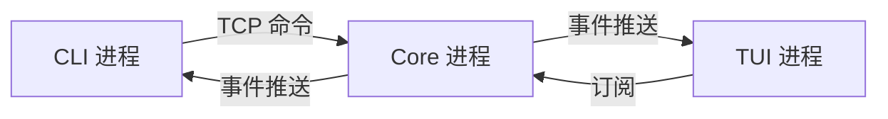
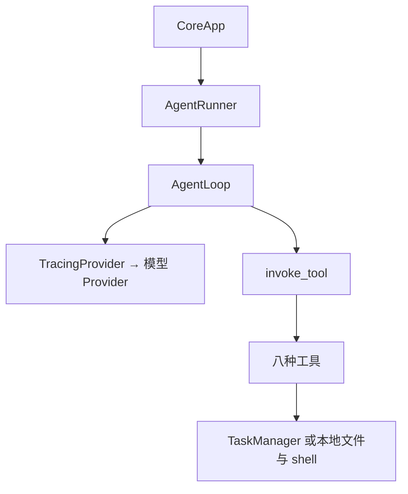
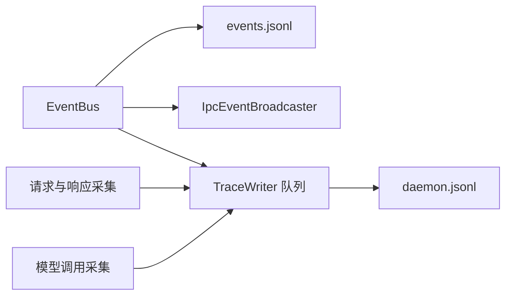
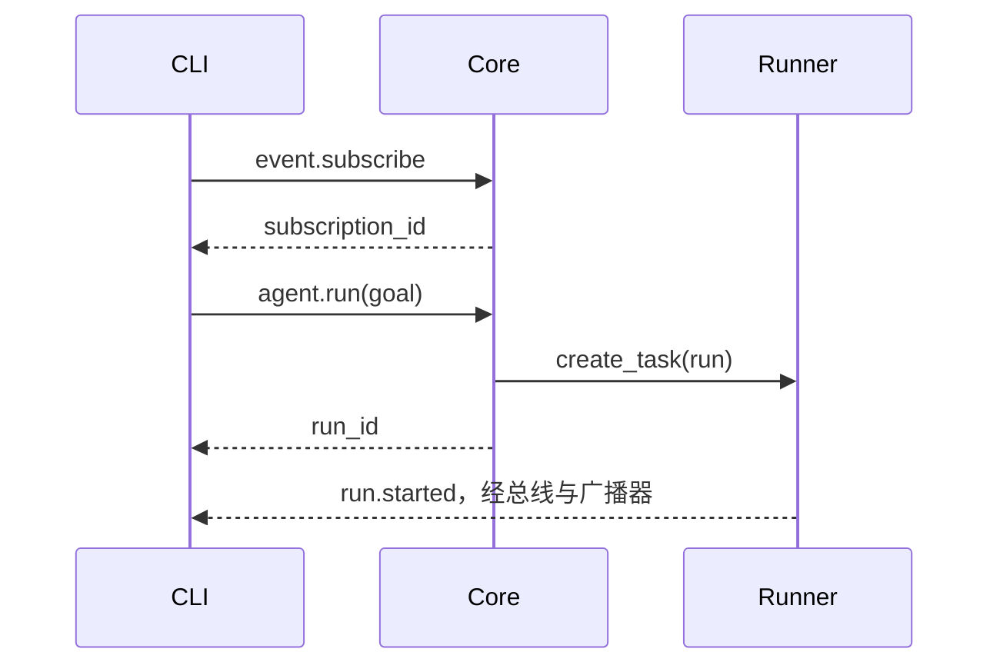
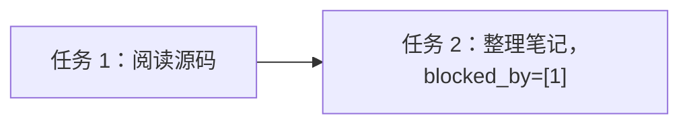
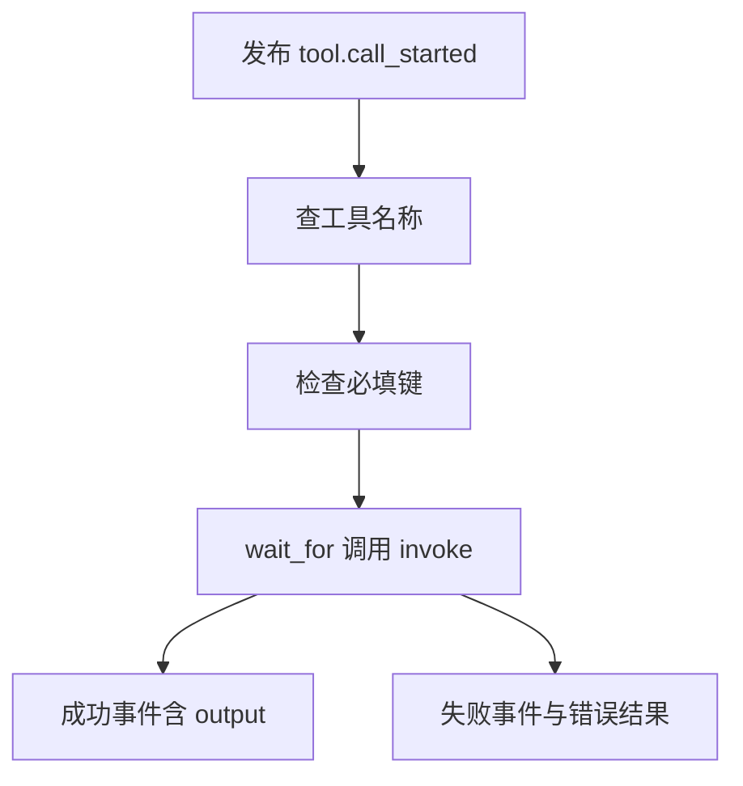
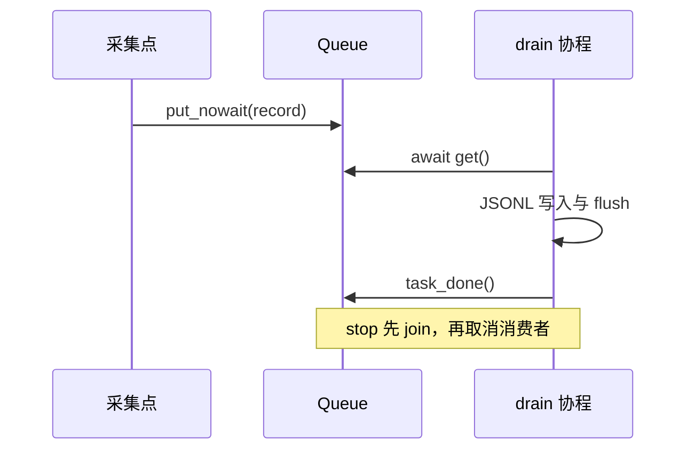
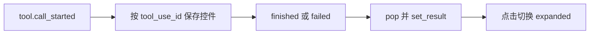

# study/s3 学习指南：任务清单、八工具、统一时间线与终端界面

> 面向已学完 S2、掌握 Python 简单语法和基本数据结构的读者。
> 对应本学习分支：完整 S2 学习成果 `7ddaf17`，合并官方 S3 `16bbe3b`（含 trace 提交 `2619e12`），并适配 Windows 与离线回归。
> 文中的模型回答、JSON 和任务编号用于解释代码，不是真实模型调用记录。

## 目录

| 章节 | 解决的问题 |
|---|---|
| [1. 阶段目标](#1-阶段目标) | 从 S2 到 S3 改变了什么 |
| [2. 架构与概念](#2-架构与概念) | 进程、run、异步 Task、业务 Task 怎样区分 |
| [3. 阅读路线](#3-阅读路线) | 从哪些源码开始，怎样逐层展开 |
| [4. 一次完整任务](#4-一次完整任务) | 从 CLI 目标到工具结果和最终回答 |
| [5. 任务模型与存储](#5-任务模型与存储) | 字段、文件、依赖和状态怎样更新 |
| [6. 八工具体系](#6-八工具体系) | 模型如何选择工具，Python 如何执行 |
| [7. 统一时间线](#7-统一时间线) | IPC、事件、模型记录怎样关联 |
| [8. TUI 终端界面](#8-tui-终端界面) | token、工具调用与结束事件怎样变成控件 |
| [9. 协议与数据结构](#9-协议与数据结构) | 命令、事件、trace、工具结果各是什么 |
| [10. Python 与异步知识](#10-python-与异步知识) | 语法、类型与库函数 |
| [11. 异常与资源清理](#11-异常与资源清理) | 错误、取消、关闭与边界 |
| [12. 配置与 Windows 运行](#12-配置与-windows-运行) | 可执行命令与兼容修复 |
| [13. 测试与练习](#13-测试与练习) | 不调用真实模型也能学会主要机制 |
| [14. 自测与答案](#14-自测与答案) | 检验是否能独立解释系统 |
| [15. 分支与验证说明](#15-分支与验证说明) | 官方功能、学习增量与交付证据 |

第一遍读第 1～4 节，建立整体地图；第二遍对照第 5～8 节打开源码；第三遍做第 13 节练习并追踪错误和清理路径。遇到陌生语法查第 10 节，不需要先通读全部库文档。

此前讲义保留为阶段历史：[S0](STUDY_GUIDE_S0.md)、[S1](STUDY_GUIDE_S1.md)、[S2](STUDY_GUIDE_S2.md)。其中“只注册 read_file”“只允许一个 run”“RichLog 缓存输出”描述旧阶段，不能直接套用到 S3。图使用 Mermaid，每张只表达一个关系；不能渲染时，正文和表格也能独立阅读。

## 1. 阶段目标

S2 已把客户端和执行核心拆成独立进程，通过 TCP 传 JSON-RPC 命令和事件。S3 保留这条主线，丰富模型可调用的本地能力，并让执行过程更容易观察。

| 方面 | S2 | S3 当前实现 |
|---|---|---|
| 工具注册 | read_file | read_file、bash、write_file、list_dir、四个 task_* |
| 业务任务清单 | 没有 | 每个 run 的 `.tasks/task_N.json` |
| 依赖记录 | 没有 | blocked_by 列表；完成会清理其他文件中的依赖 |
| 同时受理 run | 一个任务槽 | `_running_runs` 集合，可受理多个 run |
| Python 执行结果 | run 返回 None | 保留 run，新增 run_and_capture 返回 RunOutcome |
| 最终回答 | 主要在消息/事件流 | Context.result 保存 end_turn 文本 |
| 工具成功事件 | 名称、ID、耗时等 | 增加完整 output，供 TUI 展示 |
| 观察文件 | 每 run 的 events.jsonl | 新增 daemon 级 trace，覆盖 IPC/event/LLM |
| CLI | ping/run/core/version | 新增 trace 查询与跟随 |
| TUI | RichLog 日志 | 连续文本块、工具折叠块、滚屏布局 |

### 1.1 已实现、数据定义与后续能力

“任务系统内化”在这里意味着：**模型通过工具维护自己的待办清单，文件保存在当前 run 内。** 创建一条业务 Task 不会新开一个 Agent，也不会自动调用模型。

| 层次 | 可以从代码证实什么 |
|---|---|
| 当前已实现 | 任务文件增查改、完成清依赖、八工具调用、trace、TUI 展开工具结果 |
| 已接通的通用接口 | HandlerError 能转为自定义 RPC 错误；当前 Core 三个 handler 未主动使用它 |
| 仅配置/类型约定 | router 字段存在，实际模型选择仍是 static；TaskStatus 别名不自动校验输入 |
| 当前未实现 | 自动任务调度、依赖阻止执行、拓扑排序、环检测、任务取消 RPC、TUI 输入框 |
| 后续阶段主题 | 会话与记忆、审批与策略、上下文压缩等，不属于本分支已经提供的能力 |

外部命令仍是 `core.ping`、`agent.run`、`event.subscribe`。`task_create` 是模型工具名；`task.create` 不是已注册 RPC。这个区别会影响你写测试和理解调用链。

## 2. 架构与概念

### 2.1 四个容易混淆的对象

| 名称 | 例子 | 生命周期与职责 |
|---|---|---|
| 操作系统进程 | kama-core、kama、kama-tui | 独立内存与 PID，网络通信 |
| 业务 run | 一次“阅读项目并总结”的执行 | 多轮模型请求、工具调用、事件与任务目录 |
| asyncio.Task | `create_task(runner.run(...))` | 同一事件循环内调度的协程，可等待或取消 |
| 业务 Task | id=1、subject=“阅读源码” | 一条文件待办，不会自行执行 |

一个 Core 进程可有多个 run，每个 run 各自创建 Context、TaskManager 和工具实例。不同 run 都可以有 `task_1.json`；只说“任务 1”无法跨 run 唯一定位它。

### 2.2 图 A：进程边界



“双进程”强调核心和客户端分离，不限定系统只能有两个进程。bash 工具执行时还会产生短期 shell 子进程。

### 2.3 图 B：Core 内部一次 run



Runner 组装依赖，Loop 决定每轮何时调用模型与工具。TaskManager 不知道 TCP，也不接触 SDK；工具层把模型参数转换为 Manager 或系统操作。

### 2.4 图 C：两种记录路径



EventBus 是进程内回调分发，不是 TCP，也不是另一个进程。TraceWriter 的队列把采集动作和写文件循环分开，但磁盘写入本身仍同步执行。

### 2.5 并发与隔离的准确含义

Core 删除了 S2 的“已有 run 就拒绝”检查，每次 agent.run 创建一个异步任务，放进集合，结束后 discard 移除。多个 run 在 await 位置交错推进；单个 run 的多个工具仍按顺序执行。

这不等于完整隔离：总线是共享的，当前 EventWriter 没有 run_id 过滤和退订，重叠运行时一个打开的事件文件可能记录另一个 run 的事件。TUI 的 `_current_llm` 也只有一个，交错 token 可能混入同一文本块。CLI 也采用 global 订阅且未按返回 run_id 过滤，其他 run 的结束事件可能影响当前等待。任务目录隔离成立，不能据此推导事件文件和显示层也完全隔离。

## 3. 阅读路线

链接相对本指南，可在仓库网页或编辑器中点击。先读文件职责与步骤，不必从导入列表开始逐行背库名。

| 顺序 | 源码 | 这轮要回答的问题 |
|---|---|---|
| 1 | [runner.py](../src/kama_claude/core/runner.py) | 谁创建 Manager、注册工具、返回结果 |
| 2 | [loop.py](../src/kama_claude/core/loop.py) / [context.py](../src/kama_claude/core/context.py) | 一轮如何追加消息、调用工具、判断结束 |
| 3 | [task/model.py](../src/kama_claude/core/task/model.py) | Task 有哪些字段 |
| 4 | [task/manager.py](../src/kama_claude/core/task/manager.py) | create/update 如何改变文件 |
| 5 | [task_create.py](../src/kama_claude/core/tools/builtin/task_create.py) / [task_update.py](../src/kama_claude/core/tools/builtin/task_update.py) | 参数怎样传给 Manager |
| 6 | [task_get.py](../src/kama_claude/core/tools/builtin/task_get.py) / [task_list.py](../src/kama_claude/core/tools/builtin/task_list.py) | JSON 详情与文本摘要有什么区别 |
| 7 | [invocation.py](../src/kama_claude/core/tools/invocation.py) / [registry.py](../src/kama_claude/core/tools/registry.py) | 名称查找、超时、错误事件 |
| 8 | [read_file.py](../src/kama_claude/core/tools/builtin/read_file.py) / [write_file.py](../src/kama_claude/core/tools/builtin/write_file.py) | 读取和覆盖文件 |
| 9 | [list_dir.py](../src/kama_claude/core/tools/builtin/list_dir.py) / [bash.py](../src/kama_claude/core/tools/builtin/bash.py) | 递归、子进程、超时、输出处理 |
| 10 | [trace/record.py](../src/kama_claude/core/trace/record.py) / [trace/writer.py](../src/kama_claude/core/trace/writer.py) | 记录结构与队列消费 |
| 11 | [trace/provider.py](../src/kama_claude/core/trace/provider.py) | 包装器如何保持模型接口 |
| 12 | [app.py](../src/kama_claude/core/app.py) | 共享 bus/trace 与 run 集合生命周期 |
| 13 | [socket_server.py](../src/kama_claude/core/transport/socket_server.py) / [ipc_broadcaster.py](../src/kama_claude/core/transport/ipc_broadcaster.py) | IPC trace 的采集点 |
| 14 | [tui/app.py](../src/kama_claude/tui/app.py) | 事件怎样创建或更新控件 |
| 15 | [CLI trace](../src/kama_claude/cli/commands/trace.py) / [config.py](../src/kama_claude/core/config.py) | 记录查询与配置覆盖 |

回顾网络入口可读 [CLI run](../src/kama_claude/cli/commands/run.py)、[SocketClient](../src/kama_claude/core/transport/socket_client.py)、[CLI main](../src/kama_claude/cli/main.py)。它们沿用 S2 主线，S3 并未重写通信协议。

## 4. 一次完整任务

假设目标是“阅读项目文件，建立两项学习任务，然后给出总结”。模型可能有不同决策；以下是一条便于追踪的示例。

### 4.1 提交与受理

1. CLI main 解析 `kama run`，加载配置，调用 cmd_run。
2. CLI 连接 Core，启动读循环，订阅事件，再发送 agent.run。
3. SocketServer 读 JSON 行，验证外壳，通过 method 查 handler，并记录 IPC trace。
4. CoreApp 校验 goal、生成 run_id、创建 Runner，把 runner.run 调度到后台。
5. Core 返回 AgentRunResult，服务器加上请求 id 发送响应。

**响应只表示受理。** 最终完成与否由后来 run.finished 告知；它不是最终模型回答。



事件与响应共用 TCP，调度可能交错。SocketClient 按外壳区分消息，不能假定下一行必然是刚发请求的响应。

### 4.2 Runner 的组装与收尾

| 步骤 | 对象或动作 | 产生什么 |
|---|---|---|
| 1 | 确定 run_id，mkdir | runs/<run_id>/ |
| 2 | 创建 TaskManager | .tasks/，扫描最大 ID |
| 3 | 选 bus，添加回调 | Core 总线或独立测试总线 |
| 4 | ExecutionContext | goal 作为 user 消息，step=0 |
| 5 | EventWriter 上下文 | 打开文件，订阅，发布 run.started |
| 6 | Provider 与可选包装器 | 假模型或 Anthropic；可外包 TracingProvider |
| 7 | `_build_registry` | 八工具；四个任务工具共享 Manager |
| 8 | Loop.run | 消息与工具循环，直接更新 context |
| 9 | 结束事件与结果 | 关闭文件，返回 RunOutcome |

run 只是 await run_and_capture 后忽略返回值。Core 的后台任务使用 None 返回接口；Python 调用者可用 run_and_capture 读取最终文本。

### 4.3 模型提出工具调用

模型收到目标、历史与八种工具 schema，可能返回这样的项目数据对象：

```python
ToolCallBlock(
    id="call-1",
    name="task_create",
    input={"subject": "阅读入口代码", "description": "从 Runner 进入 Loop"},
)
```

它只是“想调用什么”的数据，尚未写文件。Loop 先把它放进 assistant 的 tool_use 块，再调用 invoke_tool。


task_create 提取参数，Manager 分配 id 并保存 JSON，工具把 Task 转回 JSON 字符串。invoke_tool 发布含 output 的成功事件，Loop 把同一 content 放进 tool_result。这形成两条路径：事件供客户端观察，工具结果供模型下一轮继续决策。

### 4.4 依赖与终态

第二轮模型从工具结果拿到 id，再创建依赖第一项的第二项任务。后续 `task_update(task_id=1,status="completed")` 清掉第二项中的依赖 1，但不会自动把它改成 in_progress。

模型返回 `stop_reason="end_turn"` 时，Loop 保存最后响应 text 到 context.result，标记 success，发布 step.finished 后退出。Runner 发布 run.finished，返回 RunOutcome。

**run 成功不等于清单中所有 Task 完成。** Loop 的结束条件来自 stop_reason 与步数上限，不读取 Manager 的完成比例。

### 4.5 从哪里读取结果

| 位置 | 内容 |
|---|---|
| CLI/TUI | llm.token 文本、run.finished 状态 |
| RunOutcome.result | 最后 end_turn 文本，不拼接所有前序文本 |
| events.jsonl | 业务事件，工具成功含 output；run.finished 不含 result |
| .tasks/task_N.json | 清单当前快照，不是完整变更历史 |
| daemon trace | 多层观察记录；详细模式含 LLM 响应 text |

## 5. 任务模型与存储

### 5.1 字段

| 字段 | 类型 | 谁写入 | 用途 |
|---|---|---|---|
| id | int | Manager.create | 当前 run 目录内编号 |
| subject | str | create 参数 | 短标题 |
| description | str | create，默认空 | 详细说明 |
| status | TaskStatus | create/update | pending、in_progress、completed |
| blocked_by | list[int] | create/update/完成清理 | 前置事项编号 |
| created_at | str | create | UTC 创建时间 |
| updated_at | str | create/update/清依赖 | 最近修改时间 |

Task 是 dataclass，不是 Pydantic 模型。from_dict 显式转换并补默认值，不自动核验 status 枚举或依赖有效性。Literal 主要帮助类型检查器，update 仍需显式判断状态字符串是否合法。

### 5.2 文件与编号

```text
runs/
  <run_id>/
    events.jsonl
    .tasks/
      task_1.json
      task_2.json
```

构造 Manager 时 glob 找文件，stem 去扩展名，split 取编号，max 加一；空目录从 1 开始。重建 Manager 可以续编号，但两个同时写同一目录的实例并无锁，可能分到相同 ID。

```json
{
  "id": 2,
  "subject": "整理调用链",
  "description": "画出从 CLI 到工具执行的过程",
  "status": "pending",
  "blocked_by": [1],
  "created_at": "2026-10-13T08:00:00+00:00",
  "updated_at": "2026-10-13T08:00:00+00:00"
}
```

转换链为 `Task ↔ dict ↔ JSON 文本 ↔ UTF-8 文件`。to_dict 返回字典，json.dumps 返回字符串，write_text 才真正写磁盘。

### 5.3 create 三步

1. 检查 blocked_by 中各 ID 对应文件存在，不检查依赖是否已完成。
2. 构造 pending Task，复制依赖列表，设置创建/更新时间。
3. 保存成功后递增编号，返回对象。

`blocked_by or []` 会把 None 和空列表都当作无依赖。list 复制防止调用者后来直接修改同一个列表。

### 5.4 update 的实际顺序

1. load 当前文件，不存在抛 ValueError。
2. 给了 status 就验证并赋值；completed 立即扫描其他文件清依赖。
3. add 列表用 set 去重；remove 列表用推导式删除。
4. 刷新 updated_at，保存当前 Task，返回对象。

新增依赖在 update 中不检查存在性；set 不保证原顺序；同一 ID 同时加入与删除，最后会被删除。清理其他文件发生在保存当前文件之前，多文件更新不是事务。

### 5.5 依赖清理例子



执行 update(1, status="completed") 后：

| 记录 | 更新前 | 更新后 |
|---|---|---|
| 任务 1.status | pending 或 in_progress | completed |
| 任务 2.blocked_by | [1] | [] |
| 任务 2.status | pending | 仍然 pending |

箭头只表示记录的前置关系，没有后台执行器。常用顺序是 pending → in_progress → completed，但代码允许直接完成，也允许 completed 改回 pending；已清除的依赖不会自动恢复。

### 5.6 get 与 list

get 返回 Task；list_all 按数字 ID 排序；format_list 转成文本：

```text
[x] #1: 阅读源码
[ ] #2: 整理笔记
[>] #3: 执行测试 (blocked by: [2])
```

list_all 跳过部分损坏记录，但排序在 try 之外，非法文件名和 I/O 错误仍可能传播。有 except 不等于所有失败都被忽略。

## 6. 八工具体系

### 6.1 注册表连接模型说明与 Python 实现

[BaseTool/ToolResult](../src/kama_claude/core/tools/base.py) 定义约定，Registry 保存实例。name 用于查找，description 和 input_schema 提供给模型。描述不会自动执行，也不会自动实现其宣称的限制。

| 工具 | 主要参数 | 结果与副作用 |
|---|---|---|
| read_file | path | 读取 UTF-8 文本，返回内容截到 512 KiB |
| write_file | path、content | UTF-8 创建/覆盖，补父目录，内容上限 1 MiB |
| list_dir | path、max_depth | 树状文本，默认深度 2，上限 4，总条目上限 200 |
| bash | command、timeout | 系统 shell 执行，合并 stdout/stderr |
| task_create | subject，可选 description/blocked_by | 新建 pending 文件，返回 JSON |
| task_update | task_id，可选 status/add/remove | 更新文件，completed 清依赖 |
| task_get | task_id | 返回完整 JSON |
| task_list | 无必填参数 | 返回带状态符号的文本摘要 |

### 6.2 invoke_tool 公共流程



区分两类失败：工具返回 ToolResult(is_error=True)，以及工具抛异常。公共层把多数普通异常转成失败结果，模型下一轮可以修正参数。取消异常向上传播，不作为普通工具错误吞掉。

必填检查只看键是否存在，不完整验证类型、数组元素和 enum。`task_id="abc"` 在工具内部转 int 失败，由外层转为 runtime_error。schema 既是模型说明，又是有限校验的来源，不能把两者混为完整验证。

### 6.3 文件工具

`Path(path_str).parts` 拆分路径组件，检查完整的 `..`。描述要求相对 cwd，但实现也接受不含 `..` 的绝对路径；没有解析符号链接后限制根目录。它们不是完整文件沙箱。

read_file 一次 read_bytes 读入整个文件，再截前 512 KiB 解码；所以限制的是返回内容，不是读取峰值内存。截断可能切开 UTF-8 字符，errors="replace" 会替换无法解码部分。

write_file 先 encode 计算 UTF-8 字节数，再 mkdir 补父目录，最后 write_text 覆盖文件。字符数与字节数不同，中文通常占多个 UTF-8 字节。

list_dir 的内部 `_walk` 是嵌套递归函数。nonlocal count 共享全树计数，sorted 按 `(是否文件, 名字)` 排序，enumerate 提供序号以选择树线。隐藏条目也会列出，深度和条数用于控制展示规模。

### 6.4 bash 的进程和超时

1. 取 command 和 timeout；默认 60 秒，参数上限 120 秒。
2. create_subprocess_shell 创建 shell，PIPE 捕获输出，STDOUT 合并错误流。
3. communicate 收完管道并等进程退出，wait_for 负责超时。
4. 超时时 kill 直接子进程，再 communicate 回收；正常时 UTF-8 解码并检查退出码。

工具名叫 bash，但没有指定 executable。Windows 通常使用 cmd.exe，POSIX 通常使用 /bin/sh；打开 Git Bash 终端不代表这个工具就使用 Git Bash。

当前输出先全部收集再截断，不是流式内存上限；按字节判断超限后按字符截取，并非严格 64 KiB 结果。Windows 命令可能用本地代码页输出，UTF-8 replace 解码可能出现乱码。kill 直接 shell 不等于回收完整子进程树，外层取消也没有完整进程树 finally。

### 6.5 async 接口不等于内部全部非阻塞

write_file、list_dir、任务工具的 async invoke 主要执行同步 Path/JSON 操作，没有 await。这期间不会自动切换协程；wait_for 不能抢占同步文件操作。统一异步接口让调用方用相同方式调用工具，并不会自动创建工作线程。

## 7. 统一时间线

### 7.1 三类文件各回答什么

| 文件 | 范围 | 用途 |
|---|---|---|
| runs/<id>/events.jsonl | 由该 run writer 订阅写入 | 业务进度与历史回放 |
| ~/.kama/traces/daemon.jsonl | daemon 级 | 命令、响应、推送、业务事件、模型接口的联合观察 |
| ~/.kama/logs/core.log | 服务日志 | 监听、配置、处理异常等诊断 |

trace 不是另一套业务状态，也不是恢复执行的事务日志。CLI trace 读取文件，不会重新调用工具或模型。

### 7.2 TraceRecord 字段

| 字段 | 含义 | 例子 |
|---|---|---|
| ts | UTC 采集时间字符串 | ISO 格式 |
| direction | 数据方向 | CLIENT→CORE、CORE→CLIENT、CORE、CORE→LLM、LLM→CORE |
| layer | 观察层 | ipc、event、llm |
| kind | 具体动作 | command、response、error、push、event、api_call、api_response |
| run_id | 可选 run 关联 | event/LLM/push 常有；请求响应通常无顶层值 |
| step | 可选轮次 | Loop 传给 TracingProvider |
| client_id | 可选连接标识 | peername 的字符串 |
| data | 异构字典 | params、事件、模型消息或响应 |

下面是模型接口摘要，不能当成完整 HTTP 请求：

```json
{"ts":"2026-10-13T08:00:00+00:00","direction":"CORE→LLM","layer":"llm","kind":"api_call","run_id":"demo-run","step":2,"client_id":null,"data":{"message_count":3,"tool_count":8}}
```

### 7.3 采集点

| 位置 | 内容 | 注意 |
|---|---|---|
| SocketServer._handle_line | 已校验外壳的 command | 非法 JSON 不会产生同样的 command 记录 |
| SocketServer._send | response/error | drain 后记录，顶层未填 run_id |
| IpcEventBroadcaster.handle | 每个实际推送的 push | data 主要是 sub_id/event_type |
| CoreApp._trace_event_handler | 完整业务事件 | 一个事件与多个 push 是不同观察角度 |
| TracingProvider.chat | 请求前 api_call、正常返回后 api_response | 异常不补 api_response |

按 run_id 筛选会漏掉部分握手记录；“没查到 command”不等于没有发过命令。一个事件广播给两位订阅者，会留下两条 push。

### 7.4 模型包装器的五步

1. 根据 include_payload 选择 messages/tool_schemas 或仅数量。
2. emit api_call，取 monotonic 起点。
3. await inner.chat，原样传递 step。
4. 算 latency_ms，用 dataclasses.asdict 转换工具调用和用量，emit api_response。
5. 原样返回 LlmResponse，Loop 不需要知道启没启 trace。

包装器不记录 SDK 后续补上的完整 system/cache_control/HTTP headers，也不负责重试。include_llm_payload=False 仅减少 LLM 层载荷，IPC params、业务 token、工具 output 仍可能包含正文。

### 7.5 队列消费与关闭



emit 不等待落盘；join 等每个 put 对应的 task_done，不是等文件关闭。stop 随后取消正在等下一条的消费者，await 它完成，让 with 释放文件。

队列无大小上限，data 内嵌套对象不是完整深复制快照。写入失败没有后台恢复，消费者失败且仍有积压时 join 可能一直等待。flush 刷新 Python 缓冲，不等于磁盘 fsync。

### 7.6 trace CLI

cmd_trace 展开文件路径，逐行 UTF-8 读取；_process_line 校验 TraceRecord，再依次应用 run/layer/direction 条件。raw 输出原 JSON 行，默认输出彩色摘要。

follow 初次读完后重新打开并 seek 到末尾，再轮询。两次打开之间新增行可能跳过，也不处理文件轮转。time.sleep(0.05) 同步阻塞适用于这个独立 CLI 路径，它没有运行 asyncio 事件循环。

## 8. TUI 终端界面

### 8.1 对象与字段

| 对象 | 关键字段 | 谁更新 |
|---|---|---|
| LLMStreamBlock | _text | append_token，随后 Static.update |
| ToolCallBlock | 名称、参数、output、耗时、is_error、finished | started 创建，finished/failed 设置结果 |
| KamaTuiApp | _client、_current_llm、_pending_tool_blocks、连接参数 | socket worker 与事件处理器 |

`core.llm.types.ToolCallBlock` 是模型请求数据；`tui.app.ToolCallBlock` 是控件。名字一样，职责与父类不同。

### 8.2 生命周期

1. compose 生成 header 与 VerticalScroll。
2. on_mount 启动 socket worker，让主界面继续响应点击和 q。
3. 连接后启动读循环、注册回调、订阅事件。
4. 事件回调创建或更新控件。
5. 断线时关连接、清当前文本块引用，等两秒再重连。

yield 把子控件交给框架建界面，不是发布业务事件。mount 把控件加入已经存在的滚屏容器，scroll_end 滚到底部。

### 8.3 连续 token

首个 token 创建 LLMStreamBlock；后续连续 token 追加同一 _text，每次立即 update。任意非 token 事件调用 _break_llm，下一段 token 新开块。S2 的“先缓存直到非 token 再整段输出”解释已经过时。

### 8.4 工具配对



同一工具能多次调用，所以键是 tool_use_id，不能用工具名。结束事件没有匹配块时不新建替代块。failed 显示错误色与文本，只有 finished 后点击才展开详情，CSS 类控制可见性。

### 8.5 界面范围

S3 没有目标输入框、审批弹窗或任务看板。CLI 提交、TUI 观察。重连回放无游标去重；多 run token 不按 run_id 分块；断线遗留 pending 块也没有完整重建流程。单元测试主要验证数据与控件变化，不代表所有真实终端尺寸均已人工检查。

## 9. 协议与数据结构

### 9.1 五种表示

| 表示 | 类型 | 使用位置 |
|---|---|---|
| 网络外壳 | JsonRpcRequest/Success/Error、EventPushEnvelope | TCP 一行一条 JSON |
| 业务模型 | AgentRunCommand、Event | Core 校验与总线 |
| 模型响应 | LlmResponse、模型 ToolCallBlock | Provider 与 Loop |
| 工具结果 | ToolResult | 工具与 Loop |
| 文件待办 | Task + task_N.json | TaskManager |

完整生成契约见 [WIRE_PROTOCOL.md](../WIRE_PROTOCOL.md)，模型定义见 [commands.py](../src/kama_claude/core/bus/commands.py)、[events.py](../src/kama_claude/core/bus/events.py)、[envelope.py](../src/kama_claude/core/bus/envelope.py)。

### 9.2 消息例子

```json
{"jsonrpc":"2.0","id":"req-1","method":"agent.run","params":{"goal":"阅读 README 并总结"}}
```

```json
{"jsonrpc":"2.0","id":"req-1","result":{"run_id":"demo-run"}}
```

```json
{"kind":"event","event":{"type":"tool.call_finished","run_id":"demo-run","tool_use_id":"call-1","tool_name":"task_list","elapsed_ms":2,"output":"[ ] #1: 阅读源码","ts":"2026-10-13T08:00:00+00:00"}}
```

id 关联请求响应；run_id 关联一次执行；tool_use_id 关联一次模型工具调用；Task.id 是本地待办编号。四者不能互换。

### 9.3 两层错误

RPC METHOD_NOT_FOUND 表示未注册 method；工具 runtime_error 表示某次模型请求执行失败，通常会回到下一轮模型。两者不在同一层。

HandlerError 保存 code/message/data，服务器支持转换它；但没有因此实现 TASK_NOT_FOUND=-32003 等 task RPC。旧的官方 task_graph 测试引用了不存在接口，不能据此反推功能。

### 9.4 三套状态

| 对象 | 状态与控制者 |
|---|---|
| ExecutionContext | running → success/failed，由 Loop/取消处理更新 |
| Task | pending/in_progress/completed，Manager 保存，无严格迁移图 |
| asyncio.Task | 未完成、完成、取消等，由事件循环调度 |

取消 run 不会自动把磁盘任务全部改成 cancelled；TaskStatus 里就没有 cancelled。

## 10. Python 与异步知识

### 10.1 类型和对象

| 语法 | 这里的含义 | 不代表什么 |
|---|---|---|
| `str \| None` | 字符串或空值 | 不自动提供默认值 |
| `list[int]` | 整数列表类型提示 | 不自动逐项校验 |
| `dict[str, Any]` | 字符串键，宽松值类型 | 不保证能序列化任意对象 |
| `Literal[...]` | 静态允许值；Pydantic 可据此校验 | dataclass 不自动执行校验 |
| `@dataclass` | 自动构造、比较、显示 | 不是存储引擎 |
| `@classmethod` | cls 接收类 | 不要求先有实例 |
| `*, step=0` | 必须用名称传 step | 不能作为普通位置参数 |
| `Protocol` | 接口形状约定 | 不强制具体类继承它 |

LLMProvider 用 Protocol；假模型提供相容的 chat 即可注入。Mypy 检查接口，测试检查行为，两者互补。

### 10.2 数据转换

```python
record_dict = task.to_dict()               # 项目：Task → dict
text = json.dumps(record_dict)            # 标准库：dict → 字符串
path.write_text(text, encoding="utf-8")    # 标准库：写磁盘
```

Pydantic model_dump 返回 dict，model_dump_json 返回字符串，model_validate 验证 Python 数据并创建模型；dataclasses.asdict 是标准库函数，递归转换 dataclass，不是 Pydantic 方法。

### 10.3 容器与闭包

| 用法 | 目的 |
|---|---|
| set.add/discard | 保存 run，完成后移除；discard 不因不存在报错 |
| list(the_set) | 快照遍历，允许回调修改原集合 |
| dict.pop | TUI 取出并删除待完成工具块 |
| 列表推导式 | 重建清除依赖后的列表 |
| sorted + lambda | 按数字 ID 或目录类型排序 |
| nonlocal count | 递归函数修改外层计数 |
| get(...) or default | 缺失或假值均回退，不只是 None |

例如 timeout=0 会被 `or 默认值` 当作未给；不要只看 schema 推断边界行为。

### 10.4 await、Task 与进程

- 调用 async 函数得到协程对象，不代表已执行完。
- await 等当前操作完成，遇到可等待 I/O 时允许别的任务推进。
- create_task 安排协程并让调用方继续，不创建操作系统进程。
- Popen/create_subprocess_shell 才创建进程，有独立 PID。
- gather 等多个对象，return_exceptions=True 把异常收集为结果，常用于统一清理。
- cancel 发出请求，通常在下一个可响应取消点抛 CancelledError，不是立刻强制停止所有工作。

Loop 的 `for ...: await invoke_tool(...)` 是顺序执行。其他 run 可在等待时推进，但同一轮工具不会自动并行。

### 10.5 队列、上下文与回调

Queue.get 在空时等待；put_nowait 立即入队；task_done 减少未完成计数；join 等计数归零。这与业务 Task.status 无关。

async with EventWriter 会 await 进入与退出方法，即使内部异常也尝试关闭文件；它不会自动取消任意其他后台任务。`add_done_callback(self._running_runs.discard)` 传的是函数对象，不加括号；任务结束时框架传入那个 Task 并调用它。

### 10.6 库归属速查

| 来源 | 例子 | 作用 |
|---|---|---|
| 内置 | int、str、list、set、len、enumerate、sorted、open | 转换、容器、遍历、文件入口 |
| 标准库 pathlib | Path、glob、stem、mkdir、read_text/write_text | 路径与文件 |
| 标准库 asyncio | Task、Queue、wait_for、gather、create_subprocess_shell | 调度与异步 I/O |
| 标准库 json/dataclasses | loads/dumps、dataclass/asdict | 数据组织与序列化 |
| 标准库 time/datetime | monotonic、UTC、isoformat | 耗时与时间戳 |
| 第三方 Pydantic | BaseModel、model_validate | 校验与序列化 |
| 第三方 Textual | App、Static、Widget、VerticalScroll、run_worker | 界面与生命周期 |
| 第三方 Anthropic | AsyncAnthropic、messages.stream | 真实模型请求 |
| 项目自定义 | TaskManager.create、invoke_tool、EventBus.publish | 必须查本项目实现的业务函数 |

## 11. 异常与资源清理

### 11.1 正常关闭顺序

Core 等待函数优先使用事件循环原生信号 API，Windows 不支持时回退同步 signal。前台退出后，本学习分支在 finally 中执行：


Runner 捕获取消，记 cancelled 原因，尝试发结束事件并关文件，再重新抛出取消异常。Core 用 gather 收集结果，避免首个 CancelledError 打断后续清理。信号等待函数退出时恢复原处理器，防止永久改变进程级设置。

### 11.2 错误分层

| 出错位置 | 当前行为 |
|---|---|
| JSON/请求外壳 | SocketServer 返回协议错误 |
| 未注册 method | -32601 |
| 未知工具/缺必填键 | 失败事件与错误 ToolResult |
| 工具普通异常/超时 | 多数转成工具错误，模型可继续 |
| Provider.chat 普通异常 | Loop 标记 llm_error 并退出 |
| 达到 max_steps | 未 end_turn 时 exceeded_max_steps |
| run 取消 | cancelled，收尾后传播 CancelledError |
| 缺模型 key | Provider 构造抛 SystemExit，不在 Loop 普通异常捕获范围 |
| trace 消费者失败 | 没有完整后台恢复，不保证还能排空 |

end_turn 判断先于上限，最后一步完成仍成功。模型异常 break 路径不发 step.finished，不能假设所有 started 都有对应 finished。启动期间尚未进入信号等待 try/finally 时发生错误，也没有覆盖全部资源的完整清理栈。

### 11.3 Windows 修复延续

| 修复 | 位置 | 目的 |
|---|---|---|
| 信号回退与恢复 | Core `_wait_for_shutdown` | Windows 不支持 add_signal_handler |
| PID 存活查询 | CLI `_windows_pid_exists` | 避免 Windows os.kill(pid,0) 误终止进程 |
| 无窗口后台启动 | CLI core start | CREATE_NO_WINDOW；POSIX 仍新会话 |
| 明确 UTF-8 | 回放/PID/事件与新增 task/trace | 避免默认代码页破坏中文、箭头、emoji |
| 项目内临时目录 | conftest | 保留旧修复，尊重显式 basetemp |
| 启动等待 10 秒 | running_daemon | 轮询真实端口就绪，容许 SDK 冷启动 |

Windows 后台 core stop 使用 os.kill(SIGTERM)，通常是强制结束，不保证 Python finally。前台 Ctrl+C 更适合学习优雅退出。PID 文件也没有完整防 PID 复用身份验证；start 返回只代表创建进程，不保证端口就绪。

### 11.4 当前边界

TaskManager 没有事务、环检测和自动执行；工具没有完整权限审批/沙箱；多 run 事件文件与界面未全面隔离；历史回放没有游标去重；trace 是诊断记录而不是事务数据库。这些是阅读现有实现的准确边界，本学习分支没有把它们扩展为后续阶段架构。

## 12. 配置与 Windows 运行

### 12.1 配置优先级

默认 → TOML → .env → 已存在系统环境。实现先 load_dotenv(override=False)，再确定配置路径、读 TOML，最后应用环境变量。先加载 .env 是为了让其中 KAMA_CONFIG 也能选中配置文件，已有系统变量不会被覆盖。

| 配置 | 环境变量 | 默认/说明 |
|---|---|---|
| host | KAMA_HOST | 127.0.0.1 |
| port | KAMA_PORT | 7437 |
| logging.level | KAMA_LOG_LEVEL | INFO |
| logging.file | KAMA_LOG_FILE | ~/.kama/logs/core.log；空串不写文件 |
| logging.format | KAMA_LOG_FORMAT | text |
| agent.max_steps | KAMA_MAX_STEPS | 20，必须正整数 |
| llm.default_model | KAMA_LLM_DEFAULT_MODEL | claude-sonnet-4-6；服务实际可用性另定 |
| trace.enabled | KAMA_TRACE_ENABLED | True |
| trace.file | KAMA_TRACE_FILE | ~/.kama/traces/daemon.jsonl |
| trace.include_llm_payload | KAMA_TRACE_INCLUDE_LLM_PAYLOAD | True |
| 配置路径 | KAMA_CONFIG | ~/.kama/config.toml |

trace 布尔环境字符串 0/false/no（忽略大小写）表示假，其他字符串均真。TOML 要求真正的布尔类型。示例：

```toml
[core]
host = "127.0.0.1"
port = 7437

[agent]
max_steps = 20

[trace]
enabled = true
file = "runs/daemon-trace.jsonl"
include_llm_payload = false
```

可保存到自己选择的文件，再用 KAMA_CONFIG 指向它。关闭 LLM payload 不会禁止其他层记录正文。

### 12.2 无模型调用的前台启动

以下使用 PowerShell，各终端保持相同 cwd 和地址：

```powershell
Set-Location 'W:\Code\GitHubProject\KamaClaude'
uv sync --frozen
$env:PYTHONIOENCODING = 'utf-8'
$env:KAMA_HOST = '127.0.0.1'
$env:KAMA_PORT = '7437'
$env:KAMA_TRACE_FILE = 'runs/daemon-trace.jsonl'
uv run kama-core
```

第一个终端保留运行，第二个执行：

```powershell
Set-Location 'W:\Code\GitHubProject\KamaClaude'
$env:KAMA_HOST = '127.0.0.1'
$env:KAMA_PORT = '7437'
uv run kama --version
uv run kama ping
```

启动 daemon、version、ping 不主动调用模型。前台 Ctrl+C 停止。若端口被占用，先辨认已有服务用途，或为各终端设置同一个新端口。

### 12.3 TUI 与 trace

```powershell
uv run kama-tui
uv run kama-tui --replay '实际-run-id'
```

两条是不同启动方式，先退出一个再运行另一个；q 退出。回放参数替换成存在的 run_id。

```powershell
$env:PYTHONIOENCODING = 'utf-8'
$env:KAMA_TRACE_FILE = 'runs/daemon-trace.jsonl'
uv run kama trace --layer ipc
uv run kama trace --layer llm --raw
uv run kama trace --direction 'CORE→LLM'
uv run kama trace '实际-run-id' --follow
```

trace 文件须先存在。查看终端与 daemon 要设置同一路径。raw 可能输出目标、文件内容和工具结果，分享前自己检查具体内容。

### 12.4 后台与真实模型

```powershell
uv run kama core start
uv run kama core status
uv run kama ping
uv run kama core stop
```

start 不等待就绪，立即 ping 可能暂时失败，可稍后重试。Windows 后台 stop 不保证清理，学习生命周期优先用前台。

下面会使用真实模型并可能产生费用，仅在你要真实运行时执行：

```powershell
uv run kama run '读取 README.md，列出主要模块并总结'
```

本次交付没有执行该命令或付费模型测试，没有显示 .env 内容。使用自己的本地凭据，不将密钥写入讲义、命令记录或提交。

### 12.5 完全离线的任务实验

此命令只用临时目录操作任务文件，不启动 daemon 或模型：

```powershell
uv run python -c 'from pathlib import Path; from tempfile import TemporaryDirectory; from kama_claude.core.task.manager import TaskManager; folder=TemporaryDirectory(); m=TaskManager(Path(folder.name)); a=m.create("read source"); b=m.create("draw flow", blocked_by=[a.id]); print(m.format_list()); m.update(a.id,status="completed"); print(m.get(b.id).to_dict()); folder.cleanup()'
```

第二项 blocked_by 从 [1] 变 []，status 仍 pending。若想逐行调试，将下面代码放入自己的临时练习文件，用 uv run python 执行：

```python
from pathlib import Path
from tempfile import TemporaryDirectory
from kama_claude.core.task.manager import TaskManager

with TemporaryDirectory() as folder:
    manager = TaskManager(Path(folder))
    first = manager.create("阅读 Runner")
    second = manager.create("画调用链", blocked_by=[first.id])
    print(manager.format_list())
    manager.update(first.id, status="completed")
    print(manager.get(second.id).to_dict())
```

这里的标准库上下文管理器会在退出时清理临时目录。

## 13. 测试与练习

### 13.1 区分测试成本

| 类别 | 内容 | 真实模型 |
|---|---|---|
| tests/unit | 替身模型、任务/文件工具、trace、TUI、Windows 回归 | 否 |
| ping / S2 双进程集成 | 真实子进程与 TCP，offline_daemon 固定模型响应 | 否 |
| S3 task_graph | 假模型驱动真实 Runner/Loop/task 工具；RPC 检查旧接口未注册 | 否 |
| test_run_e2e.py | 真模型读取文件并回答 | 是，需凭据且可能收费 |

[离线 daemon](../tests/offline_daemon.py) 只用于测试，替换模型边界，保留真实 Core/TCP/Runner。共享夹具在临时 cwd 启动，不加载项目 .env，不写生产 runs 或用户 trace。

真实 e2e 文件收集时会加载 .env，离线命令直接 ignore 整个文件，避免只是选择测试却仍执行模块加载。

### 13.2 推荐测试顺序

```powershell
uv run pytest tests/unit/test_task_model.py tests/unit/test_task_manager.py -v
uv run pytest tests/unit/test_builtin_tools.py tests/unit/test_s3_windows.py -v
uv run pytest tests/unit/test_trace_writer.py tests/unit/test_tracing_provider.py -v
uv run pytest tests/unit/test_tui_app.py -v
uv run pytest tests/integration/test_s3_task_graph.py -v
```

完整离线检查：

```powershell
uv run pytest tests/unit tests/integration --ignore=tests/integration/test_run_e2e.py -q
uv run ruff check src tests scripts
uv run mypy src
uv run python scripts/gen_protocol_doc.py --check
```

也可直接使用现有 .venv 中的 python/ruff/mypy。本次验证使用现有虚拟环境，未为测试改依赖版本。

### 13.3 怎样读测试

| 测试 | 阅读目标 |
|---|---|
| [task_model](../tests/unit/test_task_model.py) | Task 与 dict 往返 |
| [task_manager](../tests/unit/test_task_manager.py) | 编号、依赖清理、列表和异常 |
| [builtin_tools](../tests/unit/test_builtin_tools.py) | shell 退出/超时、文件与目录 |
| [trace_writer](../tests/unit/test_trace_writer.py) | 顺序、停止排空、JSONL |
| [tracing_provider](../tests/unit/test_tracing_provider.py) | 详细/摘要模式、step、透传结果 |
| [tui_app](../tests/unit/test_tui_app.py) | token 复用和工具配对 |
| [S2 Windows](../tests/unit/test_s2_windows.py) | PID 不杀进程、无窗口、中文回放 |
| [S3 Windows](../tests/unit/test_s3_windows.py) | task 各读写路径与 trace CLI UTF-8 |
| [app_shutdown](../tests/unit/test_app_shutdown.py) | 信号注册回退、恢复与取消 |
| [S3 集成](../tests/integration/test_s3_task_graph.py) | 四任务工具真实回填、八工具注册、事件与 trace |

先读“功能/设计”，找输入与断言，再跟源码。假模型控制的是边界，不表示 Runner、工具、文件或 TCP 也是假的。

### 13.4 递进练习

1. **画对象图：** 分清每 run 的 Context/Manager 与共享 bus/trace。
2. **手算更新：** 第三项依赖前两项，完成第一项后写出实际变化字段，再运行验证。
3. **追工具结果：** 从 create 返回 JSON，经 invoke_tool、Context 到下一轮 messages。
4. **比较 trace：** include_payload 真/假时分别检查哪类记录省略什么字段。
5. **预测界面：** token A、token B、step.started、token C 会产生几个文本块，各是什么内容。
6. **观察错误：** 不存在的 task_id，直接 Manager.get 与通过工具调用的行为有何差异。
7. **进阶设计：** 如果要阻止依赖未完成任务执行，应在哪层加约束？先写设计与测试意图，不将当前清单当调度器。

## 14. 自测与答案

| 问题 | 答案要点 |
|---|---|
| task_create 启动新 Agent 吗 | 不会，只创建当前 run 的待办文件 |
| 四个工具为何共用 Manager | 共用清单目录和编号分配 |
| asyncio.Task 与业务 Task 的关系 | 一个执行协程，一个保存待办，无自动调度关联 |
| completed 要求依赖为空吗 | 当前不要求 |
| run success 能证明清单全完成吗 | 不能，Loop 看模型结束与步数 |
| 成功事件为何加 output | TUI 展开显示，事件/trace 可观察结果 |
| 关闭 LLM payload 是否全局去正文 | 否，只改变 LLM 层 |
| Queue.join 等线程结束吗 | 否，等 task_done 计数归零 |
| create_task 创建进程吗 | 否 |
| Windows bash 工具一定用 Git Bash 吗 | 否，使用平台默认 shell |
| task.create RPC 返回什么 | 未注册，-32601 |
| 为什么先等 run 再停 trace | 收尾事件仍能入队与落盘 |
| async 中 write_text 自动进线程吗 | 不会 |
| dataclass Literal 自动校验吗 | 不会 |
| 为何不能用 tool_name 配对 | 同名工具可多次调用，要用调用 ID |

能不看源码讲清“工具结果回模型”与“事件回客户端”两条路径，就掌握了最关键的结构。

## 15. 分支与验证说明

分支从 `codex/structure-s2-comments` 的 `7ddaf17` 创建，包含 study/s2 全部历史，再真实合并 origin/stage/s3。全部工作在当前目录完成，没有 worktree，也没有覆盖此前学习分支。

相对官方 S3 的额外内容：前阶段与本阶段结构化中文注释、S0～S3 讲义、Windows 信号/PID/后台启动及 UTF-8 兼容、回归测试、离线模型入口、旧 S3 测试适配。业务架构仍以官方为准，不新增任务 RPC 或自动依赖调度。

实际测试、AST 对照、协议生成校验与未进行的检查见 [S3 验证记录](S3_VALIDATION.md)。它区分文档示例和本次实测，也列出额外代码差异的原因。
