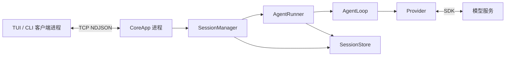
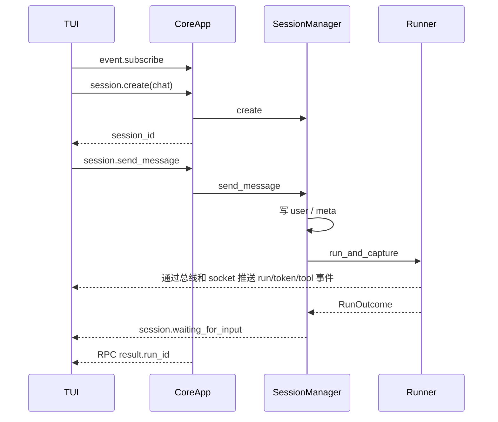
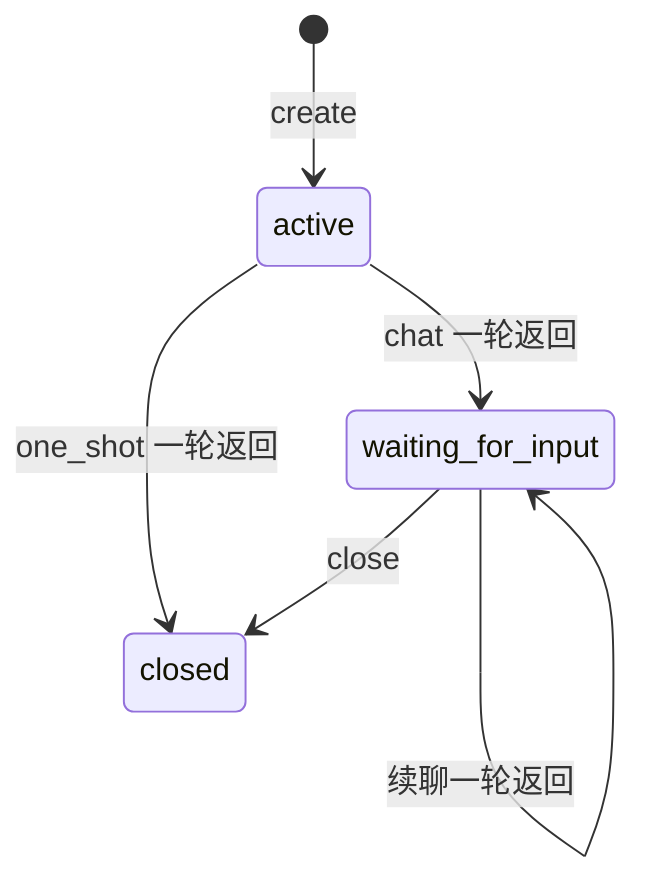
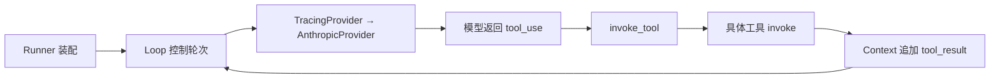
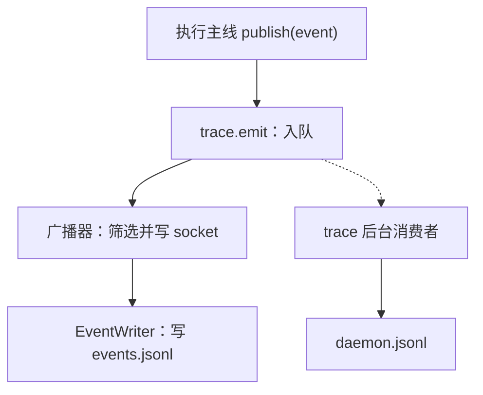

# S4 学习指南：会话、消息历史、主动笔记与 TUI 输入

对应 `study/s4`，官方基础为 `stage/s4` 的 `9ffbcc4`，学习基础为 S3 的 `e1346d6`。先读本文建立整体模型，再沿源码注释展开；验证证据见 [S4 验证记录](S4_VALIDATION.md)。此前的 [S3 指南](STUDY_GUIDE_S3.md) 保留为历史讲义。

## 目录

- [1. 阶段目标与变化](#1-阶段目标与变化)
- [2. 整体架构与对象](#2-整体架构与对象)
- [3. 推荐阅读顺序](#3-推荐阅读顺序)
- [4. 一次对话的完整旅程](#4-一次对话的完整旅程)
- [5. 会话与记忆的实现](#5-会话与记忆的实现)
- [6. 模型与工具的往返](#6-模型与工具的往返)
- [7. 事件通信和日志](#7-事件通信和日志)
- [8. TUI 输入与显示](#8-tui-输入与显示)
- [9. Python 阅读补课](#9-python-阅读补课)
- [10. 异常取消与实现边界](#10-异常取消与实现边界)
- [11. 配置与 Windows 运行](#11-配置与-windows-运行)
- [12. 测试练习与答案](#12-测试练习与答案)

## 1. 阶段目标与变化

S3 主要回答“怎样执行一次目标并观察过程”；S4 回答“下一次输入怎样接着上一次对话继续”。最外面新增 SessionManager，内部仍沿用 Runner → Loop → Provider → 模型。

| 方面 | S3 | 当前 S4 |
| --- | --- | --- |
| 用户输入 | CLI 一次目标，TUI 观察 | TUI 多行输入、CLI chat、多轮 session |
| 执行组织 | 一次 run 独立执行 | 一个 session 包含多次 run；agent.run 自动创建 one_shot |
| 模型历史 | Context 主要在内存 | thread.jsonl 保存消息，每轮完整读回 |
| 主动记忆 | 无 | note_save 追加 notes.md，下轮作为 system 指令的一部分 |
| 工具 | 八种 | 会话执行九种；直接无会话 Runner 仍八种 |
| 待办依赖 | TaskManager 保存与清依赖 | 不变，没有自动调度器 |
| 通信与观测 | TCP、EventBus、trace | 保留，增加 session 命令/事件 |
| 跨平台 | 学习分支 Windows 修复 | 继承并把 chat 纳入退出回收 |

官方提交称“分层语义记忆”，实际实现要从代码理解：当前是完整对话文件与主动笔记文件两条路径，没有向量数据库、语义检索、自动压缩、跨会话检索，也没有启动时恢复磁盘会话索引。不要把后续阶段规划读成 S4 已实现。

## 2. 整体架构与对象



箭头表示调用或使用，不意味着每个框都是线程。Core 通常只有一个 asyncio 事件循环：当某个协程 `await` 网络时，其他就绪协程有机会运行。同步文件 IO 仍会占用当前线程。

| 名称 | 保存或执行什么 | 生命周期与创建者 |
| --- | --- | --- |
| 进程 | Python 程序、内存、事件循环 | shell/Popen 启动 CLI、TUI、Core |
| session | 会话模式、状态、标题、run_ids | SessionManager.create 创建 |
| run | 当前用户输入的一次 Agent 执行 | 每次 send_message 生成新 run_id |
| asyncio.Task | 被事件循环调度的协程 | create_task 创建；完成/取消后结束 |
| 业务 Task | subject、status、blocked_by 等待办数据 | 模型调用 task_create，由 TaskManager 保存 |
| Context | 本轮历史、step、status、result、notes 快照 | Runner 每轮新建，Loop 更新 |

一个 session 可以有多个 run；一个 run 可以创建多个业务 Task，也可以没有。业务 Task 的 ID 从本轮 `.tasks` 中分配，不是全局 ID；下一轮历史虽然知道上轮 task_id，新一轮 TaskManager 也不会自动加载上轮待办。

## 3. 推荐阅读顺序

第一遍只回答“谁调用、保存什么、交给谁”，不要卡在每个类型标注上。

| 顺序 | 源码 | 第一遍的问题 |
| --- | --- | --- |
| 1 | [core/app.py](../src/kama_claude/core/app.py) | 七个 RPC 怎么接入？agent.run 与 session.send_message 返回时机有何差别？ |
| 2 | [session/model.py](../src/kama_claude/core/session/model.py) | session 和 run_id 如何关联？ |
| 3 | [session/manager.py](../src/kama_claude/core/session/manager.py) | 一条输入怎样被保存、执行、转成等待状态？ |
| 4 | [session/store.py](../src/kama_claude/core/session/store.py) | 哪些内容写文件？传给模型时丢掉哪些元数据？ |
| 5 | [runner.py](../src/kama_claude/core/runner.py) | 历史、notes、九工具怎样装配？ |
| 6 | [context.py](../src/kama_claude/core/context.py) 与 [loop.py](../src/kama_claude/core/loop.py) | 一轮内部怎样多次调用模型？ |
| 7 | [llm/provider.py](../src/kama_claude/core/llm/provider.py) 与 [trace/provider.py](../src/kama_claude/core/trace/provider.py) | 谁真正调用 SDK？谁只包装观测？ |
| 8 | [note_save.py](../src/kama_claude/core/tools/builtin/note_save.py) | 模型怎样决定保存笔记？ |
| 9 | [tui/app.py](../src/kama_claude/tui/app.py) | 输入消息和 Core 事件分别走哪条路径？ |
| 10 | [cli/commands/chat.py](../src/kama_claude/cli/commands/chat.py) | 阻塞 input 如何不阻塞网络接收？ |

其余全部源文件索引见 [S4 项目架构地图](PROJECT_STRUCTURE.md)。

## 4. 一次对话的完整旅程

### 4.1 TUI 创建会话并发送第一条消息



1. [TUI 入口](../src/kama_claude/tui/__main__.py) 读取连接配置，创建 KamaTuiApp。
2. `compose` 产出顶部 Label、滚动区域、ChatTextArea；`on_mount` 启动 socket worker。
3. `_socket_loop` 建立连接，登记事件回调并创建接收协程，订阅事件，再创建 chat session。
4. 输入 Enter 产生 Textual 的 `Submitted` 消息。App 清空/禁用输入、设置 `_busy=True`，发送 RPC。
5. SocketServer 解析一行 NDJSON，校验 JSON-RPC，再按 `method` 找 CoreApp handler。
6. SessionManager 取会话及其锁，检查 busy/closed，追加 user 消息，发布 message_received；生成 run_id，写 meta。
7. 工厂创建 Runner。Runner 从 Store 读历史和 notes，构造新 Context、TaskManager、工具表、EventWriter、Provider。
8. Loop 请求模型；有工具就执行并回填，有最终回答就结束。token 事件在模型响应尚未完整返回时已经可以显示。
9. Runner 发布 run.finished，关闭 EventWriter，将 `context.messages[prefill_len:]` 追加到 thread，返回 RunOutcome。
10. SessionManager 将 chat 置为 waiting_for_input，发事件、写 meta，最后返回 run_id。TUI 根据事件恢复输入。

消息历史不通过 TUI 保持。第二轮 TUI 只提交新文字和 session_id，Core 重新读 thread，把上轮回答、工具请求/结果连同新问题传给模型。

### 4.2 旧入口仍保留

`kama run --goal ...` → `agent.run` → 创建 one_shot session → 后台 `asyncio.Task` 执行 send_message → 立即返回 run_id。一轮结束后会话自动 closed。CLI 等 run.finished；它可能在 session.closed 之前退出。

`kama chat` 使用同样的 session RPC。它用 `run_in_executor(None, input, prompt)` 在线程池等终端输入，同时接收协程继续读网络。一次 send_message 返回后才读下一条。

## 5. 会话与记忆的实现

### 5.1 三个核心对象

| 对象/字段 | 创建与更新 | 读取者/用途 |
| --- | --- | --- |
| Session.id/mode | create 时确定 | 目录定位；one_shot/chat 决定结束行为 |
| status | create=active；run 返回后 waiting_for_input/closed | Manager 校验关闭；UI 接收对应事件 |
| title | 初始可指定，否则首次消息前 40 字符 | meta 保存，当前没有会话选择面板 |
| created_at/updated_at | UTC ISO 字符串 | 保存元数据，非超时计时器 |
| run_ids | 每轮开始前追加 | meta 中关联历史 run |
| Manager._sessions | 内存字典，由 create 登记 | `_get_session` 查询；不自动恢复旧文件 |
| Manager._locks | 每会话一把 asyncio.Lock | send_message/close 防同会话重入 |
| Store._root | Core 启动时传入 | `~/.kama/sessions`，当前无独立配置键 |



图表达元数据值，不是完整执行状态机：续聊时发布 resumed，但代码没有先把 status 改回 active。“忙”由锁表示；不要仅看 status 判断是否正在执行。失败 RunOutcome 也可能回到等待，因为 Manager 当前不检查 outcome.status。取消会跳过后续状态更新。

### 5.2 磁盘布局

```text
~/.kama/sessions/sess-xxxxxxxxxxxx/
  meta.json                  会话元数据与 run_ids
  thread.jsonl               user/assistant 模型消息
  notes.md                   note_save 主动追加的笔记
  runs/<run_id>/
    events.jsonl             运行期间收到的业务事件
    .tasks/task_1.json       本轮待办条目（创建后才存在）
```

没有 note_save 调用时 notes.md 可以不存在；没有 task_create 时 `.tasks` 可以为空。无会话的直接 Python Runner 调用仍使用 `runs/<run_id>`，这是测试与兼容入口，不是 S4 daemon 的默认会话路径。

### 5.3 完整历史与增量写回

Manager 在运行前写本轮 user。Runner 读取历史 `history`，记住 `prefill_len=len(history)`，Context 用 `[dict(m) for m in history]` 复制外层消息字典。结束后只追加切片 `messages[prefill_len:]`，避免把所有旧消息再写一遍。

典型 thread 行（下面每一行都是单独 JSON 对象）：

```jsonl
{"ts":"2026-10-14T00:00:00+00:00","role":"user","content":"读取 README"}
{"ts":"2026-10-14T00:00:01+00:00","role":"assistant","content":[{"type":"tool_use","id":"call-1","name":"read_file","input":{"path":"README.md"}}],"run_id":"run-example"}
{"ts":"2026-10-14T00:00:02+00:00","role":"user","content":[{"type":"tool_result","tool_use_id":"call-1","content":"文件正文"}],"run_id":"run-example"}
```

Store 读取时剥离 ts/run_id，只返回模型接受的 role/content。它会跳过坏 JSON 行和未知 role；这不是完整 schema 校验。`_trim_orphan_tool_use` 维护 pending ID 集合：遇到调用加入，遇到结果删除，记住最近一次集合为空的位置。末尾若还有未配对调用，只返回此前安全前缀，不改原文件，也不重新执行工具。

### 5.4 主动笔记

模型看到 note_save schema 后，可以提出 `{"content":"项目使用 Python 3.12"}`。实际工具追加带时间/run_id 的 Markdown 小节，返回 `saved`；TUI 将成功摘要显示为 remembered。

下一轮 Runner 读 notes 全文，Context.system_prompt 把它拼接到基本 system 指令，Loop 传给 Provider；TracingProvider 必须透传 system。工具刚写笔记时，本轮 `session_notes` 快照不会自动更新，但本轮历史已经有这次工具调用/结果。

没有自动去重、筛选、检索或长度限制；模型是否调用 note_save 取决于它的决策。空 notes 时 system_prompt 直接返回 base，代码不会额外拼接记笔记提醒，不过工具描述仍存在。

## 6. 模型与工具的往返



| 层次 | 具体职责 | 不应混淆的点 |
| --- | --- | --- |
| ToolRegistry.tool_schemas | 把名称、描述、参数 schema 给模型 | 不是执行函数，也不触发工具 |
| 模型 tool_use | 提出 id/name/input | 模型无法直接调用本地 Python |
| invoke_tool | 查表、检查必填参数、超时、事件和异常转换 | 不是完整 JSON Schema 校验器 |
| 工具 invoke | 读写文件、执行 shell、管理待办或写笔记 | 真正副作用在这里发生 |
| Context | 保存 assistant 请求和 user 工具结果 | 工具结果是下一次模型的输入 |
| AgentLoop | 决定继续下一轮或终止 | 多个工具顺序 await，不自动并行 |

例如模型请求 read_file，工具返回文件正文；Loop 将结果与原 tool_use_id 关联，再次请求模型。模型第二次才可基于正文回答。这是“观察结果后继续决策”的实现，不是工具自己调用模型。

待办依赖通常由模型在 task_create 的 blocked_by 或 task_update 参数中提出，TaskManager 保存进 JSON。完成父任务会清理其他条目的相应依赖。没有任何代码因依赖清空而 create_task 执行子任务；也没有强制所有待办 completed 才允许模型 end_turn。

## 7. 事件通信和日志

### 7.1 五个名称各司其职

| 名称 | 代码/含义 | 与执行主线的关系 |
| --- | --- | --- |
| bus 数据模型 | [bus/events.py](../src/kama_claude/core/bus/events.py)、[commands.py](../src/kama_claude/core/bus/commands.py) | 定义命令/事件字段，不是服务 |
| EventBus | [events/bus.py](../src/kama_claude/core/events/bus.py) | 执行过程发布进度，顺序调用订阅者 |
| IPC | 进程间通信这一用途 | 将命令交给 Core，将事件送回界面 |
| socket | [transport](../src/kama_claude/core/transport/socket_server.py) 的 TCP 字节传输 | NDJSON 分帧，JSON-RPC 关联请求/响应 |
| trace | [trace/writer.py](../src/kama_claude/core/trace/writer.py) 等采集器 | 观察 IPC、事件、模型调用，不驱动 Agent |

### 7.2 回调何时执行

`bus.subscribe(handler)` 只将函数对象加入列表；没有括号调用 handler。`await bus.publish(event)` 才遍历列表，对同一个 event 按注册顺序逐个 `await handler(event)`。当前没有并发 fan-out、异常隔离或退订接口。慢回调拖慢发布者；回调异常阻止后续回调并向上传播。

Core 启用 trace 时先登记 trace 回调，再登记广播器，Runner 后登记 EventWriter。多次并发 publish 在 await 处可能交错，所以“单次发布内顺序”不等于全系统事件都有一个不可交错的事务顺序。



Trace 的 emit 使用 Queue.put_nowait，后台协程 get 后写 UTF-8 文件，再 task_done。Queue.join 等未完成计数清零；不是等队列“看起来为空”，也不是证明数据已物理刷盘。网络 StreamWriter.drain 是发送流量控制，不能证明客户端已收取或处理响应。

### 7.3 为什么日志不一一对应

events.jsonl 记录订阅 EventBus 期间收到的业务事件；trace 包含 ipc/event/llm 三个观察位置。一条事件可能产生一条 event trace、多个客户端 push trace；一次模型调用另有 api_call/api_response 或 api_error。

session.created/message_received 在本轮 EventWriter 打开前，waiting_for_input 在关闭后，因此不能假设本轮 events.jsonl 包含完整会话生命周期。共享总线上的 EventWriter 还没有 run_id 过滤/退订，重叠运行可能混入其他 run 的事件。thread.jsonl 是模型消息，不是 events.jsonl 的别名。

### 7.4 协议例子

```json
{"jsonrpc":"2.0","id":"1","method":"session.create","params":{"mode":"chat","title":"学习 S4"}}
```

```json
{"jsonrpc":"2.0","id":"2","method":"session.send_message","params":{"session_id":"sess-example","content":"继续解释上面的函数"}}
```

| 命令 | 返回内容/时机 |
| --- | --- |
| session.create | session_id/status；只创建会话 |
| session.send_message | run_id；本轮运行返回后 |
| session.get_history | messages；读取保存的模型历史 |
| session.close | status=closed；忙时拒绝 |
| agent.run | run_id；后台运行尚未完成也可返回 |

请求 id 用于 SocketClient 的 Future 匹配；session_id/run_id 是业务标识。完整模型与事件外壳见自动生成的 [WIRE_PROTOCOL.md](../WIRE_PROTOCOL.md)。

## 8. TUI 输入与显示

`ChatTextArea.Submitted` 是 Textual 界面消息；`SessionWaitingForInputEvent` 是 Core 业务事件。两者名称都叫“消息/事件”，但所属系统不同。

| 操作/事件 | 当前行为 |
| --- | --- |
| Enter | 非空文本提交；拦截默认换行 |
| Ctrl+J、Shift/Alt/Super+Enter | 插入换行；具体组合受终端键码支持影响 |
| Ctrl+Q | 尝试 session.close 后退出 |
| 提交 | 清空输入、禁用输入、busy=True、追加用户行 |
| llm.token | 追加到当前 LLMStreamBlock 的字符串并 update |
| 非 token 事件 | finalize Markdown 并结束当前连续块 |
| tool.call_started/finished | 按 tool_use_id 创建/完成 ToolCallBlock |
| waiting_for_input | busy=False、启用并聚焦输入 |
| 断线重连 | 新建客户端和新 chat session；不是恢复原 session |

Textual socket worker 独立接收消息，所以发送处理函数等待 RPC 时仍可更新 token。Static.update 只调用一个控件也可能引发布局重算；不能说“绝不影响布局”。连续 token 通常合并在一个块中，但 usage 等非 token 事件也会切断块。

本分支用 Textual `run_test`/Pilot 验证挂载、真实键盘消息、多轮输入和本地 TCP，会话模型为 fake。这是自动化组件/集成验证，不是人工在真实终端里检查所有窗口尺寸和快捷键。

## 9. Python 阅读补课

| 写法 | 来源与含义 | 本项目位置 |
| --- | --- | --- |
| dataclass / field(default_factory=list) | 标准库生成初始化方法；每实例独立列表 | Session、Context |
| str 或 None 的联合类型 | 类型提示允许两种值，不自动校验 | system、session 等可选参数 |
| Literal / Protocol | typing 声明有限值/结构接口 | SessionStatus、LLMProvider |
| Pydantic BaseModel | 第三方数据校验和序列化 | RPC、事件 |
| Callable[[], AgentRunner] | 无参数、返回 Runner 的可调用对象 | runner_factory |
| lambda: AgentRunner(...) | 保存延迟创建对象的小函数 | CoreApp 接线 |
| async def | 调用后得到协程，必须 await 或调度才执行 | send_message |
| await | 暂停当前协程，等结果或异常 | 网络、锁、模型 |
| create_task | 把协程安排到事件循环并返回 Task | 后台 run、socket 接收 |
| async with lock | 等待锁并保证退出时释放 | 同会话串行控制 |
| async with EventWriter | 调用异步进入/退出方法打开/关闭文件 | Runner |
| add_done_callback(fn) | Task 完成后调用 fn(task) | 回收集合 discard |
| dict(m)、切片 | 内置浅复制、选择列表一段 | 历史预填与增量写回 |
| TYPE_CHECKING | 类型检查为真，运行时为假 | 避免循环导入 |
| run_in_executor(None, input, prompt) | 标准库在线程池执行阻塞函数，返回可等待对象 | CLI chat |
| Textual run_worker/post_message | 第三方管理后台协程/投递界面消息 | TUI |

`asyncio.Task` 与 `Future` 也不同：Task 驱动协程；Future 是可等待的结果占位。SocketClient.send_command 创建 Future，接收循环按响应 id 设置结果，发送者才从 await 恢复。

取消不是同步“杀死函数”。Task.cancel 请求在协程可响应的位置抛 CancelledError；finally/上下文管理器负责清理。同步文件读写或阻塞函数期间不能假设立即取消。

## 10. 异常取消与实现边界

| 路径 | 实际处理 | 阅读提示 |
| --- | --- | --- |
| 不存在/关闭/忙会话 | HandlerError -32010/-32011/-32012 | busy 直接拒绝，不是后台排队 |
| 模型普通异常 | trace 记 api_error 后原样抛出；Loop 标记 llm_error | 上层转换失败不等于包装器吞异常 |
| Provider 构造普通异常 | Runner 捕获并标记 llm_error | SystemExit 不是 Exception，缺凭据仍有特殊边界 |
| 工具异常/超时 | invoke_tool 转 ToolResult 错误并回填 | 模型下一轮可能调整 |
| 取消 | Loop/Runner 记录 cancelled，发结束事件，关闭文件，追加已生成历史后重抛 | Manager 锁释放，等待事件可能不产生 |
| Core 前台退出 | 取消并等待登记的 one_shot/chat run，再停 server/trace | 学习分支把 chat 补入回收集合 |
| Windows 后台 stop | 使用进程终止机制 | 不能保证运行 Python finally |

SessionStore 的工具配对裁剪让下次读取避开未完成尾部，但不是事务回滚。文件写入失败、事件回调异常、trace 消费者失败等路径也没有通用恢复系统。

当前其他边界：

- Store 能读 meta，不等于 Manager 会启动恢复。Core 重启后旧 session_id 在内存索引里不存在。
- SocketServer 同连接逐条 await handler；一个长 send_message 会延后同连接的 close。TUI 的 Ctrl+Q 不等于取消当前模型请求。
- 不同 session 可同时运行，但 TUI 全局订阅没有完整 session/run 过滤，token 和 busy 状态可能受别的会话影响。
- 没有 session.list/resume RPC、自动摘要、压缩、任务自动调度、权限审批或安全沙箱。
- Thread 全文读取与文件写入是同步操作；历史越长，请求越大，不会自动按 token 预算截断。
- 工具相对路径以 Core 工作目录为基准；bash 取消不保证整个子进程树被回收。

## 11. 配置与 Windows 运行

### 11.1 位置和默认值

配置实际以 [config.py](../src/kama_claude/core/config.py) 为准。优先级是默认值 → TOML → `.env` → 已有环境变量。实现上先 `load_dotenv(".env", override=False)`，再确定 KAMA_CONFIG，读 TOML，最后应用环境变量。因此 `.env` 中 KAMA_CONFIG 也能选择配置文件，已有同名环境变量仍优先。

| 配置 | 默认值 | 环境变量 |
| --- | --- | --- |
| 配置文件 | ~/.kama/config.toml | KAMA_CONFIG |
| host/port | 127.0.0.1 / 7437 | KAMA_HOST / KAMA_PORT |
| logging | INFO、~/.kama/logs/core.log、text | KAMA_LOG_LEVEL / KAMA_LOG_FILE / KAMA_LOG_FORMAT |
| agent.max_steps | 20 | KAMA_MAX_STEPS |
| llm.default_model | claude-sonnet-4-6 | KAMA_LLM_DEFAULT_MODEL |
| llm.router | static（目前无动态路由） | 无对应环境变量，TOML 可设置 |
| trace | enabled=true、include_llm_payload=true | KAMA_TRACE_ENABLED / KAMA_TRACE_INCLUDE_LLM_PAYLOAD |
| trace.file | ~/.kama/traces/daemon.jsonl | KAMA_TRACE_FILE |
| session 根目录 | ~/.kama/sessions | 当前无 KAMA_SESSION_* 配置 |

模型 Provider 显式要求环境变量 ANTHROPIC_API_KEY，并传给 SDK；仅设置 AUTH_TOKEN 不能绕过这项检查。服务地址等 SDK 配置不属于 KamaConfig 的 TOML 字段。不要把真实密钥写进学习文档或验证输出。

```toml
[core]
host = "127.0.0.1"
port = 7437
[agent]
max_steps = 20
[llm]
default_model = "claude-sonnet-4-6"
router = "static"
[trace]
enabled = true
file = "~/.kama/traces/daemon.jsonl"
include_llm_payload = true
```

Core 启动时读取配置，更改模型、端口、trace 等需重启 Core；只重启 TUI 不改变运行中的 Core。CLI/TUI 各自读取连接配置，地址必须匹配。notes 每轮重新读取，无需为新笔记重启；重启反而会丢失内存 session 索引。

### 11.2 PowerShell 命令

```powershell
Set-Location W:\Code\GitHubProject\KamaClaude
# 前台启动，不会仅因启动就发模型请求
.venv\Scripts\kama-core.exe
```

另一个终端：

```powershell
Set-Location W:\Code\GitHubProject\KamaClaude
.venv\Scripts\kama.exe ping
.venv\Scripts\kama-tui.exe
```

输入并提交目标会请求真实模型，以下只是运行方式说明，本次验证没有执行：

```powershell
.venv\Scripts\kama.exe chat
.venv\Scripts\kama.exe run --goal "解释 README"
```

临时修改端口需两个终端一致：

```powershell
$env:KAMA_PORT = "7440"
# 设置后重新启动对应 Core/客户端
```

Windows 下优先前台 Ctrl+C 观察清理。后台 start 使用隐藏窗口参数，PID 存活检查采用 Windows 查询接口而非 os.kill(pid, 0)，避免误终止进程。保留的 trace 读取按行尝试 UTF-8 与旧 GB18030，支持旧记录和新 UTF-8 混合；不是把整份历史强制按单一代码页解码。

## 12. 测试练习与答案

### 12.1 从测试理解功能

| 测试 | 观察重点 |
| --- | --- |
| [test_session_store.py](../tests/unit/test_session_store.py) | meta/thread/notes、孤立工具尾部裁剪 |
| [test_session_manager.py](../tests/unit/test_session_manager.py) | 模式、状态、拒绝关闭会话 |
| [test_runner.py](../tests/unit/test_runner.py) | 历史与 system 注入、note_save 真正注册和执行 |
| [test_s4_session_ipc.py](../tests/integration/test_s4_session_ipc.py) | 真实 JSON-RPC 创建、读历史、关闭 |
| [test_s4_tui_offline.py](../tests/integration/test_s4_tui_offline.py) | Pilot 键盘、多轮提交、真实 socket 与 UTF-8 落盘 |
| [test_app_shutdown.py](../tests/unit/test_app_shutdown.py) | Windows 信号回退、one_shot/chat 取消及清理顺序 |
| [test_s3_windows.py](../tests/unit/test_s3_windows.py) | 中文待办、UTF-8 与旧编码 trace |
| [test_tracing_provider.py](../tests/unit/test_tracing_provider.py) | system 透传、api_error 后异常继续传播 |
| [test_s3_task_graph.py](../tests/integration/test_s3_task_graph.py) | 清依赖不自动执行、真实 Loop 与工具结果回填 |

```powershell
.venv\Scripts\python.exe -m pytest tests/unit/test_session_store.py tests/unit/test_session_manager.py tests/unit/test_runner.py -q
.venv\Scripts\python.exe -m pytest tests/integration/test_s4_tui_offline.py -q
```

离线 daemon 仅替换模型边界，保留 TCP/Core/SessionManager/Runner；测试使用临时 HOME 和 cwd。完整离线套件要显式排除 `test_run_e2e.py`，该文件需要真实服务/凭据，不能混入免费本地验证。

### 12.2 循序渐进练习

1. 不运行代码，画出 session_id → 多个 run_id → 每轮 .tasks 的关系，指出哪些状态会写磁盘。
2. 读 Store 测试，将消息内容换成中文和 emoji，预测 JSONL 行与 read_messages 返回值的差异。
3. 给 fake Provider 连续返回一次 note_save 和一次 end_turn，观察 notes.md 与 thread 的不同内容；再启动同会话第二轮，检查 system 包含笔记。
4. 在独立测试中构造 tool_use 无结果的尾部，调用 read_messages，观察返回列表裁剪但原文件未改。
5. 用 Pilot 提交两条输入，观察 busy、输入框 disabled、run 目录数量；无需真实模型。
6. 阅读取消测试，标出 cancel 发起者、CancelledError 接收者、文件关闭和 trace.stop 的先后。

### 12.3 自测与答案要点

| 问题 | 答案要点 |
| --- | --- |
| 一轮 run 和模型一步有什么不同？ | 一条用户输入启动 run；run 内 Loop 可请求模型多次，每次是 step。 |
| 为什么不每轮把 goal 再 append？ | Manager 已写当前 user；完整 history 已含它，再写会重复。 |
| note_save 是否使下一步 system 立刻改变？ | 不会重读本轮 notes 快照；下一轮 Runner 才重新加载，当前历史仍含工具结果。 |
| 模型 end_turn 是否证明待办全部完成？ | 否，Loop 不遍历 TaskManager 检查完成状态。 |
| dependencies 清空会启动 asyncio.Task 吗？ | 不会；依赖是数据，执行仍由模型后续工具决策推进。 |
| EventBus.subscribe 是否立刻执行回调？ | 否，只存函数；publish 按注册顺序 await。 |
| drain 成功能否证明 TUI 已显示？ | 否，只是发送端流量控制；客户端还要收包和更新控件。 |
| 同一事件为什么有多个 trace？ | 内部发布、每次网络推送和模型调用是不同采集点。 |
| 重启 Core 能继续旧 session_id 吗？ | 当前不能自动恢复索引；文件保留不等于会话可恢复。 |
| waiting_for_input 能否证明上一轮成功？ | 不能，Manager 当前不检查 RunOutcome.status。 |
| 一次 Static.update 是否完全不影响布局？ | 不能保证，内容大小变化可能触发布局。 |

学习完成标准：不用逐行背代码，能够从输入解释到历史预填、工具回填、笔记保存、事件返回、状态收尾，并明确指出每一步由哪个对象负责。
