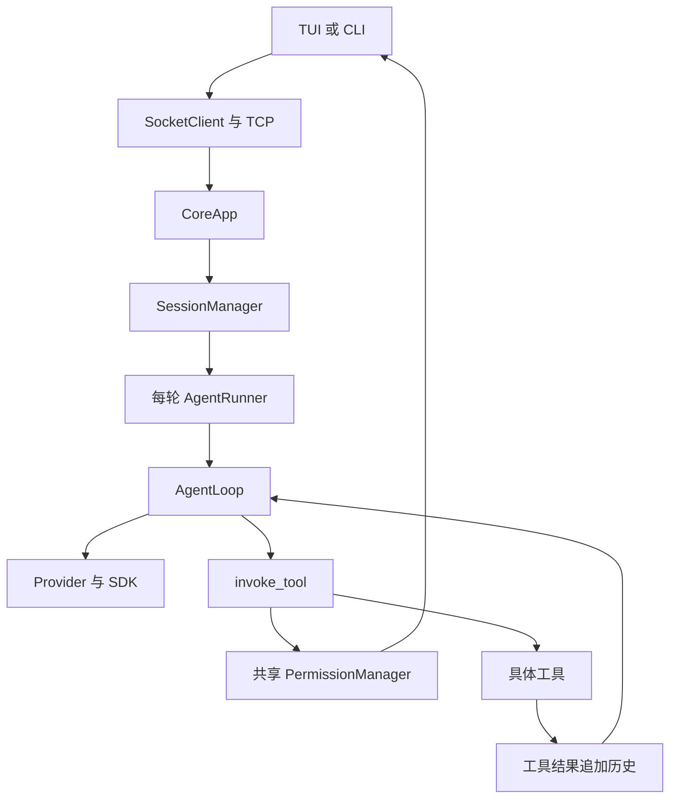
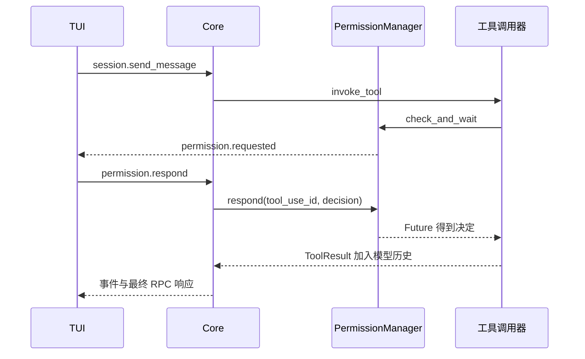
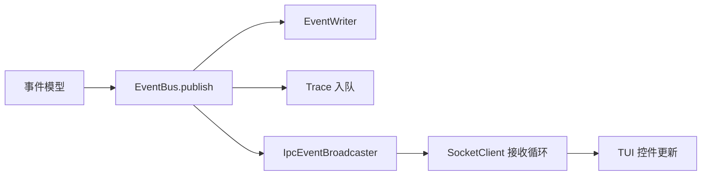

# S5 学习指南：让工具执行经过审批

本讲义对应 `study/s5`，官方基线为 `7738b8f`。先读全局图，再追踪一次写文件，最后研究 Future、重试与收尾。S0～S4 指南保留历史含义；当前目录地图见 [PROJECT_STRUCTURE](PROJECT_STRUCTURE.md)，实际验证见 [S5_VALIDATION](S5_VALIDATION.md)。

## 目录

- [1. 阶段目标与变化](#1-阶段目标与变化)
- [2. 整体对象与生命周期](#2-整体对象与生命周期)
- [3. 推荐阅读顺序](#3-推荐阅读顺序)
- [4. 一次输入的完整旅程](#4-一次输入的完整旅程)
- [5. 权限判断与审批](#5-权限判断与审批)
- [6. 校验失败与重试](#6-校验失败与重试)
- [7. 历史笔记与任务](#7-历史笔记与任务)
- [8. 事件协议与界面](#8-事件协议与界面)
- [9. Python 阅读补课](#9-python-阅读补课)
- [10. 退出与异常路径](#10-退出与异常路径)
- [11. 配置与 Windows 操作](#11-配置与-windows-操作)
- [12. 测试练习与自测](#12-测试练习与自测)

## 1. 阶段目标与变化

S5 的核心是：**模型提出工具请求后，先校验参数、判断权限，必要时等待用户审批；执行失败后，按错误类型决定是否重试，并把结果交回模型。**

下面用 12 个问题串起 S5 的主要变化，按表中顺序阅读源码即可。沿用的会话历史、notes、Provider 分工等基础机制在后文按需查阅。

| 编号 | 学习问题 | S5 的变化与理解要点 | 主要源码位置 |
| --- | --- | --- | --- |
| 1 | S5 在原来的执行链中增加了什么？ | 在 Loop → invoke_tool → tool.invoke 之间加入参数校验、权限审批和有限重试；Core 创建共享 PermissionManager，经 Runner、Loop 传给调用器。 | [app.py](../src/kama_claude/core/app.py)：CoreApp.run；[runner.py](../src/kama_claude/core/runner.py)：run_and_capture；[loop.py](../src/kama_claude/core/loop.py)：run；[invocation.py](../src/kama_claude/core/tools/invocation.py)：invoke_tool |
| 2 | 哪些工具新增参数校验？校验与审批谁先？ | bash、read_file、write_file、list_dir、note_save 使用 Pydantic 参数模型；先校验，失败返回 schema_error，不进入审批。task_* 尚未接入这层校验。 | [base.py](../src/kama_claude/core/tools/base.py)：BaseTool.params_model；[invocation.py](../src/kama_claude/core/tools/invocation.py)：校验分支；参数模型见 [bash.py](../src/kama_claude/core/tools/builtin/bash.py)、[read_file.py](../src/kama_claude/core/tools/builtin/read_file.py)、[write_file.py](../src/kama_claude/core/tools/builtin/write_file.py)、[list_dir.py](../src/kama_claude/core/tools/builtin/list_dir.py)、[note_save.py](../src/kama_claude/core/tools/builtin/note_save.py) |
| 3 | ALLOW、DENY、ASK 分别表示什么？默认如何选择？ | 分别表示允许、拒绝、询问。read_file/list_dir/note_save 默认允许，bash/write_file 及未登记策略的工具默认询问。 | [policy.py](../src/kama_claude/core/permissions/policy.py)：PermissionDecision、ToolPolicy、DEFAULT_POLICIES |
| 4 | 多条权限规则同时适用时，谁优先？ | 拒绝正则 → 越界启发式强制询问 → 会话缓存 → 全局缓存 → 允许正则 → 默认值。evaluate 只做静态判断；check_and_wait 还处理缓存和审批等待。 | [policy.py](../src/kama_claude/core/permissions/policy.py)：evaluate、matches_outside_cwd；[manager.py](../src/kama_claude/core/permissions/manager.py)：check_and_wait |
| 5 | ASK 怎样暂停工具调用，并在用户回答后继续？ | 按 tool_use_id 登记 Future，再发布 permission.requested；permission.respond 找到该 Future 并 set_result，等待中的调用继续处理决定。 | [manager.py](../src/kama_claude/core/permissions/manager.py)：_PendingRequest、check_and_wait、respond；[bus/events.py](../src/kama_claude/core/bus/events.py)：PermissionRequestedEvent；[bus/commands.py](../src/kama_claude/core/bus/commands.py)：PermissionRespondCommand；[app.py](../src/kama_claude/core/app.py)：_permission_respond_handler |
| 6 | TUI 怎样展示审批并提交用户选择？ | PermissionBlock 显示请求摘要，PermissionSelect 接收方向键/Enter 或 y/a/n/d，App 将选择发送为 permission.respond。 | [tui/app.py](../src/kama_claude/tui/app.py)：PermissionBlock、PermissionSelect、_handle_event_inner、on_permission_select_decided；[policy.py](../src/kama_claude/core/permissions/policy.py)：param_preview |
| 7 | 等待工具审批时，为什么界面和同一连接还能处理回答？ | TUI 用 worker 等待长 send_message RPC；服务端为各请求创建独立 asyncio.Task，让审批回应可以在原请求完成前得到处理。 | [tui/app.py](../src/kama_claude/tui/app.py)：on_chat_text_area_submitted、_do_send_message；[socket_server.py](../src/kama_claude/core/transport/socket_server.py)：_read_loop、_handle_line |
| 8 | 四种审批选择有什么区别？always 怎样保存？ | allow_once/deny_once 只决定本次；always_allow/always_deny 同时更新会话和全局缓存，并保存到 ~/.kama/policy.toml，Core 启动时加载。缓存按工具名决定，不限定某条命令。 | [manager.py](../src/kama_claude/core/permissions/manager.py)：_apply_response、_session_always、_persistent_always；[storage.py](../src/kama_claude/core/permissions/storage.py)：load_policy_file、save_policy_file |
| 9 | 用户一直不回答，或等待被中断，会怎样？ | 审批默认等待 60 秒，配置为 0 则无限等待；超时按拒绝处理。本学习分支还在取消/异常时清理 pending，断连时拒绝关联会话当时已有的审批。 | [config.py](../src/kama_claude/core/config.py)：PermissionConfig；[manager.py](../src/kama_claude/core/permissions/manager.py)：check_and_wait 的 finally、cancel_session；[app.py](../src/kama_claude/core/app.py)：_on_disconnect |
| 10 | 工具失败怎样分类和反馈？ | 统一为 schema_error、permission_denied、timeout、runtime_error、rate_limited；失败事件使用 error_class，返回的 ToolResult 使用 error_type。 | [invocation.py](../src/kama_claude/core/tools/invocation.py)：_fail、invoke_tool；[base.py](../src/kama_claude/core/tools/base.py)：ToolResult；[bus/events.py](../src/kama_claude/core/bus/events.py)：ToolCallFailedEvent；[errors.py](../src/kama_claude/core/tools/errors.py)：RateLimitedError |
| 11 | 哪些失败会重试？重试需要再次审批吗？ | 执行阶段的 runtime_error/rate_limited 最多执行三次，间隔 2、4 秒；其他错误不重试。审批在重试循环外，只做一次；重试不回滚已发生的操作。 | [invocation.py](../src/kama_claude/core/tools/invocation.py)：_RETRYABLE、_MAX_RETRIES、_RETRY_BASE_S、重试循环 |
| 12 | 被拒绝或重试后仍失败，模型还能继续吗？ | 调用器返回最终 ToolResult；Loop 将其作为带 is_error 的 tool_result 加入历史，下一步模型据此调整。沿用结果回填机制，接入 S5 新增的失败原因。 | [invocation.py](../src/kama_claude/core/tools/invocation.py)：返回结果；[loop.py](../src/kama_claude/core/loop.py)：run；[context.py](../src/kama_claude/core/context.py)：add_tool_result |

阅读主线：**参数校验 → 权限规则与缓存 → 必要时等待审批 → 执行与重试 → 结果反馈给模型**。规则、审批、错误处理分别在第 5、8、6 节展开；离线验证见第 12 节。

## 2. 整体对象与生命周期



| 对象 | 谁创建、保存什么、何时结束 |
| --- | --- |
| CoreApp | 进程入口创建；保存共享总线、会话管理器、权限管理器、活动 run 任务；退出时先取消并等待 run。 |
| SessionManager | Core 创建；保存内存 Session 和每 session 一把 Lock；不会启动时扫描磁盘恢复索引。 |
| Session | Manager 创建；保存 id/mode/status/title/run_ids 等元数据；是跨轮容器。 |
| AgentRunner | runner_factory 每条消息创建；准备本轮 Provider、Context、工具注册表、TaskManager 和 EventWriter。 |
| ExecutionContext | Runner 创建；保存本轮 messages、step、status、reason、result、notes；由 Loop 修改。 |
| PermissionManager | Core 启动创建一份，跨 run/session 共用；保存规则、pending Future 和 always 缓存。 |
| Provider | Runner 每轮使用；接口描述 chat，具体实现负责请求模型；包装器记录 trace。 |

五个容易混淆的词：session 是连续对话；run 是一次输入触发的执行；step 是一次模型请求；业务 Task 是 `.tasks/task_N.json` 中的待办；`asyncio.Task` 是事件循环调度一个协程的句柄。一个 run 可以有很多 step，每 step 可以请求多个工具，也可以完全不创建业务 Task。

Session.status 与 Context.status 是两套状态。chat 上一轮结束后可以仍显示 waiting_for_input，下一轮忙碌与否主要由锁判断；Context 的 success 只描述本轮，不保证业务待办全部完成。

## 3. 推荐阅读顺序

1. [CoreApp](../src/kama_claude/core/app.py)：run 的接线与 handler；先知道对象从哪里来。
2. [SessionManager](../src/kama_claude/core/session/manager.py) → [Runner](../src/kama_claude/core/runner.py) → [Loop](../src/kama_claude/core/loop.py)：定位一次输入主线。
3. [invocation](../src/kama_claude/core/tools/invocation.py)：读“校验 → 权限 → 执行 → 重试”六步。
4. [policy](../src/kama_claude/core/permissions/policy.py) → [manager](../src/kama_claude/core/permissions/manager.py) → [storage](../src/kama_claude/core/permissions/storage.py)：先无状态规则，再 Future 等待，最后文件保存。
5. [TUI](../src/kama_claude/tui/app.py)：按 Submitted、worker、permission.requested、PermissionSelect.Decided、respond 阅读。
6. [SocketServer](../src/kama_claude/core/transport/socket_server.py) → [SocketClient](../src/kama_claude/core/transport/socket_client.py)：理解同一连接如何同时等待长 RPC 和处理审批。
7. [Context](../src/kama_claude/core/context.py) → [SessionStore](../src/kama_claude/core/session/store.py) → [TracingProvider](../src/kama_claude/core/trace/provider.py)：最后串起保存与观察。

模型关系再单独看：[LLMProvider](../src/kama_claude/core/llm/base.py) 是 Protocol 接口；[AnthropicProvider](../src/kama_claude/core/llm/provider.py) 用 AsyncAnthropic SDK 真正请求模型；TracingProvider 接收一个符合接口的对象，记录前后数据后委托给它。包装器不是第二次模型调用。system 参数沿包装器传到真实实现；异常记录 api_error 后原异常继续传播，由上层处理。

## 4. 一次输入的完整旅程

以“写入学习笔记”为例，模型是否调用工具由模型响应决定，输入文字本身不会直接触发文件修改。

1. ChatTextArea 遇 Enter 发 Textual Submitted 消息；Ctrl+J 可换行。App 清空输入、设置 `_busy`，启动 `_do_send_message` worker。
2. SocketClient 给 `session.send_message` 分配 RPC id，发送 NDJSON，建立等待响应的 Future。独立网络接收协程继续运行。
3. SocketServer 为该请求创建 asyncio.Task，Core handler 再创建可统一回收的 run_task，并等待它。读循环仍能处理其他请求。
4. SessionManager 查内存索引，忙则返回 SESSION_BUSY；拿锁后写用户消息到 thread、更新 meta/run_ids，调用新 Runner。
5. Runner 读取已有完整历史与 notes，记录预填长度，建立 Context、注册九个会话工具。共享权限管理器沿 Runner → Loop 传下去。
6. Loop 发布 step.started，调用 Provider.chat。Provider 将 messages、tools、system 交 SDK，消费流式响应，返回 LlmResponse。
7. Loop 先把 assistant 的文本和 tool_use 块追加到 Context，再逐个 await invoke_tool。这里没有 gather 并行工具执行。
8. invocation 先发布 started，再查工具、校验参数、等待权限、实际 invoke。拒绝也返回 ToolResult，而不是让工具偷偷执行。
9. Context.add_tool_result 按 tool_use_id 关联结果；同一 assistant 的多个结果合并在一条 user 消息内。失败块带 is_error=true，下一 step 模型能据此继续决策。
10. 模型 end_turn 则 Context 成功；命中上限且未 end_turn 则失败。Runner 发布 run.finished、关闭事件文件、保存历史增量，再返回 RunOutcome。
11. Manager 在正常返回后把 chat 标为 waiting_for_input，写 meta 并发布事件；TUI 恢复输入；长 RPC 最后才返回 run_id。



## 5. 权限判断与审批

### 5.1 判断的实际位置

调用器在 `tool.invoke` 前检查权限，重试前已决定好，不会每次弹窗。Core 工厂始终传 Manager；直接在 Python 创建 AgentRunner 而不传 Manager，或直接调用工具的 invoke，会跳过审批。因此这是应用主线的门禁，不是无法绕过的操作系统限制。

默认 read_file、list_dir、note_save 为 ALLOW；bash、write_file 为 ASK；未登记的工具包括四个 task_*，兜底 ASK。不能因为 task_list 只读就声称它默认允许。

### 5.2 六层判断与缓存顺序

| 顺序 | 条件 | 效果 |
| --- | --- | --- |
| 1 | bash 命中 deny_patterns | auto_deny，任何 always 都不能越过。默认 deny_patterns 为空。 |
| 2 | bash 命中 outside-cwd 启发式 | 强制 ASK，不看缓存与白名单。 |
| 3 | session_id + tool_name 缓存 | 返回该会话 always 决定。 |
| 4 | tool_name 持久缓存 | 跨 session 返回 always 决定。 |
| 5 | bash allow_patterns | 自动允许；默认列表为空。 |
| 6 | 工具默认值 | ALLOW/DENY 直接返回，ASK 创建等待。未知工具也询问。 |

policy.evaluate 只做四层静态判断，不包含缓存，不能当成 check_and_wait 的完全等价替代。

outside-cwd 只是正则：检测 POSIX 绝对路径、`~`、`../`、HOME/PWD 变量和 cd 等。Windows 盘符、反斜线、`%USERPROFILE%`、命令拼接、解释器内执行和符号链接没有完整覆盖。文件工具拒绝路径中的 `..`，但并不统一禁止绝对路径；read_file 默认允许。always_allow bash 后可能经 shell 写文件，也可能借 read_file 访问绝对路径，规则不是按“同类操作”统一建模。学习时要理解这些真实边界，不能宣称已有完整防绕过机制。

### 5.3 等待如何被唤醒

`_pending[tool_use_id]` 保存 Future、session_id、tool_name。先创建并登记 Future，再广播事件，订阅者立刻回应也不会丢失。event_emitter 是调用器传入的异步回调，将 dict 转成 PermissionRequestedEvent 并补 run_id。

协议 decision 当前只是 str，没有枚举校验；未知字符串也会唤醒等待并按拒绝处理。界面正常提供四种字符串：allow_once、deny_once、always_allow、always_deny。respond 取出挂起项并 set_result，原来的 await 得到字符串后继续。一次决定只影响本次；always 同时修改 session 缓存和全局持久缓存，实际作用是按工具名跨会话生效，而非仅记住这条命令或文件路径。

审批事件带 run_id、session_id 与 tool_use_id，但 respond 命令只有 tool_use_id、decision。当前 pending 全局仅按 tool_use_id 建索引，未校验回应连接归属，也没有解决多个模型 run 复用相同工具 ID 的碰撞；sessions 目录隔离不能替代全局 ID 安全。应在单用户、可信本地连接场景理解现有实现。

```json
{"jsonrpc":"2.0","id":12,"method":"permission.respond","params":{"tool_use_id":"toolu_example","decision":"allow_once"}}
```

### 5.4 持久化的真实含义

Core 启动加载 `~/.kama/policy.toml`；always 决定更新内存后覆盖写文件。保存失败会记录日志，但内存决定仍然生效。重启后新 Manager 重新读取；手动改文件不会热更新当前内存。

```toml
[always]
bash = "deny"
write_file = "allow"
```

storage 是简单行解析器，不是完整 TOML 保真编辑器；保存覆盖整个文件，没有原子替换或跨进程写锁。默认不创建 policy 文件，第一次 always 才写入。PermissionDeniedError 仅定义并导出；主线拒绝通过 ToolResult 表达，不能写成必然抛此异常。

## 6. 校验失败与重试

工具 schema 给模型描述 JSON 参数；tool_use 是模型提出的请求；params_model 是本地 Pydantic 校验；invoke_tool 是公共执行入口；实际工具实现负责副作用；tool_result 是回给模型的观察结果。这六者不能混为一个“工具”。

Pydantic 的 Field 约束例如 bash timeout 为 1～120 秒、默认 60；list_dir 深度为 1～4、默认 2。extra=ignore 会忽略多余字段。调用器只校验，不把转换结果替换到原 input；内置工具会再次解析取字段。task_* 没有 params_model，不会在公共层获得同样校验。

| error_class | 当前处理 |
| --- | --- |
| schema_error | 不执行，不重试，将说明返回模型。 |
| permission_denied | 不执行，不重试；包含超时拒绝。 |
| timeout | 立即返回错误，不重试。 |
| runtime_error | 最多再试两次，间隔 2、4 秒。 |
| rate_limited | 同样有限退避，RateLimitedError 可触发此分类。 |

最多三次实际调用，每次有独立外层 timeout（默认 120 秒）。审批等待和退避不计入单次执行 timeout，但 elapsed_ms 从 started 前开始累计。bash 还有内部 timeout，通常默认 60 秒。不是整个 run 的 120 秒总预算。

每次重试失败都会发 tool.call_failed，attempt=1/2/3；最终才给 Loop 一个 ToolResult。未知工具在查找处直接返回 runtime_error，不进入重试。CancelledError 属于 BaseException，不被普通 except Exception 吞掉。EventBus 回调异常可能传播，不能声称调用器“绝不抛异常”。

重试可能重复非幂等副作用；非零退出 bash 也属于 runtime_error。当前没有自动事务或副作用回滚。TUI 的 failed 处理会先弹出工具块索引，后续重试成功未必更新原块；事件文件比当前展示更完整。这是现有显示边界。

## 7. 历史笔记与任务

| 文件 | 内容、生产者与读取者 |
| --- | --- |
| thread.jsonl | Manager 先写用户输入；Runner 收尾追加新 assistant/tool_result 消息；下一 run 读回完整历史。 |
| meta.json | Session 元数据、run_ids 和状态；Manager 写，当前不用于启动恢复索引。 |
| notes.md | 模型主动调用 note_save 后由 Store 创建并追加；下一 run 读入 system。 |
| runs/run_id/events.jsonl | 本轮 EventWriter 收到的业务事件；用于查看/回放，不是模型历史。共享总线尚缺严格 run 过滤。 |
| trace.jsonl | Core 统一采集 IPC/event/LLM 多层记录；队列消费者 UTF-8 写入，CLI 逐行兼容旧 GB18030。 |
| .tasks/task_N.json | 每 run 的业务待办；模型通过 task 工具提出内容和依赖，TaskManager 保存。 |

thread 行可附 run_id、ts 等元数据，读入模型前去掉。Runner 用 prefill_len 只追加新增部分；append_messages 循环调用追加单条，不是事务，也不保证只开一次文件。用户消息在模型失败前已经保存，取消不会自动撤销。

Store 扫描 tool_use/tool_result ID 的配对；若尾部仍有未配对调用，只返回最近完全配对位置之前的前缀，之后的用户消息也可能被裁掉。它不改磁盘原始内容，也不修复任意位置的所有畸形对话。

note_save 的调用者是模型，经 Loop/公共权限入口执行；Runner 给工具绑定 session/run。没调用不会凭空出现 notes.md；同轮已准备好的 system 不会立刻重新加载新笔记，下一 run 才读入。没有语义检索和自动压缩。

task 依赖由模型参数提出并由 TaskManager 保存。标 completed 会移除其他待办对它的依赖，不自动执行后继。每 run 重建 TaskManager，并不是跨 run 的共享调度器。模型 end_turn 只结束本轮，不保证待办完成。

## 8. 事件协议与界面

[bus/events.py](../src/kama_claude/core/bus/events.py) 定义 Pydantic 数据；[events/bus.py](../src/kama_claude/core/events/bus.py) 才保存回调并执行 publish。subscribe 保存函数引用，不马上执行；publish 在发布者协程里按登记顺序逐个 await，慢回调拖慢后续回调，异常也可能中断传播。



RPC 响应用 id 找到等待的 Future；主动推送用 event 外壳，交 on_event 回调。事件模型存在不等于运行时必发布，也不等于 TUI 有对应处理分支。drain 仅做写缓冲流控，不确认客户端已经收到或处理。

TUI 有三类异步工作：Textual 消息泵处理键盘与本地 Message；socket worker 接收服务端事件；发送 worker 等长 send_message RPC。PermissionSelect.Decided 是本地消息，App 将其转换成网络 permission.respond；permission.requested 才是协议事件。

审批选项支持方向键和 Enter，也支持 y/1、a/2、n/3、d/4。选择控件实际挂载到 Screen 顶层、prompt 前；摘要留在日志流。提交决定后界面先更新摘要，随后 await RPC，所以摘要不能单独证明 Core 已确认。允许后该 run 仍忙，输入框即使恢复，_busy 仍拦重复提交。

TUI 订阅 global，尚未完整过滤其他 session 的事件或重连时清掉旧审批控件；并发多会话展示有局限。旧事件回放也不应被当成仍有效的审批请求。

CLI chat 虽加入决定映射，但主循环等待 send_message 返回期间不能再次 readline，所以交互 ASK 会等到超时才继续。CLI run 没有完整人工审批入口。S5 交互学习以经过 Pilot 验证的 TUI 为主，不能声称 CLI 与 TUI 都已具备同等闭环。

## 9. Python 阅读补课

| 语法或库 | 对应代码与理解方式 |
| --- | --- |
| A 或 None | 类型标注允许为空；不是运行时自动判空。调用前仍需 if/assert。 |
| dict[str, ToolPolicy] | 字符串键映射规则对象；与对象从磁盘加载是两回事。 |
| dataclass / field | 自动生成初始化；default_factory=list 给每个对象独立列表。 |
| StrEnum | 有限的字符串决定集合，减少拼写错误；用户四种决定仍是另一个字符串集合。 |
| Protocol | 约定对象应该有 chat；fake Provider 也可符合，不要求继承真实 SDK 类。 |
| ClassVar[type[BaseModel]] | 工具类级别保存一个“模型类”，调用 model_validate 才得到实例。 |
| Callable / 回调 | 把函数当值保存，稍后调用；subscribe(handler) 与 handler(event) 时机不同。 |
| Future[str] | 未来的字符串结果；等待者 await，respond 生产者 set_result。 |
| create_task | 把协程交给事件循环并立即拿到句柄；不会创建线程。 |
| asyncio.Lock | async with 获得互斥访问；退出自动释放，已写文件不自动回滚。 |
| wait_for / timeout | 到期取消被等待工作；依赖协程响应取消，同步文件 IO 不会被魔法打断。 |
| try/finally | 正常、异常、取消均执行清理；Manager 在此删除 pending 并取消悬空 Future。 |
| ContextVar | 每个异步上下文保存 writer，避免不同连接混用；不等于全局共享字典。 |
| Queue / join | trace emit 入队，消费者落盘；join 等 task_done 计数归零，不等于网络确认。 |
| run_worker | Textual 托管后台协程，避免主消息泵在等待模型时无法处理审批键。 |

建议先能解释“谁创建 Future、谁完成它”，再研究类型标注。异步不是同时执行每行 Python，而是在 await 处把机会交给其他就绪任务。

## 10. 退出与异常路径

| 情况 | 实际结果与边界 |
| --- | --- |
| 正常允许 | 执行工具，写结果进 Context，模型下一 step 继续。 |
| 用户拒绝 | 不调用工具，返回 permission_denied；模型仍可正常 end_turn。 |
| 审批超时 | 返回 False/timeout，调用器发布 denied 和工具失败；不写 always。 |
| 广播异常 | Manager finally 删除 pending，异常向上；Runner 可能将本轮标 llm_error。 |
| run 取消 | Manager finally 清理 Future；Runner 发结束事件、保存增量后继续抛取消；锁释放。 |
| socket 断开 | 本学习分支按连接记录的 session 拒绝当时已有审批；不取消整轮 run。以后新发起的 ASK 仍可能等超时。 |
| session.close | 先拒绝已有审批，再尝试关闭；若锁仍占用，仍报 SESSION_BUSY，不是取消运行接口。 |
| TUI 退出 | 尽力发 close，再退出；忙碌时 close 可能失败。退出与 Core 退出是两个生命周期。 |
| Core 正常退出 | 跨平台信号唤醒；取消并等待 one_shot/chat，然后收尾请求任务、server 和 trace。 |
| Windows 强制 stop | 可能直接终止进程，不能保证执行 finally。 |

取消 shell 会 kill 并 await 直接子进程，不保证完整进程树。UTF-8 文件写读保护中文/emoji，但 shell 输出仍按 UTF-8 replacement 解码，本地传统编码命令可能乱码。Windows PID 查询与无窗口 Core 启动继承此前修复。

同 session 的锁释放不代表 Session.status 必然刷新：异常/取消可能跳过正常的状态更新和 meta 写入。EventBus/文件写入若本身失败，也不能声称收尾一定完整。trace 消费者失败后 join 卡住等旧边界仍保留。

## 11. 配置与 Windows 操作

优先级：内建默认 → `~/.kama/config.toml` → 当前工作目录 `.env` → 已有进程环境变量。实际先 load_dotenv(override=False)，使 `.env` 中 KAMA_CONFIG 能选择 TOML，然后应用环境层。Core/TUI/CLI 分别加载配置；工具相对路径以 Core 工作目录为准。

```toml
[permission]
timeout_s = 60.0
```

审批超时默认 60 秒，`KAMA_PERMISSION_TIMEOUT_S` 覆盖；0 表示无限等待。生产配置修改后需要重启 Core；TUI 连接或日志配置改动需要重启 TUI。policy 文件默认 `~/.kama/policy.toml`，没有独立的 KAMA_POLICY_FILE 配置。

| 设置 | 默认值或作用 |
| --- | --- |
| KAMA_CONFIG | 选择配置文件，默认 ~/.kama/config.toml。 |
| KAMA_HOST / KAMA_PORT | 默认 127.0.0.1 / 7437。 |
| KAMA_PERMISSION_TIMEOUT_S | 默认 60，可设 0。 |
| KAMA_TRACE_ENABLED / KAMA_TRACE_FILE | 默认开启，路径 ~/.kama/traces/daemon.jsonl。 |
| KAMA_TUI_LOG_FILE | 默认 ~/.kama/logs/tui.log，UTF-8 滚动文件 5 MiB、3 份备份。 |
| ANTHROPIC_* | Provider 要求 ANTHROPIC_API_KEY；已安装 SDK 另读取 ANTHROPIC_BASE_URL 等。本次不读密钥、不调用模型。 |

PowerShell 示例仅用于理解配置；发送自然语言给真实模型可能收费，本次验证使用 fake。

```powershell
$env:KAMA_PERMISSION_TIMEOUT_S = '30'
# 在准备好独立配置的终端启动 Core；不要重复启动已有监听实例
.venv\Scripts\kama-core.exe
```

```powershell
# 另一个终端连接 TUI；选择 y/a/n/d 审批
.venv\Scripts\kama-tui.exe
```

```powershell
# 离线验证，明确排除真实模型模块
.venv\Scripts\python.exe -m pytest tests/unit tests/integration --ignore=tests/integration/test_run_e2e.py -q
.venv\Scripts\ruff.exe check src tests scripts
.venv\Scripts\mypy.exe src
.venv\Scripts\python.exe scripts/gen_protocol_doc.py --check
```

源码核实：Provider 显式检查 ANTHROPIC_API_KEY 并传给 AsyncAnthropic；只设 AUTH_TOKEN 不能绕过该检查。已安装 SDK 在未显式传 base_url 时读取 ANTHROPIC_BASE_URL，默认指向官方 Anthropic API；设置自定义 URL 不会把请求协议自动转换成 OpenAI API。模型默认 claude-sonnet-4-6，可用 KAMA_LLM_DEFAULT_MODEL 覆盖，最多 step 默认 20，可用 KAMA_MAX_STEPS 覆盖。

不要把 tests/integration 全部直接收集再用 marker 排除：真实模型模块可能在收集时加载项目 .env。这里用 --ignore 阻止收集。测试默认用户目录与 KAMA 环境隔离，子进程 fake 使用临时 cwd，不读取真实 sessions、policy、trace 或项目 .env。

## 12. 测试练习与自测

按顺序读测试，每次先猜结果，再运行单文件：

1. [policy 测试](../tests/unit/test_permission_policy.py)：default、正则与强制 ASK，练习静态分支。
2. [Manager 测试](../tests/unit/test_permission_manager.py)：先登记再回应、always 跨会话、磁盘重载、超时与断连。
3. [参数测试](../tests/unit/test_tool_params.py) 与 [重试测试](../tests/unit/test_tool_retry.py)：观察校验和三次执行；测试把退避置零来缩短时间。
4. [S5 执行链](../tests/integration/test_s5_permission_flow.py)：fake 模型提出 bash 请求，真实 Manager 与 Runner 处理，离线运行安全命令。
5. [S5 TUI](../tests/integration/test_s5_tui_offline.py)：Pilot 发键盘，真实 TCP，确认允许才产生文件，拒绝结果进入 thread。
6. [清理回归](../tests/unit/test_s5_cleanup.py)：检查取消、广播异常、超时、断连和 shell 回收；再读 [S4 TUI](../tests/integration/test_s4_tui_offline.py)、[Windows](../tests/unit/test_s3_windows.py) 与 [Core 退出](../tests/unit/test_app_shutdown.py)。

练习一：画出 write_file ASK 时三个 Future/Task 的关系。要点：客户端 RPC Future 等最终响应；Core 长请求 Task 等 run；审批 Future 等用户决定，它们不是一个对象。

练习二：在临时 policy 文件上 always_allow write_file，再用新 Manager、新 session 调用。要点：跨 session 命中持久缓存；once 不写文件；强制 outside-cwd bash 仍 ASK。

练习三：让 fake 工具先 runtime_error 两次再成功，统计调用与事件。要点：三次调用、两次 failed、一次 finished，Loop 只拿最终结果；不代表副作用自动回滚。

练习四：并排读 thread 与 events。要点：模型消息与业务事件不是同一种日志；run_id 元数据读入模型前剥离，trace 还有网络/API 层。

自测题及答案要点：

- 创建 session 会调用模型吗？不会，send_message 才创建 run。
- end_turn 意味着所有 Task 完成吗？只表示本轮模型结束。
- always_allow 只记住这次路径吗？按工具名全局缓存，不是参数级规则。
- subscribe 为什么不能证明 TUI 显示事件？还要有实际发布、广播匹配、网络接收与界面分支。
- 连接断开会自动取消 run 吗？不会；本分支只结束已有审批等待。
- 超时是否覆盖审批加全部重试？执行 timeout 是每次调用；审批另有配置，退避另算。
- 任务依赖解除由谁继续执行？没有自动调度，由模型后续决策。
- note_save 何时影响 system？后续 run 重新加载 notes 时。
- `.drain()` 或 `queue.join()` 能证明终端已展示吗？都不能，等待的是各自缓冲/计数。
- 文档图语法通过等于人工终端验收吗？不等于，验证记录分别报告静态检查、Pilot 与未做的人工检查。
