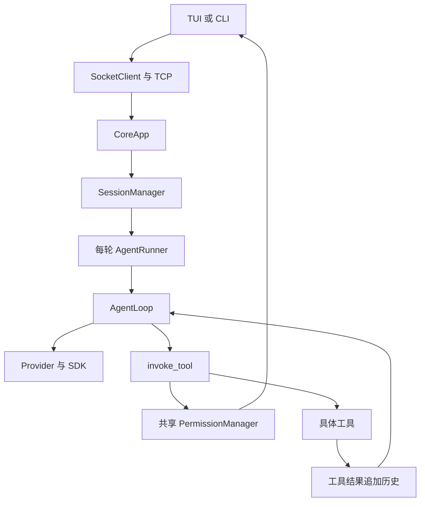
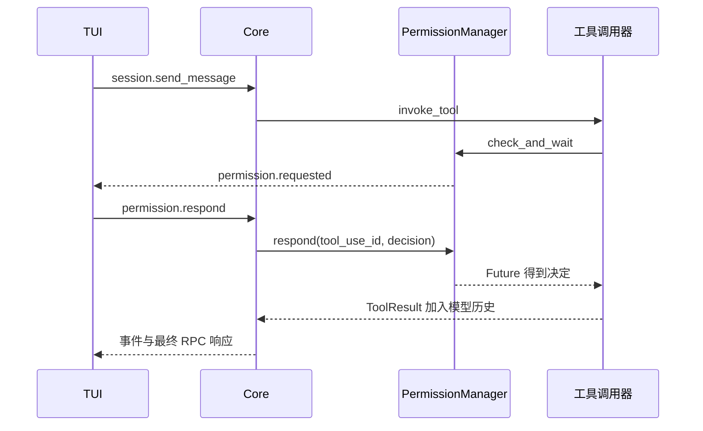
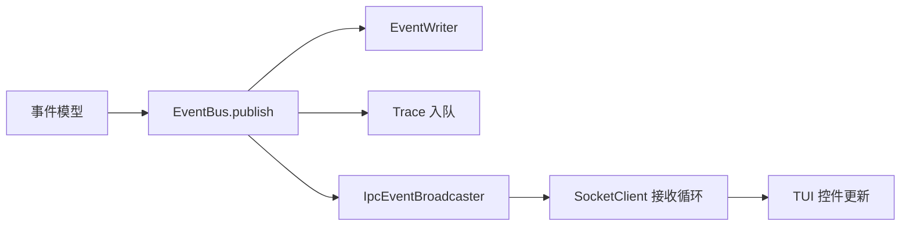

# S5 学习指南：让工具执行经过审批

本讲义对应 `study/s5`，官方基线为 `7738b8f`。先读全局图，再追踪一次写文件，最后研究 Future、重试与收尾。S0～S4 指南保留历史含义；当前目录地图见 [PROJECT_STRUCTURE](PROJECT_STRUCTURE.md)，实际验证见 [S5_VALIDATION](S5_VALIDATION.md)。

## 目录

- [1. 阶段目标与变化](#1-阶段目标与变化)
- [2. 整体对象与生命周期](#2-整体对象与生命周期)
- [3. 推荐阅读顺序](#3-推荐阅读顺序)
- [4. 一次输入的完整旅程](#4-一次输入的完整旅程)
- [5. 权限判断与审批](#5-权限判断与审批)
- [6. 校验失败与重试](#6-校验失败与重试)
- [7. 历史笔记与任务](#7-历史笔记与任务)
- [8. 事件协议与界面](#8-事件协议与界面)
- [9. Python 阅读补课](#9-python-阅读补课)
- [10. 退出与异常路径](#10-退出与异常路径)
- [11. 配置与 Windows 操作](#11-配置与-windows-操作)
- [12. 测试练习与自测](#12-测试练习与自测)

## 1. 阶段目标与变化

S4 主要回答“下一次输入怎样接着上一次对话继续”；S5 回答“模型提出工具请求后，程序怎样判断能否执行、向用户询问，并在失败时继续决策”。主线仍是 CoreApp → SessionManager → AgentRunner → AgentLoop → Provider；新增机制接在 **Loop → invoke_tool → 实际工具** 之间。

下面的表格既是阶段地图，也是带着问题读源码的清单。按 1.1～1.6 阅读，先能用自己的话回答“学习问题”，再打开源码核对。每行给出简要答案，源码位置精确到主要类、函数或字段；同一个文件出现多次，是因为它参与不同环节。

标记说明：**新增**是官方 S5 新机制，**变化**是 S5 调整的旧路径，**延续**是理解 S5 必须掌握的已有机制，**学习分支**是本分支保留或补充的兼容、清理修复。后文第 2～12 节再展开细节。

### 1.1 先看整体：S5 在原有主线中改变了什么

| 编号 | 学习问题 | 相对 S4 的变化与答案要点 | 源码位置 |
| --- | --- | --- | --- |
| 1 | S5 的目标是什么？权限检查插在模型调用前，还是工具执行前？ | **新增**：模型先提出 tool_use，Loop 再调用 invoke_tool；调用器在真正 tool.invoke 前做参数校验、权限判断和必要审批。创建 session 不会调用模型，也不会触发审批。 | [loop.py](../src/kama_claude/core/loop.py)：AgentLoop.run；[invocation.py](../src/kama_claude/core/tools/invocation.py)：invoke_tool |
| 2 | CoreApp、SessionManager、Runner、Loop 分别负责什么？谁创建和复用权限管理器？ | **变化**：Core 启动创建一份 PermissionManager；每条消息仍由 Manager 创建新 Runner；Runner 把同一权限管理器及 session_id 传给 Loop，再交调用器。权限缓存因此可跨 run/session 生效。 | [app.py](../src/kama_claude/core/app.py)：CoreApp.run；[session/manager.py](../src/kama_claude/core/session/manager.py)：send_message；[runner.py](../src/kama_claude/core/runner.py)：__init__、run_and_capture |
| 3 | 工具 schema、tool_use、参数模型、invoke 和 tool_result 有什么区别？ | **变化**：schema 向模型说明工具；tool_use 是模型的请求；params_model 是本地校验类；invoke 才执行副作用；ToolResult 经 Context 转成 tool_result 返回模型。新增校验不会让 schema 本身变成可执行代码。 | [registry.py](../src/kama_claude/core/tools/registry.py)：ToolRegistry；[base.py](../src/kama_claude/core/tools/base.py)：BaseTool、ToolResult；[llm/types.py](../src/kama_claude/core/llm/types.py)：ToolCallBlock；[context.py](../src/kama_claude/core/context.py)：add_tool_result |
| 4 | LLMProvider、AnthropicProvider、TracingProvider 谁真正请求模型？S5 改变这层分工了吗？ | **延续**：Protocol 定义接口，Anthropic 实现调用异步 SDK，TracingProvider 包装并记录请求/响应/api_error，同时透传 system；权限检查由工具调用器承担。 | [llm/base.py](../src/kama_claude/core/llm/base.py)：LLMProvider；[llm/provider.py](../src/kama_claude/core/llm/provider.py)：AnthropicProvider.chat；[trace/provider.py](../src/kama_claude/core/trace/provider.py)：TracingProvider.chat |
| 5 | 哪些工具新增参数校验？参数不合法时会先弹审批吗？ | **新增**：bash、read_file、write_file、list_dir、note_save 有 Pydantic 参数模型；调用器先校验，失败返回 schema_error，不进入审批。task_* 没有 params_model，仍自行检查；调用器不保留转换后的实例，内置工具会再次解析。 | [invocation.py](../src/kama_claude/core/tools/invocation.py)：invoke_tool 校验分支；[bash.py](../src/kama_claude/core/tools/builtin/bash.py)：BashParams；[read_file.py](../src/kama_claude/core/tools/builtin/read_file.py)：ReadFileParams；[write_file.py](../src/kama_claude/core/tools/builtin/write_file.py)：WriteFileParams；[list_dir.py](../src/kama_claude/core/tools/builtin/list_dir.py)：ListDirParams；[note_save.py](../src/kama_claude/core/tools/builtin/note_save.py)：NoteSaveParams |

### 1.2 再看规则：哪些调用允许、拒绝或询问

| 编号 | 学习问题 | 相对 S4 的变化与答案要点 | 源码位置 |
| --- | --- | --- | --- |
| 6 | ALLOW、DENY、ASK 是什么？默认哪些工具需要人决定？ | **新增**：read_file/list_dir/note_save 默认 ALLOW；bash/write_file 默认 ASK；未登记策略的 task_* 也 ASK。没有默认黑名单命令集合，deny_patterns 默认是空列表。 | [policy.py](../src/kama_claude/core/permissions/policy.py)：PermissionDecision、ToolPolicy、DEFAULT_POLICIES、_UNKNOWN_TOOL_DEFAULT |
| 7 | 黑名单、越界启发式、always 缓存、白名单与默认值谁优先？ | **新增**：顺序为 bash deny_patterns → outside-cwd 强制 ASK → 会话缓存 → 全局持久缓存 → bash allow_patterns → 工具默认值。前两层不被 always_allow 跳过。 | [manager.py](../src/kama_claude/core/permissions/manager.py)：PermissionManager.check_and_wait |
| 8 | policy.evaluate 与 check_and_wait 为什么不能互换？ | **新增**：evaluate 只做四层静态规则评估；check_and_wait 还查两级缓存，并能广播和等待审批。前者返回三态决定，后者返回 allowed 与决定字符串。 | [policy.py](../src/kama_claude/core/permissions/policy.py)：evaluate；[manager.py](../src/kama_claude/core/permissions/manager.py)：evaluate、check_and_wait |
| 9 | outside-cwd 怎样判断？工具名 bash 在 Windows 上真的运行 Git Bash 吗？ | **新增规则＋延续执行方式**：规则用正则识别部分 POSIX 路径、变量和 cd；不完整覆盖 Windows 盘符、反斜线和变量。工具未指定 executable，Windows 通常用 cmd.exe；规则与实际 shell 不是完整统一的沙箱。 | [policy.py](../src/kama_claude/core/permissions/policy.py)：OUTSIDE_CWD_HEURISTICS、matches_outside_cwd；[bash.py](../src/kama_claude/core/tools/builtin/bash.py)：BashTool.invoke |
| 10 | “允许一次”和“总是允许”分别记住什么？换 run/session 还有效吗？ | **新增**：once 只影响本次；always 同时写入按 session_id/tool_name 的缓存及按 tool_name 的全局缓存，后者可跨 session。记住的是工具名，不是这条命令或路径；跨 run 的历史共享与权限缓存是两件事。 | [manager.py](../src/kama_claude/core/permissions/manager.py)：_session_always、_persistent_always、_apply_response |
| 11 | always 保存在哪里？何时加载？保存失败或手改文件会怎样？ | **新增**：Core 启动读取 ~/.kama/policy.toml，always 决定后覆盖写入；保存失败记录日志，内存仍生效；手改后须重启 Core。存储只解析简单 [always] 行，没有原子替换或通用 TOML 保真编辑。 | [app.py](../src/kama_claude/core/app.py)：CoreApp.run 的 policy_file；[manager.py](../src/kama_claude/core/permissions/manager.py)：__init__、_apply_response；[storage.py](../src/kama_claude/core/permissions/storage.py)：load_policy_file、save_policy_file |
| 12 | 权限是否覆盖所有实际执行入口？能否换工具执行相同操作？ | **新增机制的边界**：Core 模型执行主线经过调用器；直接 tool.invoke 或不传 Manager 的 Python Runner 可跳过审批。read_file 默认允许且路径检查不禁止所有绝对路径，获准的 shell 也能写文件；没有按操作类别统一防绕过。 | [invocation.py](../src/kama_claude/core/tools/invocation.py)：permission_manager 条件分支；[runner.py](../src/kama_claude/core/runner.py)：__init__；[read_file.py](../src/kama_claude/core/tools/builtin/read_file.py)：invoke；[write_file.py](../src/kama_claude/core/tools/builtin/write_file.py)：invoke |

### 1.3 沿审批走一圈：请求怎样等到用户决定

| 编号 | 学习问题 | 相对 S4 的变化与答案要点 | 源码位置 |
| --- | --- | --- | --- |
| 13 | ASK 时保存了什么？为什么先登记 Future，再发布事件？ | **新增**：_PendingRequest 保存 Future、session_id、tool_name，索引用 tool_use_id。Future 是未来的决定；先登记可接住广播回调立即 respond 的情况，await 期间其他协程仍可运行。 | [manager.py](../src/kama_claude/core/permissions/manager.py)：_PendingRequest、_pending、check_and_wait |
| 14 | 审批请求、用户决定与原工具调用怎样关联？三个 ID 各做什么？ | **新增**：permission.requested 带 run_id、session_id、tool_use_id；respond 命令用 tool_use_id 找 Future。run_id 标识一轮，session_id 标识对话，tool_use_id 标识模型的一次工具请求。 | [bus/events.py](../src/kama_claude/core/bus/events.py)：PermissionRequestedEvent；[bus/commands.py](../src/kama_claude/core/bus/commands.py)：PermissionRespondCommand；[app.py](../src/kama_claude/core/app.py)：_permission_respond_handler |
| 15 | 四种用户决定如何唤醒原调用？无效或迟到回应怎样处理？ | **新增**：respond 取出 pending 并 set_result；等待者继续做 _apply_response。decision 当前只校验 str，未知值按拒绝处理；找不到 pending 则记日志，不执行原工具；RPC ok 不证明工具已成功。 | [manager.py](../src/kama_claude/core/permissions/manager.py)：respond、_apply_response；[bus/commands.py](../src/kama_claude/core/bus/commands.py)：PermissionRespondCommand、PermissionRespondResult |
| 16 | 审批等待多久？0 表示什么？超时会修改 always 吗？ | **新增**：默认 60 秒，KAMA_PERMISSION_TIMEOUT_S 或 [permission].timeout_s 可改；0 无限等待。超时返回 False/timeout，不更新 always，调用器转成拒绝事件与 permission_denied 结果。 | [config.py](../src/kama_claude/core/config.py)：PermissionConfig、_apply_toml、_apply_env；[manager.py](../src/kama_claude/core/permissions/manager.py)：check_and_wait；[invocation.py](../src/kama_claude/core/tools/invocation.py)：拒绝分支 |
| 17 | 同一工具 ID 在并发 run 重复会怎样？回应是否核对连接归属？ | **当前边界**：pending 全局仅按 tool_use_id 建索引，可能相互覆盖；respond 未校验会话或连接归属。事件携带更多 ID、磁盘目录按 session 隔离，都不代表关联已在所有入口严格校验。 | [manager.py](../src/kama_claude/core/permissions/manager.py)：_pending、check_and_wait、respond；[app.py](../src/kama_claude/core/app.py)：_permission_respond_handler |

### 1.4 观察交互：TUI、网络与事件怎样配合

| 编号 | 学习问题 | 相对 S4 的变化与答案要点 | 源码位置 |
| --- | --- | --- | --- |
| 18 | 用户输入怎样发出去？等待模型时为什么还能按审批键？ | **变化**：ChatTextArea 发本地 Submitted 消息；App 设置 busy 后用 run_worker 执行长 send_message RPC，Textual 消息泵继续处理键盘，socket worker 继续接收事件。 | [tui/app.py](../src/kama_claude/tui/app.py)：ChatTextArea._on_key、on_chat_text_area_submitted、_do_send_message、_socket_loop |
| 19 | ASK 在哪里显示？按键如何变成 permission.respond？ | **新增**：permission.requested 创建日志摘要 PermissionBlock，以及挂在 prompt 前的 PermissionSelect；方向键/Enter 或 y/a/n/d 产生本地 Decided 消息，App 再发送 RPC。预览由 param_preview 截取，不代替实际参数。 | [tui/app.py](../src/kama_claude/tui/app.py)：_handle_event_inner、PermissionBlock、PermissionSelect.on_key、on_permission_select_decided、_mount_permission_select；[policy.py](../src/kama_claude/core/permissions/policy.py)：param_preview |
| 20 | Core 已经在等待 send_message，为什么同一 socket 还能处理审批回应？ | **变化**：服务端每读一行都 create_task 分派，不再串行 await 长 handler；ContextVar 保存各请求所属 writer。网络读循环、长请求、run 和审批 Future 是不同对象。 | [transport/socket_server.py](../src/kama_claude/core/transport/socket_server.py)：_read_loop、_handle_line、get_connection_writer；[app.py](../src/kama_claude/core/app.py)：_session_send_handler、_permission_respond_handler |
| 21 | RPC 响应与主动事件推送怎么区分？drain 成功代表用户看到了吗？ | **延续**：SocketClient 按响应 id 完成 RPC Future，event 推送交事件回调；drain 只等待写缓冲流控，不保证接收或显示。审批摘要先更新，也不能单独证明 Core 已确认。 | [transport/socket_client.py](../src/kama_claude/core/transport/socket_client.py)：send_command、run_event_loop、_dispatch；[bus/envelope.py](../src/kama_claude/core/bus/envelope.py)：协议外壳；[transport/socket_server.py](../src/kama_claude/core/transport/socket_server.py)：_send |
| 22 | 事件从哪里来？自动允许/拒绝也一定有 permission 事件吗？ | **变化＋延续**：调用器发布审批事件；EventBus.subscribe 保存回调，publish 顺序 await。auto_allow/auto_deny 不单独发 granted/denied；静态拒绝仍发 tool.call_failed。定义事件不等于每条路径都会发布或显示。 | [invocation.py](../src/kama_claude/core/tools/invocation.py)：_emit_permission、允许/拒绝分支；[events/bus.py](../src/kama_claude/core/events/bus.py)：subscribe、publish；[transport/ipc_broadcaster.py](../src/kama_claude/core/transport/ipc_broadcaster.py)：handle |
| 23 | CLI chat 与 TUI 都有审批文字，为什么实际交互能力不同？ | **变化的边界**：CLI 增加决定映射，但主循环 await send_message 时无法再 readline，ASK 会等超时；TUI 的 worker 才形成可用的同连接键盘闭环。 | [cli/commands/chat.py](../src/kama_claude/cli/commands/chat.py)：ChatPrinter.handle、_chat_async；[tui/app.py](../src/kama_claude/tui/app.py)：_do_send_message、on_permission_select_decided |
| 24 | 怎样查看审批和失败？事件文件、统一 trace、TUI 日志分别记录什么？ | **新增日志＋延续观测**：events.jsonl 保存业务事件；trace 汇总 IPC/event/LLM，TraceWriter 用队列消费；tui.log 保存客户端日志，默认 UTF-8 滚动文件。三者均不同于模型消息历史。 | [events/writer.py](../src/kama_claude/core/events/writer.py)：EventWriter；[app.py](../src/kama_claude/core/app.py)：_trace_event_handler；[trace/writer.py](../src/kama_claude/core/trace/writer.py)：TraceWriter；[tui/__main__.py](../src/kama_claude/tui/__main__.py)：_setup_logging；[cli/commands/trace.py](../src/kama_claude/cli/commands/trace.py) |
| 25 | 多个会话、重连和历史回放时，审批控件会自动正确隔离吗？ | **当前边界**：TUI 订阅 global，未完整按 session/run 过滤，也未在重连时统一清掉旧审批控件；回放的 requested 不代表现在仍有 Future 等待。理解单会话闭环后，还要区分事件显示与有效审批。 | [tui/app.py](../src/kama_claude/tui/app.py)：_socket_loop、_handle_event_inner、_pending_permission_blocks；[transport/ipc_broadcaster.py](../src/kama_claude/core/transport/ipc_broadcaster.py)：subscribe、handle；[app.py](../src/kama_claude/core/app.py)：_subscribe_handler、_replay_events |

### 1.5 继续执行：失败、重试、模型历史与会话

| 编号 | 学习问题 | 相对 S4 的变化与答案要点 | 源码位置 |
| --- | --- | --- | --- |
| 26 | 工具错误分几类？error_class、error_type、异常类是同一个东西吗？ | **变化**：失败事件用 error_class，ToolResult 仍用 error_type；分类有 schema_error、permission_denied、timeout、runtime_error、rate_limited。RateLimitedError 被实际捕获；PermissionDeniedError 仅定义/导出，主线拒绝返回结果。 | [bus/events.py](../src/kama_claude/core/bus/events.py)：ToolCallFailedEvent；[tools/base.py](../src/kama_claude/core/tools/base.py)：ToolResult；[tools/errors.py](../src/kama_claude/core/tools/errors.py)：RateLimitedError；[permissions/errors.py](../src/kama_claude/core/permissions/errors.py)：PermissionDeniedError；[invocation.py](../src/kama_claude/core/tools/invocation.py)：_fail、invoke_tool |
| 27 | 哪些失败会重试？最多几次？是否重新审批？ | **新增**：runtime_error/rate_limited 最多执行三次，退避 2、4 秒；审批只做一次。schema_error、permission_denied、timeout 不重试；未知工具在查表处直接返回，不进入重试循环。 | [invocation.py](../src/kama_claude/core/tools/invocation.py)：_RETRYABLE、_MAX_RETRIES、_RETRY_BASE_S、invoke_tool |
| 28 | 审批超时、工具外层超时、bash 自己的超时和总耗时各算什么？ | **变化**：审批有独立配置；每次 invoke 外层默认 120 秒；bash 默认内部 60 秒，参数 1～120。退避和审批不占单次执行 timeout，elapsed_ms 却从最初累计；不存在统一的整轮 120 秒预算。 | [config.py](../src/kama_claude/core/config.py)：PermissionConfig；[invocation.py](../src/kama_claude/core/tools/invocation.py)：elapsed、wait_for；[bash.py](../src/kama_claude/core/tools/builtin/bash.py)：BashParams、invoke |
| 29 | 重试是否回滚副作用？TUI 会准确展示每次尝试的最终状态吗？ | **新增机制的边界**：失败可能发生在部分操作已完成之后，重试可重复副作用；attempt 标记失败次数。TUI 首次 failed 就移除待工具索引，后续成功未必更新原块，应结合事件日志核对。 | [invocation.py](../src/kama_claude/core/tools/invocation.py)：重试循环；[bus/events.py](../src/kama_claude/core/bus/events.py)：ToolCallFailedEvent.attempt；[tui/app.py](../src/kama_claude/tui/app.py)：_handle_event_inner 的 tool.call_failed/finished |
| 30 | 工具被拒绝或最终失败，模型怎样知道并继续？多个工具请求是否并行？ | **延续＋新增错误类别**：Loop 顺序 await 每个工具，把最终 ToolResult 写为 tool_result；错误带 is_error。多个结果合并到同一条 user 消息，下一 step 模型继续判断；中间重试失败事件不会逐条写入模型历史。 | [loop.py](../src/kama_claude/core/loop.py)：AgentLoop.run；[context.py](../src/kama_claude/core/context.py)：add_assistant_message、add_tool_result；[invocation.py](../src/kama_claude/core/tools/invocation.py)：invoke_tool 返回点 |
| 31 | session、run、step、业务 Task 与 asyncio.Task 如何区分？会话状态能说明是否忙吗？ | **延续**：session 包含多次 run，step 是模型请求次数；业务 Task 是待办数据，asyncio.Task 调度协程。Session.status 与 Context.status 独立，忙碌由会话锁判断；end_turn 不保证待办全部完成。 | [session/model.py](../src/kama_claude/core/session/model.py)：Session；[session/manager.py](../src/kama_claude/core/session/manager.py)：_locks、send_message；[context.py](../src/kama_claude/core/context.py)：ExecutionContext；[task/model.py](../src/kama_claude/core/task/model.py)：Task |
| 32 | S5 还怎样保存历史与 notes？失败、取消后下次会读到什么？ | **延续**：Manager 先保存用户输入，Runner 收尾只追加历史增量并附 run_id；Store 读入时去元数据、裁掉未配对工具尾部，裁剪不改原文件。note_save 由模型决定调用，写入 notes.md，下一 run 才重新加载到 system；无自动检索/压缩。 | [runner.py](../src/kama_claude/core/runner.py)：run_and_capture 的 prefill_len 与收尾；[session/store.py](../src/kama_claude/core/session/store.py)：append_messages、read_messages、_trim_orphan_tool_use、read_notes；[note_save.py](../src/kama_claude/core/tools/builtin/note_save.py)：invoke |
| 33 | task_* 受审批后就有自动调度、跨 run 共享或依赖执行门禁了吗？ | **权限新增、任务机制延续**：默认 task_* 走未知工具 ASK；依赖仍由模型提出、TaskManager 保存，completed 只解除依赖，不自动执行后继。Runner 每 run 新建 TaskManager，历史知道旧 ID 不代表能直接操作旧目录。 | [policy.py](../src/kama_claude/core/permissions/policy.py)：默认与未知工具规则；[runner.py](../src/kama_claude/core/runner.py)：_build_registry、run_and_capture；[task/manager.py](../src/kama_claude/core/task/manager.py)：create、update |

### 1.6 最后查收尾：断连、退出、配置与验证

| 编号 | 学习问题 | 相对 S4 的变化与答案要点 | 源码位置 |
| --- | --- | --- | --- |
| 34 | 等待审批时 run 被取消，或广播事件抛异常，Future 会不会遗留？ | **学习分支**：登记后的广播与等待纳入 try/finally，删除 pending，并取消仍未完成的 Future；取消继续传播。普通业务失败返回 ToolResult，不代表所有异常都被吞掉。 | [manager.py](../src/kama_claude/core/permissions/manager.py)：check_and_wait 的 finally；[runner.py](../src/kama_claude/core/runner.py)：run_and_capture 的 CancelledError 分支 |
| 35 | 断开 socket、退出 TUI、关闭 session、取消 run 是同一件事吗？ | **学习分支＋既有语义**：断连按连接关联的 session 拒绝当时已有审批，不取消整轮；后续新 ASK 仍可能等待。close 先拒绝已有审批，忙时仍报 SESSION_BUSY；TUI 退出尽力 close，失败也退出。 | [app.py](../src/kama_claude/core/app.py)：_remember_session、_on_disconnect、_session_close_handler；[manager.py](../src/kama_claude/core/permissions/manager.py)：cancel_session；[session/manager.py](../src/kama_claude/core/session/manager.py)：close；[tui/app.py](../src/kama_claude/tui/app.py)：action_quit |
| 36 | Core 退出时怎样回收 one_shot/chat、并发 RPC 和 shell？ | **学习分支**：先取消并等待活动 run，再停止 server/trace；服务端保存请求 Task 并在 stop 时回收；bash 被取消后 kill 并等待直接子进程，不保证整个进程树。 | [app.py](../src/kama_claude/core/app.py)：CoreApp.run 的 finally、_running_runs；[transport/socket_server.py](../src/kama_claude/core/transport/socket_server.py)：_requests、_request_done、stop；[bash.py](../src/kama_claude/core/tools/builtin/bash.py)：CancelledError 分支 |
| 37 | 新审批配置怎样覆盖默认值？修改配置或 policy 是否需要重启？ | **新增＋延续配置链**：默认 → TOML → .env → 已有环境变量；.env 先补入环境，才能选择 KAMA_CONFIG。审批超时在 Core 加载，修改后重启 Core；policy 也不热加载；TUI 日志/连接配置由 TUI 自己加载。 | [config.py](../src/kama_claude/core/config.py)：get_config、_apply_toml、_apply_env；[app.py](../src/kama_claude/core/app.py)：run；[tui/__main__.py](../src/kama_claude/tui/__main__.py)：main、_setup_logging |
| 38 | Windows、中文/emoji 和旧 trace 的兼容修复还在哪？ | **学习分支延续**：跨平台信号恢复、PID 存活查询、无窗口 Core 启动、任务/trace 显式 UTF-8、旧 GB18030 与 UTF-8 逐行兼容均保留；强制结束进程不保证 finally，shell 输出也不保证传统编码无乱码。 | [app.py](../src/kama_claude/core/app.py)：_wait_for_shutdown；[cli/commands/core.py](../src/kama_claude/cli/commands/core.py)；[task/manager.py](../src/kama_claude/core/task/manager.py)；[trace/writer.py](../src/kama_claude/core/trace/writer.py)；[cli/commands/trace.py](../src/kama_claude/cli/commands/trace.py)；[bash.py](../src/kama_claude/core/tools/builtin/bash.py)：invoke |
| 39 | 怎样不调用付费模型，就证明规则、执行、TUI 及清理真正连通？ | **新增验证**：静态规则/Manager/参数/重试单测覆盖分支；fake Provider 驱动真实 Runner；Pilot 通过真实 TCP 按 y/n，核对文件与 thread；断连/取消测试核对收尾。夹具隔离用户目录与配置，--ignore 排除真实模型模块的收集。 | [test_permission_policy.py](../tests/unit/test_permission_policy.py)、[test_permission_manager.py](../tests/unit/test_permission_manager.py)、[test_tool_params.py](../tests/unit/test_tool_params.py)、[test_tool_retry.py](../tests/unit/test_tool_retry.py)；[test_s5_permission_flow.py](../tests/integration/test_s5_permission_flow.py)、[test_s5_tui_offline.py](../tests/integration/test_s5_tui_offline.py)、[test_s5_cleanup.py](../tests/unit/test_s5_cleanup.py)；[conftest.py](../tests/conftest.py)、[offline_daemon.py](../tests/offline_daemon.py) |
| 40 | 新增 permission.respond 和权限事件后，怎样保证协议文档跟着变化？ | **变化**：commands/events 定义数据与联合类型，Core 另行注册 handler；生成器从模型生成 WIRE_PROTOCOL.md，--check 检查同步。定义命令类型、接入处理器、同步协议是三个步骤。 | [bus/commands.py](../src/kama_claude/core/bus/commands.py)：Command；[bus/events.py](../src/kama_claude/core/bus/events.py)：Event；[app.py](../src/kama_claude/core/app.py)：CoreApp.run；[gen_protocol_doc.py](../scripts/gen_protocol_doc.py)、[WIRE_PROTOCOL.md](../WIRE_PROTOCOL.md) |

读完后，用“模型提出请求 → 校验 → 规则/缓存 → 必要时等待 TUI 决定 → 执行/有限重试 → 结果进入历史 → 模型继续 → 保存与清理”复述一次完整过程。如果还能说明每一步由谁负责、等待什么、失败后去哪里，就已经掌握 S5 的主体；接下来按第 3 节进入源码细读。

## 2. 整体对象与生命周期



| 对象 | 谁创建、保存什么、何时结束 |
| --- | --- |
| CoreApp | 进程入口创建；保存共享总线、会话管理器、权限管理器、活动 run 任务；退出时先取消并等待 run。 |
| SessionManager | Core 创建；保存内存 Session 和每 session 一把 Lock；不会启动时扫描磁盘恢复索引。 |
| Session | Manager 创建；保存 id/mode/status/title/run_ids 等元数据；是跨轮容器。 |
| AgentRunner | runner_factory 每条消息创建；准备本轮 Provider、Context、工具注册表、TaskManager 和 EventWriter。 |
| ExecutionContext | Runner 创建；保存本轮 messages、step、status、reason、result、notes；由 Loop 修改。 |
| PermissionManager | Core 启动创建一份，跨 run/session 共用；保存规则、pending Future 和 always 缓存。 |
| Provider | Runner 每轮使用；接口描述 chat，具体实现负责请求模型；包装器记录 trace。 |

五个容易混淆的词：session 是连续对话；run 是一次输入触发的执行；step 是一次模型请求；业务 Task 是 `.tasks/task_N.json` 中的待办；`asyncio.Task` 是事件循环调度一个协程的句柄。一个 run 可以有很多 step，每 step 可以请求多个工具，也可以完全不创建业务 Task。

Session.status 与 Context.status 是两套状态。chat 上一轮结束后可以仍显示 waiting_for_input，下一轮忙碌与否主要由锁判断；Context 的 success 只描述本轮，不保证业务待办全部完成。

## 3. 推荐阅读顺序

1. [CoreApp](../src/kama_claude/core/app.py)：run 的接线与 handler；先知道对象从哪里来。
2. [SessionManager](../src/kama_claude/core/session/manager.py) → [Runner](../src/kama_claude/core/runner.py) → [Loop](../src/kama_claude/core/loop.py)：定位一次输入主线。
3. [invocation](../src/kama_claude/core/tools/invocation.py)：读“校验 → 权限 → 执行 → 重试”六步。
4. [policy](../src/kama_claude/core/permissions/policy.py) → [manager](../src/kama_claude/core/permissions/manager.py) → [storage](../src/kama_claude/core/permissions/storage.py)：先无状态规则，再 Future 等待，最后文件保存。
5. [TUI](../src/kama_claude/tui/app.py)：按 Submitted、worker、permission.requested、PermissionSelect.Decided、respond 阅读。
6. [SocketServer](../src/kama_claude/core/transport/socket_server.py) → [SocketClient](../src/kama_claude/core/transport/socket_client.py)：理解同一连接如何同时等待长 RPC 和处理审批。
7. [Context](../src/kama_claude/core/context.py) → [SessionStore](../src/kama_claude/core/session/store.py) → [TracingProvider](../src/kama_claude/core/trace/provider.py)：最后串起保存与观察。

模型关系再单独看：[LLMProvider](../src/kama_claude/core/llm/base.py) 是 Protocol 接口；[AnthropicProvider](../src/kama_claude/core/llm/provider.py) 用 AsyncAnthropic SDK 真正请求模型；TracingProvider 接收一个符合接口的对象，记录前后数据后委托给它。包装器不是第二次模型调用。system 参数沿包装器传到真实实现；异常记录 api_error 后原异常继续传播，由上层处理。

## 4. 一次输入的完整旅程

以“写入学习笔记”为例，模型是否调用工具由模型响应决定，输入文字本身不会直接触发文件修改。

1. ChatTextArea 遇 Enter 发 Textual Submitted 消息；Ctrl+J 可换行。App 清空输入、设置 `_busy`，启动 `_do_send_message` worker。
2. SocketClient 给 `session.send_message` 分配 RPC id，发送 NDJSON，建立等待响应的 Future。独立网络接收协程继续运行。
3. SocketServer 为该请求创建 asyncio.Task，Core handler 再创建可统一回收的 run_task，并等待它。读循环仍能处理其他请求。
4. SessionManager 查内存索引，忙则返回 SESSION_BUSY；拿锁后写用户消息到 thread、更新 meta/run_ids，调用新 Runner。
5. Runner 读取已有完整历史与 notes，记录预填长度，建立 Context、注册九个会话工具。共享权限管理器沿 Runner → Loop 传下去。
6. Loop 发布 step.started，调用 Provider.chat。Provider 将 messages、tools、system 交 SDK，消费流式响应，返回 LlmResponse。
7. Loop 先把 assistant 的文本和 tool_use 块追加到 Context，再逐个 await invoke_tool。这里没有 gather 并行工具执行。
8. invocation 先发布 started，再查工具、校验参数、等待权限、实际 invoke。拒绝也返回 ToolResult，而不是让工具偷偷执行。
9. Context.add_tool_result 按 tool_use_id 关联结果；同一 assistant 的多个结果合并在一条 user 消息内。失败块带 is_error=true，下一 step 模型能据此继续决策。
10. 模型 end_turn 则 Context 成功；命中上限且未 end_turn 则失败。Runner 发布 run.finished、关闭事件文件、保存历史增量，再返回 RunOutcome。
11. Manager 在正常返回后把 chat 标为 waiting_for_input，写 meta 并发布事件；TUI 恢复输入；长 RPC 最后才返回 run_id。



## 5. 权限判断与审批

### 5.1 判断的实际位置

调用器在 `tool.invoke` 前检查权限，重试前已决定好，不会每次弹窗。Core 工厂始终传 Manager；直接在 Python 创建 AgentRunner 而不传 Manager，或直接调用工具的 invoke，会跳过审批。因此这是应用主线的门禁，不是无法绕过的操作系统限制。

默认 read_file、list_dir、note_save 为 ALLOW；bash、write_file 为 ASK；未登记的工具包括四个 task_*，兜底 ASK。不能因为 task_list 只读就声称它默认允许。

### 5.2 六层判断与缓存顺序

| 顺序 | 条件 | 效果 |
| --- | --- | --- |
| 1 | bash 命中 deny_patterns | auto_deny，任何 always 都不能越过。默认 deny_patterns 为空。 |
| 2 | bash 命中 outside-cwd 启发式 | 强制 ASK，不看缓存与白名单。 |
| 3 | session_id + tool_name 缓存 | 返回该会话 always 决定。 |
| 4 | tool_name 持久缓存 | 跨 session 返回 always 决定。 |
| 5 | bash allow_patterns | 自动允许；默认列表为空。 |
| 6 | 工具默认值 | ALLOW/DENY 直接返回，ASK 创建等待。未知工具也询问。 |

policy.evaluate 只做四层静态判断，不包含缓存，不能当成 check_and_wait 的完全等价替代。

outside-cwd 只是正则：检测 POSIX 绝对路径、`~`、`../`、HOME/PWD 变量和 cd 等。Windows 盘符、反斜线、`%USERPROFILE%`、命令拼接、解释器内执行和符号链接没有完整覆盖。文件工具拒绝路径中的 `..`，但并不统一禁止绝对路径；read_file 默认允许。always_allow bash 后可能经 shell 写文件，也可能借 read_file 访问绝对路径，规则不是按“同类操作”统一建模。学习时要理解这些真实边界，不能宣称已有完整防绕过机制。

### 5.3 等待如何被唤醒

`_pending[tool_use_id]` 保存 Future、session_id、tool_name。先创建并登记 Future，再广播事件，订阅者立刻回应也不会丢失。event_emitter 是调用器传入的异步回调，将 dict 转成 PermissionRequestedEvent 并补 run_id。

协议 decision 当前只是 str，没有枚举校验；未知字符串也会唤醒等待并按拒绝处理。界面正常提供四种字符串：allow_once、deny_once、always_allow、always_deny。respond 取出挂起项并 set_result，原来的 await 得到字符串后继续。一次决定只影响本次；always 同时修改 session 缓存和全局持久缓存，实际作用是按工具名跨会话生效，而非仅记住这条命令或文件路径。

审批事件带 run_id、session_id 与 tool_use_id，但 respond 命令只有 tool_use_id、decision。当前 pending 全局仅按 tool_use_id 建索引，未校验回应连接归属，也没有解决多个模型 run 复用相同工具 ID 的碰撞；sessions 目录隔离不能替代全局 ID 安全。应在单用户、可信本地连接场景理解现有实现。

```json
{"jsonrpc":"2.0","id":12,"method":"permission.respond","params":{"tool_use_id":"toolu_example","decision":"allow_once"}}
```

### 5.4 持久化的真实含义

Core 启动加载 `~/.kama/policy.toml`；always 决定更新内存后覆盖写文件。保存失败会记录日志，但内存决定仍然生效。重启后新 Manager 重新读取；手动改文件不会热更新当前内存。

```toml
[always]
bash = "deny"
write_file = "allow"
```

storage 是简单行解析器，不是完整 TOML 保真编辑器；保存覆盖整个文件，没有原子替换或跨进程写锁。默认不创建 policy 文件，第一次 always 才写入。PermissionDeniedError 仅定义并导出；主线拒绝通过 ToolResult 表达，不能写成必然抛此异常。

## 6. 校验失败与重试

工具 schema 给模型描述 JSON 参数；tool_use 是模型提出的请求；params_model 是本地 Pydantic 校验；invoke_tool 是公共执行入口；实际工具实现负责副作用；tool_result 是回给模型的观察结果。这六者不能混为一个“工具”。

Pydantic 的 Field 约束例如 bash timeout 为 1～120 秒、默认 60；list_dir 深度为 1～4、默认 2。extra=ignore 会忽略多余字段。调用器只校验，不把转换结果替换到原 input；内置工具会再次解析取字段。task_* 没有 params_model，不会在公共层获得同样校验。

| error_class | 当前处理 |
| --- | --- |
| schema_error | 不执行，不重试，将说明返回模型。 |
| permission_denied | 不执行，不重试；包含超时拒绝。 |
| timeout | 立即返回错误，不重试。 |
| runtime_error | 最多再试两次，间隔 2、4 秒。 |
| rate_limited | 同样有限退避，RateLimitedError 可触发此分类。 |

最多三次实际调用，每次有独立外层 timeout（默认 120 秒）。审批等待和退避不计入单次执行 timeout，但 elapsed_ms 从 started 前开始累计。bash 还有内部 timeout，通常默认 60 秒。不是整个 run 的 120 秒总预算。

每次重试失败都会发 tool.call_failed，attempt=1/2/3；最终才给 Loop 一个 ToolResult。未知工具在查找处直接返回 runtime_error，不进入重试。CancelledError 属于 BaseException，不被普通 except Exception 吞掉。EventBus 回调异常可能传播，不能声称调用器“绝不抛异常”。

重试可能重复非幂等副作用；非零退出 bash 也属于 runtime_error。当前没有自动事务或副作用回滚。TUI 的 failed 处理会先弹出工具块索引，后续重试成功未必更新原块；事件文件比当前展示更完整。这是现有显示边界。

## 7. 历史笔记与任务

| 文件 | 内容、生产者与读取者 |
| --- | --- |
| thread.jsonl | Manager 先写用户输入；Runner 收尾追加新 assistant/tool_result 消息；下一 run 读回完整历史。 |
| meta.json | Session 元数据、run_ids 和状态；Manager 写，当前不用于启动恢复索引。 |
| notes.md | 模型主动调用 note_save 后由 Store 创建并追加；下一 run 读入 system。 |
| runs/run_id/events.jsonl | 本轮 EventWriter 收到的业务事件；用于查看/回放，不是模型历史。共享总线尚缺严格 run 过滤。 |
| trace.jsonl | Core 统一采集 IPC/event/LLM 多层记录；队列消费者 UTF-8 写入，CLI 逐行兼容旧 GB18030。 |
| .tasks/task_N.json | 每 run 的业务待办；模型通过 task 工具提出内容和依赖，TaskManager 保存。 |

thread 行可附 run_id、ts 等元数据，读入模型前去掉。Runner 用 prefill_len 只追加新增部分；append_messages 循环调用追加单条，不是事务，也不保证只开一次文件。用户消息在模型失败前已经保存，取消不会自动撤销。

Store 扫描 tool_use/tool_result ID 的配对；若尾部仍有未配对调用，只返回最近完全配对位置之前的前缀，之后的用户消息也可能被裁掉。它不改磁盘原始内容，也不修复任意位置的所有畸形对话。

note_save 的调用者是模型，经 Loop/公共权限入口执行；Runner 给工具绑定 session/run。没调用不会凭空出现 notes.md；同轮已准备好的 system 不会立刻重新加载新笔记，下一 run 才读入。没有语义检索和自动压缩。

task 依赖由模型参数提出并由 TaskManager 保存。标 completed 会移除其他待办对它的依赖，不自动执行后继。每 run 重建 TaskManager，并不是跨 run 的共享调度器。模型 end_turn 只结束本轮，不保证待办完成。

## 8. 事件协议与界面

[bus/events.py](../src/kama_claude/core/bus/events.py) 定义 Pydantic 数据；[events/bus.py](../src/kama_claude/core/events/bus.py) 才保存回调并执行 publish。subscribe 保存函数引用，不马上执行；publish 在发布者协程里按登记顺序逐个 await，慢回调拖慢后续回调，异常也可能中断传播。



RPC 响应用 id 找到等待的 Future；主动推送用 event 外壳，交 on_event 回调。事件模型存在不等于运行时必发布，也不等于 TUI 有对应处理分支。drain 仅做写缓冲流控，不确认客户端已经收到或处理。

TUI 有三类异步工作：Textual 消息泵处理键盘与本地 Message；socket worker 接收服务端事件；发送 worker 等长 send_message RPC。PermissionSelect.Decided 是本地消息，App 将其转换成网络 permission.respond；permission.requested 才是协议事件。

审批选项支持方向键和 Enter，也支持 y/1、a/2、n/3、d/4。选择控件实际挂载到 Screen 顶层、prompt 前；摘要留在日志流。提交决定后界面先更新摘要，随后 await RPC，所以摘要不能单独证明 Core 已确认。允许后该 run 仍忙，输入框即使恢复，_busy 仍拦重复提交。

TUI 订阅 global，尚未完整过滤其他 session 的事件或重连时清掉旧审批控件；并发多会话展示有局限。旧事件回放也不应被当成仍有效的审批请求。

CLI chat 虽加入决定映射，但主循环等待 send_message 返回期间不能再次 readline，所以交互 ASK 会等到超时才继续。CLI run 没有完整人工审批入口。S5 交互学习以经过 Pilot 验证的 TUI 为主，不能声称 CLI 与 TUI 都已具备同等闭环。

## 9. Python 阅读补课

| 语法或库 | 对应代码与理解方式 |
| --- | --- |
| A 或 None | 类型标注允许为空；不是运行时自动判空。调用前仍需 if/assert。 |
| dict[str, ToolPolicy] | 字符串键映射规则对象；与对象从磁盘加载是两回事。 |
| dataclass / field | 自动生成初始化；default_factory=list 给每个对象独立列表。 |
| StrEnum | 有限的字符串决定集合，减少拼写错误；用户四种决定仍是另一个字符串集合。 |
| Protocol | 约定对象应该有 chat；fake Provider 也可符合，不要求继承真实 SDK 类。 |
| ClassVar[type[BaseModel]] | 工具类级别保存一个“模型类”，调用 model_validate 才得到实例。 |
| Callable / 回调 | 把函数当值保存，稍后调用；subscribe(handler) 与 handler(event) 时机不同。 |
| Future[str] | 未来的字符串结果；等待者 await，respond 生产者 set_result。 |
| create_task | 把协程交给事件循环并立即拿到句柄；不会创建线程。 |
| asyncio.Lock | async with 获得互斥访问；退出自动释放，已写文件不自动回滚。 |
| wait_for / timeout | 到期取消被等待工作；依赖协程响应取消，同步文件 IO 不会被魔法打断。 |
| try/finally | 正常、异常、取消均执行清理；Manager 在此删除 pending 并取消悬空 Future。 |
| ContextVar | 每个异步上下文保存 writer，避免不同连接混用；不等于全局共享字典。 |
| Queue / join | trace emit 入队，消费者落盘；join 等 task_done 计数归零，不等于网络确认。 |
| run_worker | Textual 托管后台协程，避免主消息泵在等待模型时无法处理审批键。 |

建议先能解释“谁创建 Future、谁完成它”，再研究类型标注。异步不是同时执行每行 Python，而是在 await 处把机会交给其他就绪任务。

## 10. 退出与异常路径

| 情况 | 实际结果与边界 |
| --- | --- |
| 正常允许 | 执行工具，写结果进 Context，模型下一 step 继续。 |
| 用户拒绝 | 不调用工具，返回 permission_denied；模型仍可正常 end_turn。 |
| 审批超时 | 返回 False/timeout，调用器发布 denied 和工具失败；不写 always。 |
| 广播异常 | Manager finally 删除 pending，异常向上；Runner 可能将本轮标 llm_error。 |
| run 取消 | Manager finally 清理 Future；Runner 发结束事件、保存增量后继续抛取消；锁释放。 |
| socket 断开 | 本学习分支按连接记录的 session 拒绝当时已有审批；不取消整轮 run。以后新发起的 ASK 仍可能等超时。 |
| session.close | 先拒绝已有审批，再尝试关闭；若锁仍占用，仍报 SESSION_BUSY，不是取消运行接口。 |
| TUI 退出 | 尽力发 close，再退出；忙碌时 close 可能失败。退出与 Core 退出是两个生命周期。 |
| Core 正常退出 | 跨平台信号唤醒；取消并等待 one_shot/chat，然后收尾请求任务、server 和 trace。 |
| Windows 强制 stop | 可能直接终止进程，不能保证执行 finally。 |

取消 shell 会 kill 并 await 直接子进程，不保证完整进程树。UTF-8 文件写读保护中文/emoji，但 shell 输出仍按 UTF-8 replacement 解码，本地传统编码命令可能乱码。Windows PID 查询与无窗口 Core 启动继承此前修复。

同 session 的锁释放不代表 Session.status 必然刷新：异常/取消可能跳过正常的状态更新和 meta 写入。EventBus/文件写入若本身失败，也不能声称收尾一定完整。trace 消费者失败后 join 卡住等旧边界仍保留。

## 11. 配置与 Windows 操作

优先级：内建默认 → `~/.kama/config.toml` → 当前工作目录 `.env` → 已有进程环境变量。实际先 load_dotenv(override=False)，使 `.env` 中 KAMA_CONFIG 能选择 TOML，然后应用环境层。Core/TUI/CLI 分别加载配置；工具相对路径以 Core 工作目录为准。

```toml
[permission]
timeout_s = 60.0
```

审批超时默认 60 秒，`KAMA_PERMISSION_TIMEOUT_S` 覆盖；0 表示无限等待。生产配置修改后需要重启 Core；TUI 连接或日志配置改动需要重启 TUI。policy 文件默认 `~/.kama/policy.toml`，没有独立的 KAMA_POLICY_FILE 配置。

| 设置 | 默认值或作用 |
| --- | --- |
| KAMA_CONFIG | 选择配置文件，默认 ~/.kama/config.toml。 |
| KAMA_HOST / KAMA_PORT | 默认 127.0.0.1 / 7437。 |
| KAMA_PERMISSION_TIMEOUT_S | 默认 60，可设 0。 |
| KAMA_TRACE_ENABLED / KAMA_TRACE_FILE | 默认开启，路径 ~/.kama/traces/daemon.jsonl。 |
| KAMA_TUI_LOG_FILE | 默认 ~/.kama/logs/tui.log，UTF-8 滚动文件 5 MiB、3 份备份。 |
| ANTHROPIC_* | Provider 要求 ANTHROPIC_API_KEY；已安装 SDK 另读取 ANTHROPIC_BASE_URL 等。本次不读密钥、不调用模型。 |

PowerShell 示例仅用于理解配置；发送自然语言给真实模型可能收费，本次验证使用 fake。

```powershell
$env:KAMA_PERMISSION_TIMEOUT_S = '30'
# 在准备好独立配置的终端启动 Core；不要重复启动已有监听实例
.venv\Scripts\kama-core.exe
```

```powershell
# 另一个终端连接 TUI；选择 y/a/n/d 审批
.venv\Scripts\kama-tui.exe
```

```powershell
# 离线验证，明确排除真实模型模块
.venv\Scripts\python.exe -m pytest tests/unit tests/integration --ignore=tests/integration/test_run_e2e.py -q
.venv\Scripts\ruff.exe check src tests scripts
.venv\Scripts\mypy.exe src
.venv\Scripts\python.exe scripts/gen_protocol_doc.py --check
```

源码核实：Provider 显式检查 ANTHROPIC_API_KEY 并传给 AsyncAnthropic；只设 AUTH_TOKEN 不能绕过该检查。已安装 SDK 在未显式传 base_url 时读取 ANTHROPIC_BASE_URL，默认指向官方 Anthropic API；设置自定义 URL 不会把请求协议自动转换成 OpenAI API。模型默认 claude-sonnet-4-6，可用 KAMA_LLM_DEFAULT_MODEL 覆盖，最多 step 默认 20，可用 KAMA_MAX_STEPS 覆盖。

不要把 tests/integration 全部直接收集再用 marker 排除：真实模型模块可能在收集时加载项目 .env。这里用 --ignore 阻止收集。测试默认用户目录与 KAMA 环境隔离，子进程 fake 使用临时 cwd，不读取真实 sessions、policy、trace 或项目 .env。

## 12. 测试练习与自测

按顺序读测试，每次先猜结果，再运行单文件：

1. [policy 测试](../tests/unit/test_permission_policy.py)：default、正则与强制 ASK，练习静态分支。
2. [Manager 测试](../tests/unit/test_permission_manager.py)：先登记再回应、always 跨会话、磁盘重载、超时与断连。
3. [参数测试](../tests/unit/test_tool_params.py) 与 [重试测试](../tests/unit/test_tool_retry.py)：观察校验和三次执行；测试把退避置零来缩短时间。
4. [S5 执行链](../tests/integration/test_s5_permission_flow.py)：fake 模型提出 bash 请求，真实 Manager 与 Runner 处理，离线运行安全命令。
5. [S5 TUI](../tests/integration/test_s5_tui_offline.py)：Pilot 发键盘，真实 TCP，确认允许才产生文件，拒绝结果进入 thread。
6. [清理回归](../tests/unit/test_s5_cleanup.py)：检查取消、广播异常、超时、断连和 shell 回收；再读 [S4 TUI](../tests/integration/test_s4_tui_offline.py)、[Windows](../tests/unit/test_s3_windows.py) 与 [Core 退出](../tests/unit/test_app_shutdown.py)。

练习一：画出 write_file ASK 时三个 Future/Task 的关系。要点：客户端 RPC Future 等最终响应；Core 长请求 Task 等 run；审批 Future 等用户决定，它们不是一个对象。

练习二：在临时 policy 文件上 always_allow write_file，再用新 Manager、新 session 调用。要点：跨 session 命中持久缓存；once 不写文件；强制 outside-cwd bash 仍 ASK。

练习三：让 fake 工具先 runtime_error 两次再成功，统计调用与事件。要点：三次调用、两次 failed、一次 finished，Loop 只拿最终结果；不代表副作用自动回滚。

练习四：并排读 thread 与 events。要点：模型消息与业务事件不是同一种日志；run_id 元数据读入模型前剥离，trace 还有网络/API 层。

自测题及答案要点：

- 创建 session 会调用模型吗？不会，send_message 才创建 run。
- end_turn 意味着所有 Task 完成吗？只表示本轮模型结束。
- always_allow 只记住这次路径吗？按工具名全局缓存，不是参数级规则。
- subscribe 为什么不能证明 TUI 显示事件？还要有实际发布、广播匹配、网络接收与界面分支。
- 连接断开会自动取消 run 吗？不会；本分支只结束已有审批等待。
- 超时是否覆盖审批加全部重试？执行 timeout 是每次调用；审批另有配置，退避另算。
- 任务依赖解除由谁继续执行？没有自动调度，由模型后续决策。
- note_save 何时影响 system？后续 run 重新加载 notes 时。
- `.drain()` 或 `queue.join()` 能证明终端已展示吗？都不能，等待的是各自缓冲/计数。
- 文档图语法通过等于人工终端验收吗？不等于，验证记录分别报告静态检查、Pilot 与未做的人工检查。
