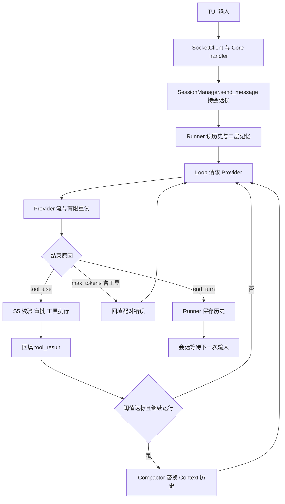

# S6 学习指南：分层记忆、上下文压缩与流重试

学习基线是 `study/s5` 的 `0e59919`，合并官方 `stage/s6` 的 `f4567c1`。先读第 1 节，再沿第 2 节的源码入口展开。来源、合并与测试证据见 [S6_VALIDATION](S6_VALIDATION.md)；沿用的权限机制见 [S5 指南](STUDY_GUIDE_S5.md)。

## 1. 阶段目标与变化

S5 解决工具能否安全执行的问题；S6 处理长对话的上下文负担与模型流中断：把全局、项目和会话记忆拼入系统提示，缩短历史中的大工具输出，用摘要替换长历史，并在特定网络错误后重新请求模型。默认启用历史读取时的工具结果截断，自动摘要默认关闭，用户可通过 TUI `/compact` 主动压缩。

| 编号 | 学习问题 | 相对 S5 的变化与答案要点 | 源码位置 |
| --- | --- | --- | --- |
| 1 | S6 增加在哪些执行边界？ | Runner 加载记忆并装配 Compactor；Store 读取时截断；Loop 可自动摘要；Core 增加手动压缩 RPC；Provider 增加流重试。 | [runner.py](../src/kama_claude/core/runner.py)：run_and_capture；[app.py](../src/kama_claude/core/app.py)：CoreApp.run |
| 2 | 三层记忆从哪里来，何时生效？ | Global 是用户目录的 .kama/context.md，Project 是 daemon 工作目录的 .kama/context.md，Session 是 notes.md；每个 run 开始读为快照。 | [loader.py](../src/kama_claude/core/memory/loader.py)：load_context_file；[runner.py](../src/kama_claude/core/runner.py)：global_ctx/project_ctx/notes |
| 3 | 记忆如何进入模型输入？ | ExecutionContext 增加 global_context/project_context；system_prompt 按 base→Global→Project→Session 拼接非空文本，和 messages 分开传入 Provider。 | [context.py](../src/kama_claude/core/context.py)：ExecutionContext.system_prompt |
| 4 | L1 如何缩短工具输出？ | read_messages 先裁剪孤儿工具调用，再将超过 8000 字符的字符串 tool_result 保留前 4000 字符及提示；返回新列表，不改原 thread。 | [store.py](../src/kama_claude/core/session/store.py)：read_messages；[budget.py](../src/kama_claude/core/compact/budget.py)：truncate_tool_results |
| 5 | L5 摘要怎样产生，返回什么？ | 把对话转成纯文本，要求六节交接摘要，以无工具、独立总线请求模型；返回 CompactionResult，普通模型异常或空摘要返回 None。 | [compactor.py](../src/kama_claude/core/compact/compactor.py)：compact_messages、_messages_to_text、CompactionResult |
| 6 | 自动摘要何时触发？ | 工具结果全部回填后，run 未结束、stop_reason 为 tool_use、存在压缩器、阈值大于 0 且 usage.context_pct 达标才触发。配置默认 0。 | [loop.py](../src/kama_claude/core/loop.py)：AgentLoop.run；[config.py](../src/kama_claude/core/config.py)：CompactionConfig |
| 7 | 自动摘要改变哪些状态，怎样跨轮保留？ | compact 将 Context.messages 替换成 user 摘要和 assistant 确认，写摘要副本并发事件；学习分支用 compaction_count 告知 Runner 整体写回，避免旧 prefill 偏移丢消息。 | [compactor.py](../src/kama_claude/core/compact/compactor.py)：compact；[context.py](../src/kama_claude/core/context.py)：compaction_count；[runner.py](../src/kama_claude/core/runner.py)：收尾写回 |
| 8 | 手动 /compact 的完整路径是什么？ | TUI worker→session.compact→SessionManager.compact→compact_messages→write_compacted；与发送消息共用会话锁，成功返回摘要和节省 token 数。 | [tui/app.py](../src/kama_claude/tui/app.py)：_do_compact；[manager.py](../src/kama_claude/core/session/manager.py)：compact；[store.py](../src/kama_claude/core/session/store.py)：write_compacted |
| 9 | 界面和协议怎样反馈上下文状态？ | llm.usage 增加 context_pct，TUI 展示比例条；自动摘要发送 context.compacted，手动摘要使用 RPC 结果显示横幅。两条路径不能混为一谈。 | [events.py](../src/kama_claude/core/bus/events.py)：LlmUsageEvent、ContextCompactedEvent；[commands.py](../src/kama_claude/core/bus/commands.py)：SessionCompactCommand/Result |
| 10 | 流重试与 S5 工具重试有何区别？ | Provider 对 RemoteProtocolError/ReadError/ConnectError 最多总尝试三次，间隔 1、2 秒；重建文本缓存，只有第一次广播 token。它重新请求模型，不重新执行已完成工具。 | [provider.py](../src/kama_claude/core/llm/provider.py)：AnthropicProvider.chat、_MAX_STREAM_RETRIES |
| 11 | max_tokens 为什么需要专门处理？ | 输出额度由 4096 改为 8192；若响应因上限结束且含工具调用，Loop 不执行不完整参数，而是补同 ID 的错误结果，避免下一次请求出现孤儿 tool_use。 | [provider.py](../src/kama_claude/core/llm/provider.py)：kwargs；[loop.py](../src/kama_claude/core/loop.py)：max_tokens 分支 |
| 12 | 压缩失败或取消如何收尾？ | 模型失败/空摘要保持原历史；手动路径报 RPC 错误；取消传播并释放会话锁。流由 async with 关闭，Runner 延续 S5 取消收尾。摘要副本写失败只记日志。 | [compactor.py](../src/kama_claude/core/compact/compactor.py)：异常处理；[manager.py](../src/kama_claude/core/session/manager.py)：compact；[runner.py](../src/kama_claude/core/runner.py)：cancelled |
| 13 | 配置与验证新增什么？ | 新增 compaction 配置和三个环境变量；auto_threshold 已接入，两个 L1 长度字段尚未接线。离线测试覆盖新模块、持久化、重试和真实 TUI/TCP 压缩后续聊。 | [config.py](../src/kama_claude/core/config.py)：_apply_toml/_apply_env；[S6 回归](../tests/unit/test_s6_regressions.py)；[TUI 闭环](../tests/integration/test_s6_tui_offline.py) |

## 2. 对象、生命周期与推荐阅读顺序

| 对象 | 创建与生命周期 | S6 责任 |
| --- | --- | --- |
| CoreApp / SessionManager | daemon 启动创建，所有会话共享 Manager | 注册 session.compact；保存手动摘要 Provider 和每会话锁 |
| AgentRunner / ExecutionContext | 每条用户消息创建一次 | 加载三层快照、读历史、装配模型与压缩器、保存结果 |
| Compactor | 自动路径每 run 一份；手动路径每次调用一份 | 总结历史；自动路径另更新 Context、写 summary、发事件 |
| SessionStore | Core 创建并注入 Manager/Runner | UTF-8 历史读取、L1、追加或备份替换 |
| AnthropicProvider | Runner 按 run 创建；手动实例由 Manager 首次使用时创建并复用 | 流请求、有限重试、用量估算 |

推荐阅读顺序：`context.py` 的字段与 system_prompt → `memory/loader.py` → `compact/budget.py` → `compact/compactor.py` 的结果类型和 compact_messages → `loop.py` → `runner.py` → `session/manager.py` → `app.py` → `tui/app.py`。这是理解顺序，真实调用从客户端进入 Core。

辅助与主线的区别：`compact_messages` 同时服务自动/手动主线；`compact` 仅自动主线使用，默认配置下不会执行。`_write_summary` 仅被 `compact` 调用。两个新包的 `__init__.py` 只是导出辅助接口，运行模块直接从具体文件导入。`SessionStore.read_meta` 没有被改造成启动恢复入口。

## 3. 一次请求的完整旅程



图中省略最大步数分支：任何一次达到 max_steps 且未 end_turn 会失败结束；`max_tokens` 不保证一定再次请求。模型重试发生在同一个 `chat` 内，不增加 Loop 的 step。

手动链完全绕过 Runner/Loop：输入精确的 `/compact` → `on_chat_text_area_submitted` 清输入框并启动 worker → `_do_compact` 发 RPC → Core 校验 `SessionCompactCommand` → Manager 检查会话/忙状态并持锁 → `compact_messages` 请求摘要 → `write_compacted` 替换 thread → RPC 返回统计 → TUI 横幅。它不新增普通用户消息，也不创建一个普通 run。

## 4. 三层记忆与两种压缩的数据流

**三层记忆**属于 system 文本。全局和项目 context.md 没有自动写入接口；notes.md 仍由 S4 的 note_save 追加，下一 run 才重新加载。拼接顺序不实现优先级覆盖、冲突消解或语义检索。项目路径基于 daemon cwd，而不是客户端窗口目录。官方新增的 [.kama/context.md](../.kama/context.md) 是发送给被运行 Agent 的项目提示示例；其中 workspace 文件约定没有变成路径沙箱，不能替代 S5 权限判断。

**L1**只针对读取到的 user 消息中的字符串 tool_result，超限才截断；嵌套列表等其他内容不会压缩。原 thread 不变，读取后的消息列表变短。同一 run 新产生的大输出在该 run 中不会再次经过 read_messages，因此不是“每次模型调用前都控制预算”。保留的提示称完整输出在 run events；它只保留提示，不校验相应事件文件是否仍存在。

**L5**把文字、tool_use、tool_result 转为带角色标记的文本，要求 Original Goal、Completed Steps、Key Constraints & Discoveries、Current File State、Remaining TODOs、Critical Data 六节。`focus` 追加到摘要指令。无检索或多级摘要调度，也没有实现名为 L2/L3/L4 的步骤。摘要请求使用专用 system，不把三层记忆单独注入摘要请求；自动压缩后 Context 的三层字段仍保留，下一步正常模型请求继续使用。

| 路径 | 内存 | 文件 | 反馈 |
| --- | --- | --- | --- |
| 自动 | messages 变为摘要/确认对，后续继续追加；学习分支增加 compaction_count | 写 summary 时间戳副本；学习分支在 Runner 收尾备份并整体保存当前历史 | context.compacted 事件 |
| 手动 | 不修改运行中的 Context，因为同会话运行时会拒绝 | 备份旧 thread，再写摘要/确认对；不额外写 summary 文件 | SessionCompactResult |

学习分支的自动写回修复很关键：旧实现用 `context.messages[prefill_len:]` 追加，摘要替换后原偏移不再有效，即使本轮运行成功也可能只保留旧历史或漏写后续内容。`compaction_count > 0` 让收尾改用 write_compacted；未压缩时保持旧追加路径。

## 5. 配置、用量、协议与 TUI

| TOML 的 [compaction] 字段 | 默认 | 环境变量 | 当前实际作用 |
| --- | --- | --- | --- |
| auto_threshold | 0.0 | KAMA_COMPACT_THRESHOLD | 0 禁用，0～1 的非零值传给 Loop |
| tool_result_limit | 8000 | KAMA_COMPACT_TOOL_LIMIT | 校验为正整数，但 Store 调用尚未传此配置 |
| tool_result_keep | 4000 | KAMA_COMPACT_TOOL_KEEP | 同上，实际仍用函数默认值 |

配置沿用默认→TOML→dotenv/环境覆盖机制；环境变量优先于 dotenv。自动摘要开启示例仅需在隔离配置的 `[compaction]` 中设置 `auto_threshold = 0.8`，不必改代码。直接实例化 AgentLoop 的默认阈值是 0.80，但生产 Runner 显式传配置默认 0.0，不能据构造签名推断生产默认开启。

Provider 用 `input_tokens / 模型窗口` 计算 context_pct，内置三种模型映射均为 200000，未知名称也回退到 200000。缓存读取/创建 token 没有加进分子；因此它是实现中的估算，可能低估实际占用。TUI 70% 起黄色、85% 起红色；`_last_context_pct` 清零只是显示状态。没有新引入 token 计数库。

`session.compact` 请求含 session_id、可选 focus；响应含 summary_tokens、saved_tokens。原始 token 数是消息字符数/4 的粗估，摘要优先取模型输出计数，saved_tokens 下限为零。代码接受任意非空摘要，不要求真的更短；错误文本中的 “not beneficial” 不能当作实现了收益判断。

TUI 只识别精确 `/compact`，不解析 `/compact 重点`；worker 不阻塞输入，但不设置 `_busy`，并发输入可能收到服务端 session busy。手动成功横幅来自 RPC，自动横幅来自新增订阅的 context.*。重试只广播首次流 token，实时文字可能停留在失败残片；成功响应的完整文本仍进入消息历史。没有在本学习分支新增重绘协议。

协议文档见 [WIRE_PROTOCOL](../WIRE_PROTOCOL.md)，生成器已补登记 S6 请求/结果/事件；仅运行旧生成器的 --check 无法发现未登记的新模型。

## 6. 与 S5 的衔接、错误与清理

工具调用仍走 `invoke_tool` 的参数校验→权限审批→执行重试→ToolResult；S6 没有绕过这条链。S5 工具失败最多三次执行、等待 2/4 秒；S6 模型流最多三次总尝试、等待 1/2 秒。常量中虽然还列出 4 秒，当前循环不会用到第三个退避值。仅捕获指定的三种 httpx 异常，不等于所有 SDK/超时错误都可重试。

手动压缩找不到会话返回 -32010，忙返回 -32012，无 Provider 返回 -32020，摘要异常或空响应返回 -32021。Manager 当前没有专门禁止压缩 closed 会话。模型等待没有增加应用层压缩超时；取消会穿过 `compact_messages` 的普通 Exception 捕获，在 async with 退出时释放会话锁。自动压缩中的取消由 Runner 延续原有结束事件和取消传播流程。

`write_compacted` 先 rename 备份再写新文件，并非原子事务；写入失败应从备份恢复，代码没有自动恢复。学习分支只把备份后缀提高到微秒，修复 Windows 正常连续压缩的同秒重名。`summary_*.md` 仍是秒级命名，自动摘要的副本可能同秒覆盖；权威会话历史是 thread。记忆文件缺失返回空，权限或 UTF-8 读取错误会传播，不被误认为缺失。

本次保留 Windows 信号/PID/启动、UTF-8 文件读写与旧 trace 解码、Core 退出等待、审批 pending 清理、断连拒绝、shell 子进程回收、SocketServer 请求任务管理等学习成果。官方已用独立 `perm_timeout_val` 修复 S5 的类型变量复用，本分支采用官方写法，没有叠加第二套实现。手动 Provider 延迟装配是本次学习修复，避免新增功能让无凭据 daemon 启动立即退出。

## 7. 本地运行与离线验证

已有 `.venv` 可直接运行以下 PowerShell 命令，无需升级依赖。测试环境隔离 HOME/USERPROFILE、KAMA/ANTHROPIC 环境；daemon 在临时 cwd 中运行，配置测试只在临时 cwd 创建或读取测试 dotenv；不读取真实项目 .env、不调用付费模型。

```powershell
.venv\Scripts\python.exe -m pytest tests/unit tests/integration --ignore=tests/integration/test_run_e2e.py -q -o cache_dir=runs/.s6-validation/cache
.venv\Scripts\ruff.exe check src tests scripts
.venv\Scripts\mypy.exe src
.venv\Scripts\python.exe scripts/gen_protocol_doc.py --check
git diff --check
```

想只追踪新行为，可以运行 `tests/unit/test_s6_regressions.py` 与 `tests/integration/test_s6_tui_offline.py`。官方新增 test_budget、test_compactor、test_context_system_prompt、test_memory_loader 验证各模块，学习分支补充跨模块行为。真实 Textual Pilot 输入 `/compact`，由真实 TCP 和 Core 改写临时 thread，之后继续发送中文消息；不是只 mock `_do_compact` 的返回值。保留 S5 审批与断连闭环测试。

官方 compactor 测试原用同步 get_event_loop，依赖事件循环遗留状态；已改用 pytest 管理的 async 测试，保留原断言。Windows 沙箱临时目录权限失败应与代码失败区分，使用新 basetemp 进行有效验证，不删除已有缓存。具体结果与命令见 [验证记录](S6_VALIDATION.md)。正常真实模型启动需用户自行配置凭据，本次未执行。

## 8. 学习自测

1. 修改项目 context.md 后，当前 run 的下一步会立即读新内容吗？不会；Runner 在 run 开始读快照。
2. 把 tool_result_limit 配置改为 100 会改变当前主线吗？不会；追到 Store 即可看到未传配置。
3. 自动摘要成功为什么不能沿用原来的 prefill_len？消息列表已被两条新消息替换，旧前缀长度不再代表新增边界。
4. 手动 /compact 会产生 context.compacted 吗？不会；它调用 compact_messages，直接从 RPC 回显。
5. 摘要比原文长是否会拒绝？不会；非空就接受，saved_tokens 最小为零。
6. 流第一次输出半段后失败，第二次成功，历史与实时 UI 一定一致吗？历史有成功完整响应，UI 可能只有首次残片。
7. max_tokens 的工具请求能交给工具校验后试着执行吗？本阶段设计直接回填错误，避免执行未完成参数。
8. 哪些是官方功能、哪些是学习修复？官方提供记忆/截断/摘要/协议/TUI/流重试；学习修复包括自动历史写回、微秒备份、延迟手动 Provider、协议生成登记及离线回归。
