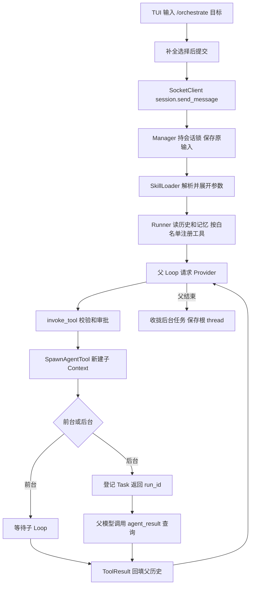

# S7 学习指南：子 Agent、Skills 与 MCP

基线为 `study/s6` 的 `1ce99c8`，合并官方 `stage/s7` 的 `70decaf`（本次核实日期：2026-10-26）。准确来源、完整阶段差异和验证证据见 [S7_VALIDATION](S7_VALIDATION.md)。建议先读本节问题表，再沿第 2、3 节进入源码；旧摘要机制见 [S6 指南](STUDY_GUIDE_S6.md)。

## 1. 阶段目标与变化

S6 让单个会话能处理较长上下文；S7 增加任务分工与能力扩展：模型可以调用独立上下文的子 Agent，用户可以通过斜杠 Skill 选择提示和工具集合，Core 可以把外部 MCP 工具接入已有执行链。编排仍由模型根据提示决定，并没有新增确定性的工作流调度器。

| 编号 | 学习问题 | 相对 S6 的变化与答案要点 | 源码位置 |
| --- | --- | --- | --- |
| 1 | S7 增加了哪些能力，编排由谁控制？ | 增加 spawn_agent/agent_result、角色配置、Skill 和 MCP；orchestrate 是提示模板，planner→executor→reviewer 顺序由模型遵循，不由 Python 状态机强制。 | [编排模板](../src/kama_claude/core/skills/builtin/orchestrate.md)、[子工具](../src/kama_claude/core/subagent/tool.py)：SpawnAgentTool |
| 2 | 启动和每轮装配发生在哪里？ | Core 启动 MCP Manager；Runner 每轮创建后台表及工具表，按 Skill 白名单筛选基础、note、子 Agent 和 MCP 工具。 | [app.py](../src/kama_claude/core/app.py)：CoreApp.run；[runner.py](../src/kama_claude/core/runner.py)：_build_registry |
| 3 | 子 Agent 继承什么，不继承什么？ | 共享 Provider、权限 Manager、session_id、后台表；新建 Context、bus、工具表和 TaskManager。不继承父历史、三层记忆、MCP/note 工具，也未装配 Compactor。 | [tool.py](../src/kama_claude/core/subagent/tool.py)：invoke、_build_child_registry |
| 4 | 前台和后台结果怎样回到父模型？ | 前台 await 子 Loop 后返回 ToolResult；后台 create_task 后返回 run_id，agent_result 查询内存 Task/Context。学习分支在父 run 收尾取消并等待未完成任务，不支持下一 run 查询。 | [tool.py](../src/kama_claude/core/subagent/tool.py)：invoke、AgentResultTool.invoke；[registry.py](../src/kama_claude/core/subagent/registry.py)：cancel_all |
| 5 | 角色与嵌套深度如何限制工具？ | 项目→用户→内建 TOML，采用 system_prompt 和 allowed_tools；model 仅解析未接线。根可生子、子可生孙，孙不再注册 spawn；角色白名单可更早移除它。 | [loader.py](../src/kama_claude/core/agents/loader.py)：AgentProfileLoader；[tool.py](../src/kama_claude/core/subagent/tool.py)：depth、_allowed |
| 6 | Skill 从哪里加载，参数如何生效？ | 项目→用户→内建，支持 name.md 和 name/SKILL.md；有限 frontmatter 解析。学习修复把替换 $ARGUMENTS 后的正文传入 system，磁盘仍保存原斜杠输入。 | [SkillLoader](../src/kama_claude/core/skills/loader.py)：resolve、render_prompt；[manager.py](../src/kama_claude/core/session/manager.py)：send_message |
| 7 | Skill 覆盖是否抹掉 S6 记忆？ | system_prompt_override 替换默认 base，根 Context 仍追加 Global/Project/Session 快照。工具白名单筛选注册，并不改变磁盘历史或生成路径沙箱。 | [context.py](../src/kama_claude/core/context.py)：system_prompt；[runner.py](../src/kama_claude/core/runner.py)：run_and_capture |
| 8 | MCP 怎样变成普通工具？ | 启动 stdio 或连接 TCP→initialize→initialized 通知→tools/list→包装为 server__tool；Runner 注册后，tools/call 返回文本并回填 tool_result。 | [server.py](../src/kama_claude/core/mcp/server.py)：start_all/get_tools；[client.py](../src/kama_claude/core/mcp/client.py)：_initialize/call_tool；[tool.py](../src/kama_claude/core/mcp/tool.py)：McpTool |
| 9 | 新工具还受哪些权限和超时约束？ | 仍经 invoke_tool；spawn_agent/agent_result/MCP 未登记默认允许，通常需审批。每次工具执行上限 120 秒；前台 spawn 整个子 Loop 也受此限制。MCP 无本地 Pydantic 参数模型。 | [invocation.py](../src/kama_claude/core/tools/invocation.py)：invoke_tool；[policy.py](../src/kama_claude/core/permissions/policy.py)：evaluate |
| 10 | 新资源失败或取消后如何收尾？ | 学习修复让子状态/完成事件收尾、后台表取消等待；MCP 握手/发现失败关闭连接，Core 监听失败也清理 MCP/trace。正常退出保留 Windows 信号和请求取消等待。 | [tool.py](../src/kama_claude/core/subagent/tool.py)：_run_background；[registry.py](../src/kama_claude/core/subagent/registry.py)：cancel_all；[app.py](../src/kama_claude/core/app.py)：finally |
| 11 | 配置优先级新增什么？ | 默认全局 TOML 后读 daemon cwd 的 .kama/config.toml；显式 KAMA_CONFIG 只读指定文件。标量覆盖，mcp.servers 追加；env 可给 stdio 子进程，不新增 MCP 环境变量映射。 | [config.py](../src/kama_claude/core/config.py)：get_config、McpServerConfig、_apply_toml |
| 12 | 协议和 TUI 怎样反馈新机制？ | 新增 skill.invoked、subagent.started/finished；TUI 补全斜杠、显示子任务进度/耗时、缩进工具、启动 banner。IPC 行限制升至 64 MiB，Server 关闭活跃连接。 | [events.py](../src/kama_claude/core/bus/events.py)、[TUI](../src/kama_claude/tui/app.py)：SlashCompleteWidget、_handle_event；[transport](../src/kama_claude/core/transport/socket_server.py)：stop |
| 13 | thinking 怎样跨请求保留？ | Provider 提取 thinking/signature，LlmResponse 携带，Loop 将其放在 assistant 内容最前，Store 原样保存读取；未新增启用 thinking 的请求配置。 | [provider.py](../src/kama_claude/core/llm/provider.py)：chat；[types.py](../src/kama_claude/core/llm/types.py)：thinking_blocks；[loop.py](../src/kama_claude/core/loop.py)：blocks |
| 14 | 怎样验证新增能力和旧机制衔接？ | 假模型跑真实 Manager/Runner/Loop、Textual/TCP；本机 fake MCP 验证握手、大行、工具错误及关闭；全量离线保留 S5/S6 回归。 | [S7 回归](../tests/unit/test_s7_regressions.py)、[TUI 闭环](../tests/integration/test_s7_tui_offline.py)、[验证记录](S7_VALIDATION.md) |

## 2. 对象关系、生命周期与推荐阅读顺序

| 对象 | 创建者与生命周期 | 作用和边界 |
| --- | --- | --- |
| McpServerManager / McpClient | Core 创建，随 daemon 启停 | 多个根 run 共享连接；每连接的锁串行收发，不为每次工具调用启动新服务 |
| SkillLoader | Manager 一份，TUI 另建 | Manager 每条命令解析；TUI 挂载时构建候选，不通过 RPC 获取服务端清单 |
| AgentRunner / BackgroundTaskRegistry | Manager 每条消息创建 | 后台表仅本轮有效；不能把类中保存字段理解成跨 run 持久化 |
| SpawnAgentTool / 子 Context | 父注册表创建工具，invoke 创建子 Context | 子执行直接调用 AgentLoop，不调用子 Runner；前台等待、后台登记 Task |
| AgentProfileLoader | subagent 模块中一份 | 每次 load 读取文件；同名首个存在文件解析失败即返回 None |
| 子 EventWriter / TaskManager | 每个子 run 独立 | events.jsonl 与 .tasks 在子 run 目录；子消息全文不作为独立 session thread 保存 |

推荐阅读顺序：`skills/loader.py` 和 `agents/loader.py` 的数据结构 → `subagent/registry.py` → `subagent/tool.py` → `mcp/client.py` / `tool.py` / `server.py` → `runner.py` → `session/manager.py` → `app.py` → `tui/app.py`。这是帮助理解的顺序，实际调用入口见下一节。

运行主线使用 `McpServerManager.get_tools`，`register_tools` 是未被主线调用的辅助方法。`SkillLoader.list_all_skills` 用于 TUI，`list_all` 是辅助名称接口。四个新包的 `__init__.py` 只是导出符号。`tests/offline_daemon.py` 仅用于测试，生产入口不会自动替换模型。

## 3. 一条编排请求的完整路径



真实路径还包括 S5 参数错误、审批拒绝、120 秒超时和工具重试；图中没有展开。planner/executor/reviewer 并不是固定会依次运行：`orchestrate.md` 给出顺序指令，是否调用和传递什么上下文仍是模型行为。子任务只收到父模型填写的 prompt，不能自动读取父对话。

子总线把事件原样桥接到父总线，最终进入 Core 广播器和 TUI。`subagent.started` 在子 EventWriter 打开前发到父总线；`subagent.finished` 在子 writer 关闭后发到父总线，所以不能要求这两个边界事件出现在子 events 文件内。根 EventWriter 订阅共享总线，可能收到同时进行的其他 run 的事件，阅读时要按 run_id 识别。

结果文本通过 `spawn_agent` 的返回值或 `agent_result` 返回，再由父 Loop 回填 `tool_result`。完成事件只含状态，不携带结果。父 thread 保存工具结果，不包含独立子 Context 的全部消息；事件文件也不能当作完整消息恢复协议。

## 4. Skill、角色与 S6 上下文的衔接

Skill 查找路径为 `.kama/skills` → `~/.kama/skills` → 包内 `skills/builtin`，每层先查 `name.md`，再查 `name/SKILL.md`。解析器支持 name、description、列表式 allowed_tools，以及 description 的 `>`/`|` 块标量；它不是完整 YAML 解析器。首个存在文件解析失败时不会继续尝试低优先级版本。

内建 init 帮助生成项目 context，review 给出审查提示，summarize 要求用 note_save 写便于人读的摘要，orchestrate 提示三角色协作。`/summarize` 是普通 run，不等同于 S6 `/compact` 的历史替换 RPC。

Manager 先保存原始输入，再识别 Skill。官方代码把展开后的内容放进 goal，却把未展开模板放进 system；有 session 历史时 Runner 使用预填 messages，goal 不会再次加入消息。学习修复因此把展开后的正文用于 system override。根 Context 仍追加三层记忆；这不是用展开正文重写磁盘用户输入。未找到 Skill、裸 `/` 均走普通消息路径。

角色从 `.kama/agents/<name>.toml` → `~/.kama/agents/<name>.toml` → 内建目录读取。内建 planner 可读文件和管理任务，executor 可写文件/bash，reviewer 也包含 bash；角色描述里的“只读”不是操作系统隔离保证。`model` 字段虽已解析，但子工具始终复用传入 Provider，不能声称角色模型切换已生效。

空 allowed_tools 表示不筛选，而非禁用所有工具。根 Skill 白名单不会自动继承为子白名单；子 registry 根据角色重新建立。子 TaskManager 独立，父模型必须显式传递计划和结果，没有共享任务看板或依赖调度。

S6 自动压缩仍只在根 Runner 装配，默认关闭；子 Loop 没有 Compactor，也不自动加载三层记忆。thinking 块在普通历史保存/读取中原样保留，但摘要文本转换只处理文本和工具块，不能声称经过摘要后还能恢复原 thinking/signature。S7 也没有增加 thinking 请求开关或处理所有可能的扩展块类型。

## 5. MCP、配置、协议与界面

MCP 主线：Core `start_all` → `_connect` → stdio 子进程或 TCP → `initialize`（代码协议版本 2024-11-05）→ `notifications/initialized` → `tools/list`。工具名包装成 `server_name__tool_name`，Runner 每轮从快照取出并按白名单注册。启动时无法连接的服务会记录失败并跳过，不阻止其他服务启动；没有自动重连。

调用时，仍先经过普通权限与工具执行链，再由 McpClient 发 `tools/call`。同一连接的 `_lock` 覆盖写请求到读匹配响应，多个根 run 不会同时消费同一 reader。客户端兼容字符串 ID，忽略空行、通知和非 JSON 行；单行限制为 64 MiB。读取每行最多等待 30 秒，重复噪声行可能延长总耗时，不能等同于总请求超时。

返回只保留 text 内容。学习分支把 `result.isError` 与 JSON-RPC error 都映射为工具失败；McpTool 使用 runtime_error，仍可能触发 S5 的 2/4 秒重试，因此有副作用的远程工具必须考虑重复执行。`params_model=None` 表示本地调用器不按 Pydantic 校验远端参数，input_schema 主要提供给模型，最终还依赖远端验证。

| 配置/界面变化 | 当前行为 |
| --- | --- |
| 默认配置路径 | 全局 TOML 后叠加 daemon cwd 的 `.kama/config.toml`；环境最后覆盖，dotenv 不覆盖已有环境 |
| KAMA_CONFIG | 显式指定时只读该 TOML，不再叠加默认两层；dotenv 可补入此变量 |
| `[[mcp.servers]]` | name、transport、command、args、env、host、port；transport 默认 stdio，TCP 默认 localhost:3000 |
| 多份 TOML 的 servers | 追加列表，不按 name 合并或覆盖；同名配置未被禁止 |
| Skill 补全 | TUI 自己扫描本地目录，输入 `/` 显示候选；上下选择、Tab/Enter 选中、Esc 收起，再 Enter 提交 |
| `/compact` | 补全会先消费 Enter；可选中后再次 Enter，或 Esc 收起后 Enter；仍是 S6 RPC |
| 子任务显示 | started 建索引/计时；finished 清理；子 step/usage 被过滤，工具缩进；不是完整的每子任务独立输出窗 |
| 新事件 | skill.invoked、subagent.started、subagent.finished，加入 Event 联合、TUI 订阅和协议生成器 |
| 传输 | IPC 两端 64 MiB 行上限；客户端捕获超长行错误，服务端增加活跃 writer 关闭 |

示例配置只说明格式，不要求启用或安装外部服务：

```toml
[[mcp.servers]]
name = "local_demo"
transport = "tcp"
host = "127.0.0.1"
port = 3000
```

MCP Manager 的服务连接是整个 daemon 共享的；子 Agent 的 registry 没有接入 MCP。TUI 的 cwd 与 daemon cwd 不同时，候选 Skill 和服务端解析结果可能不同。协议字段见 [WIRE_PROTOCOL](../WIRE_PROTOCOL.md)，生成器见 [gen_protocol_doc.py](../scripts/gen_protocol_doc.py)。

## 6. 失败、取消与资源清理

| 路径 | 当前已实现行为 | 不能据此推断 |
| --- | --- | --- |
| 子 Loop 正常结束 | 前台返回结果；后台可查询；子 writer 关闭、完成事件发送 | 事件发送不等于根 thread 已保存 |
| 父 run 正常结束或取消 | 学习修复 cancel_all：取消未完成后台任务、等待回收、清空本轮表 | 不会保留任务供下一 run 查询，也不撤销工具副作用 |
| 子执行取消/异常 | 学习修复更新 Context 为 failed，finally 发布完成；查询失败状态返回错误 | 尚未开始执行的 Task 被取消时可能没有进入执行体，不能保证每个 started 都有 finished |
| MCP 握手/发现失败 | 学习修复关闭未登记 client；启动取消向上传播 | 没有自动重连、重放请求或远端事务回滚 |
| Core 监听失败/正常退出 | 学习修复把启动后半段放入 finally；取消等待 run/request，再关 MCP 与 trace | 初始化 trace/权限阶段更早的所有异常并未统一改造 |
| MCP stdio 退出 | 取消并等待 stderr 消费任务，terminate 等待，必要时 kill 后 wait | 只回收直接子进程，不保证整棵进程树 |
| 客户端断线 | 保留 S5：拒绝该连接已挂起的审批，不直接取消整个 run | 后续新审批不保证立即拒绝，可能等待超时 |
| 根 thread 写失败 | S6 原行为仍在：异常上抛，锁最终释放 | 没有原子保存、自动恢复或续聊拦截；锁释放不代表状态正确 |

前台 spawn 被普通工具执行的 120 秒超时包住；后台 spawn 立即返回，因此子任务不是被同一个 120 秒调用持续包住，但父 run 收尾会取消它。子内部每次工具调用仍有独立超时和审批。MCP 的读超时与工具总执行超时是不同等待边界。

保留 S6 的 `compaction_count` 整体写回、微秒 thread 备份名和手动压缩延迟 Provider。官方 S7 没有替代这些修复；官方新增 active writer 关闭与旧请求 Task 取消等待互补，两者都保留。`summary_*.md` 仍是秒级命名，不能和 thread 微秒备份混淆。

## 7. 本地阅读与离线验证

无需模型凭据即可运行测试。使用现有 `.venv`，排除真实模型测试，不启动用户配置的 MCP 服务。本次测试临时 HOME/cwd 和 fake Provider 隔离，不读取真实 `.env`。

```powershell
.venv/Scripts/python.exe -m pytest tests/unit tests/integration --ignore=tests/integration/test_run_e2e.py -q -o cache_dir=runs/.s7-validation/cache --basetemp=runs/.s7-validation/final --tb=short
.venv/Scripts/ruff.exe check src tests scripts
.venv/Scripts/mypy.exe src
.venv/Scripts/python.exe scripts/gen_protocol_doc.py --check
git diff --check
```

重跑时给 basetemp 换一个新目录，避免 pytest 清理已有测试目录。真实模型运行会加载用户配置并可能产生费用，本次没有执行。先读 [S7 回归](../tests/unit/test_s7_regressions.py) 的 Provider 边界和资源断言，再读 [TUI 回归](../tests/integration/test_s7_tui_offline.py)：后者通过真实键盘操作补全和审批，并检查子事件、根磁盘历史以及继续对话。

## 8. 学习问答与系统不足记录

### 8.1 核心问题速答（对应第 1 节）

| 编号 | 问题 | 简答 |
| --- | --- | --- |
| 1 | 谁负责编排？ | 模型依据 orchestrate 提示决定，非确定性 Python 工作流。 |
| 2 | 在哪里装配？ | Core 建 MCP，Runner 每轮建工具表和后台表。 |
| 3 | 子任务继承什么？ | 共享 Provider/审批；不继承父历史、记忆和 MCP 工具。 |
| 4 | 前后台如何取结果？ | 前台返回 ToolResult，后台本轮按 run_id 查询；父结束收拢。 |
| 5 | 角色和深度怎样限制？ | 角色白名单筛选；最多子与孙两层；model 字段未执行。 |
| 6 | Skill 参数怎样进入模型？ | 学习修复把展开正文放进 system，磁盘保留原输入。 |
| 7 | 是否覆盖记忆？ | 只替换 base，根 run 继续追加三层快照。 |
| 8 | MCP 怎样成为工具？ | 握手发现后包装命名，注册并经普通执行链调用。 |
| 9 | 审批和超时仍在吗？ | 在；未知新工具通常 ASK，每次工具执行 120 秒。 |
| 10 | 失败怎样清理？ | 子任务取消等待、MCP 失败关连接、Core finally 收尾。 |
| 11 | 配置新增什么？ | 项目 TOML、mcp.servers；显式路径排除默认层，servers 追加。 |
| 12 | 界面协议新增什么？ | 三类事件、斜杠补全、子任务显示、banner、大行传输。 |
| 13 | thinking 如何保存？ | 提取原块/签名并在 assistant 前置保存；未增加启用配置。 |
| 14 | 如何验证？ | fake 模型、真实 TUI/TCP、本机 MCP、S5/S6 离线回归。 |

### 8.2 本次检查确认的补充问题

本次没有编造用户追问；下列是源码检查和验证发现。

| 检查问题 | 结论与归属 |
| --- | --- |
| 官方“跨 run 共享”的注释是否准确？ | 不准确，Core 每次创建 Runner；已修正注释。学习分支新增本轮收拢，不声称实现跨轮调度。 |
| 只替换 goal 就能展开 Skill 吗？ | 有历史时 goal 不成为新模型消息；学习分支修复实际 system 参数，回归检查 Provider 输入。 |
| MCP JSON-RPC 成功就是工具成功吗？ | 不是，result.isError 也表示失败；学习分支已映射错误。 |
| S6 测试失败是不是摘要退化？ | 本次是补全先消费 Enter；调整键盘流程后备份和续聊断言通过。 |
| 能否只断言取消返回？ | 不能；回归同时检查 Task/Context、事件文件、会话锁、下一 run 历史。 |
| 白名单等于安全沙箱吗？ | 不是；例如 reviewer 允许 bash，权限决策仍由普通审批链负责。 |

### 8.3 重新核对 S6 的不足

以下 10 项在 S7 **仍存在**，没有以测试通过宣称解决。

| S6 编号 | S7 复核结论与影响 | 源码依据 |
| --- | --- | --- |
| 1 | thread 先 rename 再直接写，无原子替换/恢复/续聊拦截，保存失败后上下文不能保证正确。 | [store.py](../src/kama_claude/core/session/store.py)：write_compacted |
| 2 | thread 备份不含本轮未保存的全部内容；summary 副本仍秒级，可能同秒覆盖。 | [runner.py](../src/kama_claude/core/runner.py)、[compactor.py](../src/kama_claude/core/compact/compactor.py) |
| 3 | 三层记忆无长度控制，压缩 messages 不会缩短 system。 | [context.py](../src/kama_claude/core/context.py)：system_prompt |
| 4 | 截断长度配置仍未接 Store，同一 run 新输出不经历史读取截断。 | [store.py](../src/kama_claude/core/session/store.py)：read_messages |
| 5 | context_pct 仍未计缓存 token，来自工具执行前请求；窗口未知回退 200000。 | [provider.py](../src/kama_claude/core/llm/provider.py)：chat |
| 6 | 摘要只检查非空，无结构/准确性/缩短收益校验。 | [compactor.py](../src/kama_claude/core/compact/compactor.py)：compact_messages |
| 7 | 流重试只广播首次 token，历史完整答案与实时片段可能不同。 | [provider.py](../src/kama_claude/core/llm/provider.py)：chat |
| 8 | 手动 compact 不设置 TUI busy，Manager 不专门禁止 closed 会话压缩。 | [TUI](../src/kama_claude/tui/app.py)：_do_compact；[manager.py](../src/kama_claude/core/session/manager.py)：compact |
| 9 | 续聊未将状态改回 active；取消可能跳过完成更新，释放锁不等于状态同步。 | [manager.py](../src/kama_claude/core/session/manager.py)：send_message |
| 10 | 摘要无应用层总超时/专门取消命令；假模型不能验证真实质量。 | [compactor.py](../src/kama_claude/core/compact/compactor.py) |

行为已改变的部分是周边能力：S7 子上下文不自动装配 S6 摘要，根 run 增加 Skill override；TUI `/compact` 前新增补全交互。以上没有解决这 10 项本身。

### 8.4 S7 当前不足与尚未实现的建议

| 当前确认的不足 | 具体影响；建议归属 |
| --- | --- |
| 后台结果仅本轮有效，无跨 run/重启恢复 | 父结束前必须查询；跨轮任务服务属于尚未实现建议，本次只修资源回收。 |
| profile.model 未接入，未知/坏角色可能返回 None | 实际继续使用默认角色/同一 Provider，不能把配置文字当执行保证。 |
| 根白名单不向子递归继承，reviewer 允许 bash | 角色“只读”是提示约束，不是系统权限隔离。 |
| MCP 重名未校验，servers 追加且客户端索引按名称保存 | 重名可能覆盖索引、工具名冲突并遗漏关闭；本次未设计配置合并策略。 |
| MCP 仅保留 text、无分页/HTTP/重连；每行超时非总超时 | 非文本结果和部分服务能力不可用；持续噪声可能拖延启动。 |
| MCP runtime_error 可触发工具重试 | 远端写操作可能重复；幂等或错误分类细化属于后续设计。 |
| TUI 本地候选与 Core 目录独立，子输出没有完全分屏 | 候选可能不匹配，多个子任务流式文字可能交织。 |
| 子消息不持久化为可恢复 thread，边界事件不全在子日志 | 无法仅凭子目录保证恢复完整执行；预启动取消也可能缺完成事件。 |
| IPC Server 超长行仍只捕获 LimitOverrunError | Python readline 可能抛 ValueError；超限错误反馈并未完整验证。 |

原子历史保存、失败续聊拦截、跨轮任务恢复、角色模型切换和 MCP 配置去重均是**尚未实现的建议**。本次只完成文档中明确标注的学习修复；真实模型质量、外部 MCP 服务兼容、真实网络故障以及全部持久化故障组合未验证。
